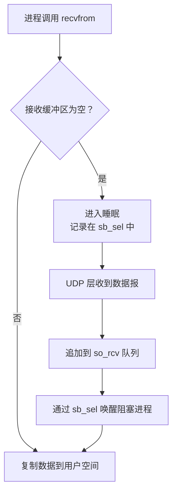

# 阻塞在 recvfrom 调用中的进程存放在套接字结构的何处以便被通知

## 进程阻塞：套接字结构中的“睡眠”与唤醒

当用户程序调用 `recvfrom` 时，如果套接字的接收缓冲区为空，进程就无法继续执行——它必须等待数据到达。这时，内核会把这个进程**挂起**，让它进入睡眠状态，直到数据就绪再将其唤醒。那么，一个关键问题是：==阻塞的进程究竟被存放在套接字结构的哪个字段里，以便在数据到达时能被精确地唤醒？==

### 为什么需要“睡眠”机制

不妨设想：进程调用 `recvfrom`，但 UDP 数据报还没到达网卡。如果内核让进程原地空转（忙等），CPU 会被白白占用，其他进程无法运行。正确的做法是：
1. 把当前进程标记为 **SLEEP** 状态；
2. 将它从调度队列中移除；
3. 当数据到达时，由中断处理程序把它放回就绪队列。

这引出一个新问题：中断处理程序怎么知道该唤醒哪一个进程？它需要从**套接字结构**中直接找到那个正在等待的进程。

### 答案：`so_rcv` 中的 `sb_sel`

在 4.4BSD 的网络代码中，每个套接字内部都有一个 `struct socket`，它包含发送缓冲区 `so_snd` 和接收缓冲区 `so_rcv`，两者都是 `struct sockbuf` 类型。`sockbuf` 结构里有一个关键字段 **`sb_sel`**，它是一个 `struct selinfo` 指针，专门用来记录因该套接字而阻塞的进程（或线程）的信息。

> [!IMPORTANT]
> 阻塞在 `recvfrom` 调用中的进程，被存放在该套接字的**接收缓冲区结构 `so_rcv` 的 `sb_sel` 字段**中。当 `udp_input` 把数据报放入队列后，会调用 `sowakeup`，通过 `sb_sel` 找到并唤醒那个睡眠的进程。

### 一个完整的例子

以南邮教材第 1 章的 UDP daytime 客户端为例：

1. 程序调用 `sendto` 发送请求数据报。
2. 程序调用 `recvfrom` 尝试读取回复。
3. 此时服务器尚未响应，套接字的输入队列为空。
4. 内核在 `sblock` 中检查到缓冲区无数据，于是调用 `tsleep` 将进程挂起，**进程的睡眠记录被关联到 `so_rcv.sb_sel`**。
5. 服务器数据到达，网络接口中断触发 `udp_input`。
6. `udp_input` 把 26 字节数据（内含时间字符串和回车符）放入 `so_rcv` 的 mbuf 链中。
7. `sowakeup` 通过 `sb_sel` 找到睡眠的进程，将其唤醒。
8. 进程重新运行，`recvfrom` 的后续代码将 26 字节从 mbuf 复制到用户缓冲区。
9. 程序用 `\0` 覆盖回车符，再交给 `printf` 输出。

### 与 `sendto` 阻塞的对比

| 系统调用 | 阻塞条件 | 记录位置 |
|---------|---------|---------|
| `recvfrom` | 接收缓冲区空 | `so_rcv.sb_sel` |
| `sendto` | 发送缓冲区满 | `so_snd.sb_sel` |

两侧对称设计：接收端在 `so_rcv` 上睡眠，发送端在 `so_snd` 上睡眠。

> [!WARNING]
> 不要把 `sb_sel` 和套接字结构本身的某些“等待队列”字段混淆。在 4.4BSD 中，**进程级别的阻塞记录统一放在 sockbuf 的 `sb_sel` 里**，而不是 socket 结构的顶层字段。这是因为同一个套接字上，可以有一个进程阻塞在读、另一个进程阻塞在写，两者必须独立记录。
