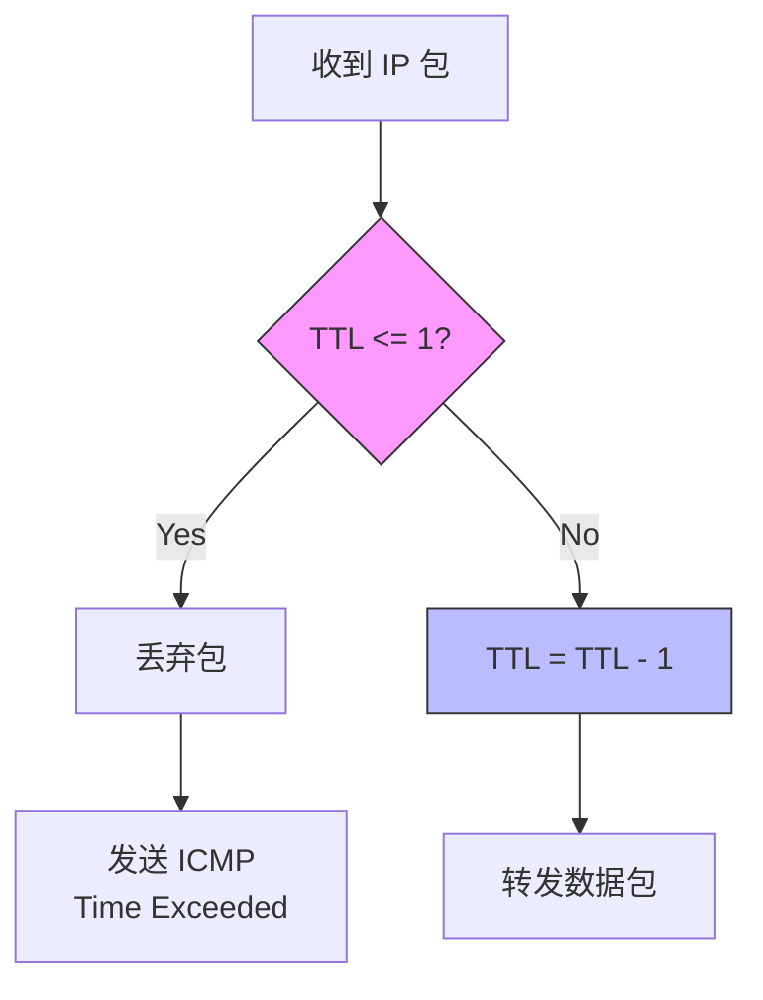

# TTL 递减时机与路由环路检测

## TTL 递减机制与环路检测

在 IP 协议中，`TTL`（Time To Live）字段不仅用于限制数据报的生命周期，更是**防止路由环路导致网络拥塞**的关键安全机制。理解其递减时机与环路处理逻辑，是掌握 `ip_forward` 核心流程的基础。

### 为什么需要 TTL？

若网络中出现路由配置错误，两台路由器可能互指对方为下一跳，形成==路由环路==。若无终止机制，数据包将在环路中无限循环，耗尽带宽与 CPU 资源。TTL 的存在确保了即使存在环路，数据包也会在有限跳数后被丢弃。

> [!IMPORTANT]
> TTL 的核心作用：防止因路由环路导致的数据包无限循环，确保网络资源的可用性。

### TTL 递减的正确时机

在 NPU 使用的代码实现（如 Figure 8.17）中，TTL 的递减操作有着严格的顺序要求：**先比较，后递减**。

> [!WARNING]
> **常见误区**：为何不先减 1 再判断？
> 若接收到的 `ip_ttl` 为 0，先执行递减操作（$0 - 1$），由于 `u_char` 类型无符号特性，结果会下溢变为 **255**。这将导致本应丢弃的过期包被错误地继续转发，破坏环路保护机制。因此，==必须先判断是否 $\le 1$，确认合法后再递减==。

### 路由环路的后果与处理

当两个路由器互相认为对方是最佳下一跳时，即形成环路。此时会发生以下现象：

1.  **数据包弹跳**：原始数据包在两路由器间来回传输。
2.  **ICMP 重定向**：若源主机与路由器在同一网络，路由器会向源主机发送 `ICMP Redirect` 消息，试图纠正路由（但在环路未消除前无效）。
3.  **最终丢弃**：随着每经过一个路由器 TTL 减 1，最终 TTL 归零，数据包被丢弃，并向上游发送 `ICMP Time Exceeded`。

| 场景 | 动作 | 结果 |
| :--- | :--- | :--- |
| `TTL > 1` | 递减 TTL，转发 | 正常路由 |
| `TTL == 1` | 不递减，丢弃 | 发送 ICMP Time Exceeded |
| `TTL == 0` | (理论上不应收到) | 若先减则变 255 (Bug) |

> [!TIP]
> **记忆口诀**：先判生死，再减寿命；若为零头，直接放手。

### 典型例题解析

**问**：Why is it necessary to decrement `ip_ttl` after testing it?
**答**：To avoid the potential error of decrementing a received TTL of 0 to become 255.
**解析**：这是为了防止无符号整数下溢。如果收到 TTL=0 的包（通常由错误或攻击产生），先减会变成 255，导致包“复活”并继续在网络中传播，违背了 TTL 的设计初衷。
