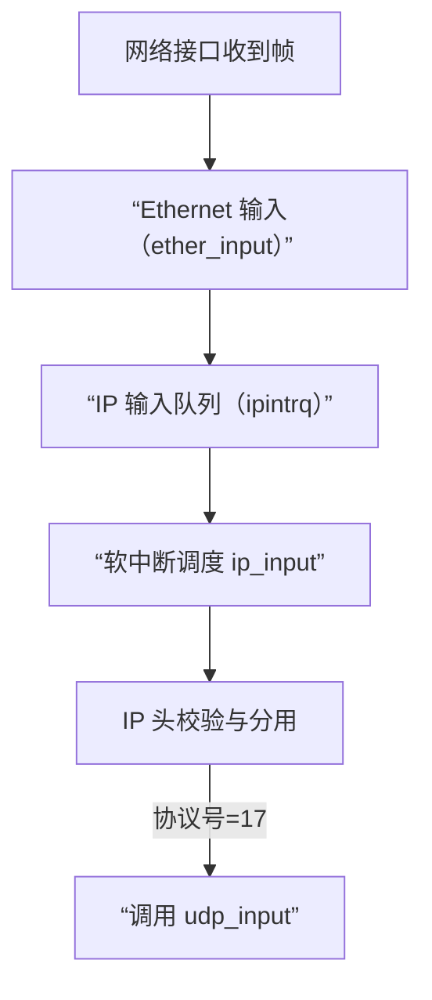
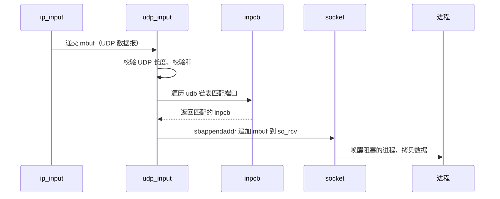

# UDP 输入（udp_input）在 4.4BSD-Lite 发行版中的处理流程

## UDP 输入（`udp_input`）在 4.4BSD-Lite 中的处理流程

当一个 UDP 数据报通过网络接口到达时，内核需要经过一条完整的协议栈路径，才能把用户数据交到等待着的进程手里。这条路径可以拆成两段：==“怎么找到对应的 socket”==和==“怎么安全地把数据交给它”==。下面的讲解就先从寻路开始，再展开 `udp_input` 内部到底做了哪些检查与动作。

### 从 IP 层到 UDP 层：协议分用

在 4.4BSD-Lite 中，IP 输入例程（`ip_input`）使用软中断异步执行。它做完 IP 头校验和检查、选项处理、目的地址比对之后，读取 IP 头里的协议字段。如果该字段值为 17，`ip_input` 就通过协议分发表（`inetsw[]`）调用 ==UDP 输入例程 `udp_input`==，并把包含整个 UDP 数据报的 mbuf 链传给它。

> [!IMPORTANT]
> `udp_input` 被调用时，mbuf 的第一个数据指针指向 **UDP 头起始位置**，IP 头在此之前已被 `ip_input` 剥离。

### 找 socket：遍历 UDP 协议控制块

`udp_input` 要做的第一件大事，是找到这个数据报该交给哪个 socket。内核不靠文件名，而是遍历所有 ==UDP 协议控制块（PCB）==。在 4.4BSD-Lite 里，PCB 结构 `inpcb` 绑定在全局链表 `udb` 上，每个 `inpcb` 通过 `inp_socket` 指针指向它所属的 `socket` 结构。

寻找过程本质是一个多键匹配：

| 匹配字段 | 必选/可选 | 说明 |
| :--- | :--- | :--- |
| 目的端口号 | **必选** | 必须与 PCB 的 `inp_lport` 一致 |
| 目的 IP 地址 | 可选 | 若 PCB 绑定了本地 IP，则比对 |
| 源端口号 | 可选 | 若 PCB 是已连接的 UDP socket |
| 源 IP 地址 | 可选 | 若 PCB 是已连接的 UDP socket |

遍历时，内核优先寻找完全匹配（connected socket），找不到再退到只匹配目的端口、且未绑定远端地址的通配 PCB。一旦定位到 `inpcb`，socket 就通过 `inp_socket` 找到了。

> [!TIP]
> 学生常见考题：“刚创建、未 `bind` 的 UDP socket 为什么能收到数据？”因为你调用 `sendto` 发出第一个数据报的时候，内核会自动调用 `in_pcbbind` 分配一个临时端口（ephemeral port），随后这个 socket 就有了 `inp_lport`，可以被 `udp_input` 匹配到。

### `udp_input` 的核心处理

找到 socket 不代表数据可以直接递交。`udp_input` 还要完成以下几步：

**校验 UDP 头部字段**
先检查 `m_len` 是否至少为 8（UDP 头最小长度）；若不够，调用 `m_pullup` 尝试将后续 mbuf 的数据合并到第一个 mbuf 中。随后读取 UDP 长度字段：

- 如果长度字段大于 mbuf 链实际总长度，丢弃；
- 如果长度字段小于 8，丢弃。

**UDP 校验和检查**
若发送方填了非零校验和，`udp_input` 会计算伪首部（含源/目的 IP、协议号、UDP 长度）加上 UDP 头和数据的校验和。校验和错误时直接丢弃数据报，==不产生任何 ICMP 差错报文==——这点常作对比，和 IP 层校验和的行为一致。

**数据放入 socket 接收队列**
通过校验后，`udp_input` 把 UDP 头和载荷一起包装成 mbuf 链，调用 `sbappendaddr` 追加到 socket 的接收缓冲区（`so_rcv`）。如果之前有进程阻塞在 `recvfrom` 上，内核将其唤醒，把数据从 mbuf 拷贝到用户缓冲区。

### 为什么 `m_pullup` 会失败？一个常见考点

课件中特别提示：`m_pullup` 失败有三种可能，而不是两种。查看 4.4BSD-Lite 源码 `uipc_mbuf.c` 可知：

1. 请求合入的连续字节数超过了 `MHLEN`（通常约 128 字节），而 mbuf 又是 `M_PKTHDR` 类型，没办法扩大；
2. 没有足够内存分配新的簇（`MCLGET` 失败）；
3. 要求的长度大于一个 mbuf 簇的最大长度 `MCLBYTES`（第三项就是容易漏的那个）。

> [!WARNING]
> 很多同学只记得“内存不够”和“长度超了 `MHLEN`”两条，漏掉“请求长度 > MCLBYTES”这条。当 IP 或 UDP 头的一部分散在不同 mbuf 中，并且传入的协议头长度超出了一个标准簇的大小时，`m_pullup` 直接返回失败，因为没有单个 mbuf 能装下这么大的连续数据。

### 拆解一道典型例题的路径

在教材第一章给出的例子中，客户端调用 `sendto` 发出一个 150 字节的 UDP 数据报到 daytime 服务器。发端路径大致是：

1. socket 层把数据复制到 mbuf 链（一进内核就做了第一次拷贝）；
2. 调用 UDP 输出例程（`udp_output`），在前面追加 UDP 头与 IP 头（分配新 mbuf）；
3. 计算 UDP 校验和时遍历整个数据，完成第二次拷贝；
4. 接口层将完整帧（以太网头 +IP 头 +UDP 头 +数据共 192 字节）拷贝到发送缓冲区，进行第三次拷贝。

收端收到回复后，`udp_input` 匹配到客户端 socket，把 26 字节的回复放入其接收队列。如果进程此时正阻塞在 `recvfrom` 上，就被唤醒，内核把这 26 字节从 mbuf 拷贝到用户提供的缓冲区——这就是收端唯一的一次拷贝动作。
