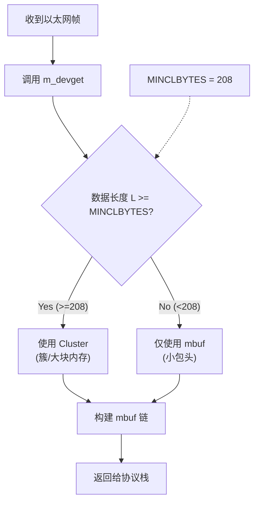

# 收到以太网帧时设备驱动程序调用的函数及 m_devget 何时使用簇

## 以太网帧接收与 m_devget 机制

当网卡收到物理信号并转换为以太网帧后，硬件会触发**接收完成中断**（receive-complete interrupt）。此时，设备驱动程序被唤醒，其核心任务是将数据从内核缓冲区高效地转移到协议栈可处理的内存结构中。这一过程的关键函数是 `m_devget`。

> [!IMPORTANT]
> `m_devget` 的作用是**创建 mbuf 链**，并将数据从驱动程序的缓冲区复制到该链中。它是连接底层硬件驱动与上层网络协议栈（如 IP、ARP）的桥梁。

### 为什么需要 m_devget？

网络数据包长度可变，而内存管理需要高效且灵活。如果为每个包都分配固定大小的内存，会造成严重浪费或溢出。`mbuf`（memory buffer）结构通过链式存储解决了这个问题。`m_devget` 根据数据长度智能选择内存布局，平衡了拷贝开销与内存碎片。

### m_devget 如何决定使用簇（Cluster）？

这是本章的核心考点。`m_devget` 在分配内存时，会判断数据长度 $L$ 与阈值 `MINCLBYTES` 的关系。

> [!TIP]
> **记忆关键值**：`MINCLBYTES` 等于 **208** 字节。
> - 若 $L \ge 208$：使用一个或多个 **簇（cluster）**。
> - 若 $L < 208$：仅使用标准的 **mbuf** 头部空间。

### 常见误区与辨析

许多同学容易混淆 `m_get` 和 `m_devget`。`m_get` 仅用于分配单个空的 mbuf，不涉及数据拷贝；而 `m_devget` 是“分配+拷贝”的一站式操作，专门用于从设备缓冲区读取数据。

| 特性 | `m_get` | `m_devget` |
| :--- | :--- | :--- |
| **主要功能** | 分配空 mbuf | 分配 mbuf 链并拷贝数据 |
| **数据来源** | 无 | 设备驱动缓冲区 |
| **是否含数据** | 否 | 是 |
| **典型场景** | 构造发送包 | 处理接收包 |

> [!WARNING]
> **易错点**：不要认为所有接收包都使用簇。只有当数据量较大（$\ge 208$ 字节）时，为了减少 mbuf 头部的开销和管理复杂度，才会启用簇。短控制报文（如 ARP 请求）通常只占用普通 mbuf。

### 实例验证

以课件中的 `leread` 函数为例。当以太网接口收到一帧数据时：
1. 驱动检测到中断，获取数据指针。
2. 调用 `m_devget(buf, len, ...)`。
3. 假设帧长为 1500 字节（标准 Ethernet MTU）。
4. 因为 $1500 \ge 208$，`m_devget` 会分配一个带有 **cluster** 的 mbuf 链。
5. 数据被完整拷贝进 cluster，随后交给 `ether_input` 进行类型分发（IP 或 ARP）。

==核心结论==：收到帧触发中断 -> 驱动调用 `m_devget` -> 依据 $L \ge 208$ 决定是否用簇 -> 形成 mbuf 链上交协议栈。
