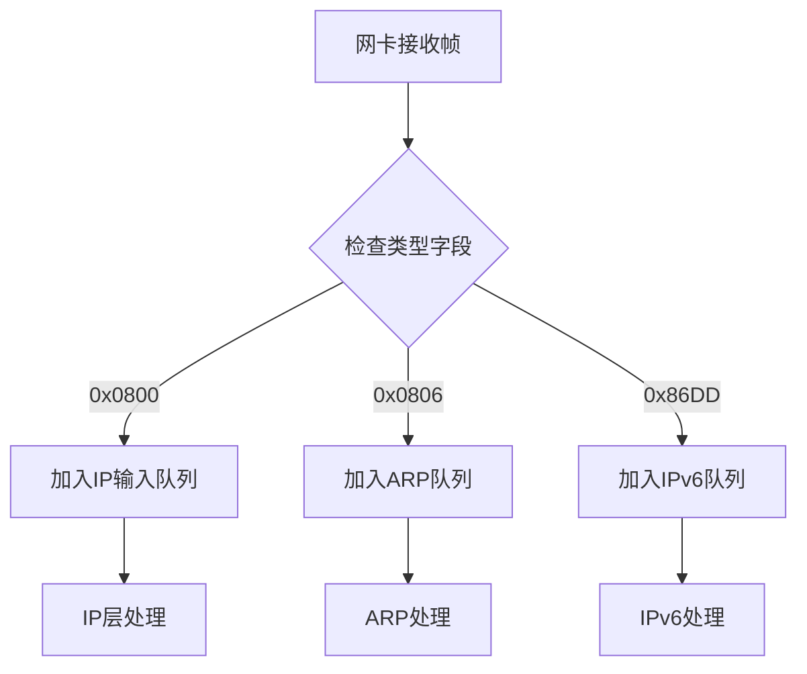

# 以太网帧格式与首部解析

# 以太网帧格式与首部解析

> [!IMPORTANT]
> 以太网帧是数据链路层的协议数据单元（PDU），其首部包含**目的地址、源地址和类型字段**，是协议分层的==关键标识==。

## 以太网帧的基本结构

| 字段 | 长度 | 作用 |
|------|------|------|
| **目的地址** | 6字节 | 接收方MAC地址 |
| **源地址** | 6字节 | 发送方MAC地址 |
| **类型/长度** | 2字节 | 标识上层协议（如IP=0x0800） |
| **数据** | 46-1500字节 | 实际载荷 |
| **FCS** | 4字节 | 帧校验序列 |

> [!TIP]
> **类型字段是关键**：以太网首部仅14字节，但类型字段（EtherType）决定了数据应该交给哪个上层协议处理，是==协议复用与分用的核心==。

## 4.4BSD-Lite中的帧处理流程

当网卡接收到以太网帧后，内核如何处理？

> [!NOTE]
> 4.4BSD-Lite的`ether_input`函数就是根据类型字段判断上层协议。例如，类型为`0x0800`时表示IP数据报，系统会将mbuf添加到IP输入队列，等待IP层处理。

## 数据发送的三次复制

以UDP发送150字节数据为例，内核经历了三次完整的数据传输：

| 阶段 | 操作 | 涉及数据量 |
|------|------|------------|
| **第一次** | 用户缓冲区→内核mbuf | 150字节用户数据 |
| **第二次** | 计算UDP校验和 | 需读取UDP首部+数据 |
| **第三次** | mbuf→接口发送缓冲区 | 完整帧192字节 |

计算过程：
$$
\text{总长度} = \underbrace{14}_{\text{以太网头}} + \underbrace{20}_{\text{IP头}} + \underbrace{8}_{\text{UDP头}} + \underbrace{150}_{\text{用户数据}} = 192\text{字节}
$$

> [!WARNING]
> **常见误区**：以为`sendto`系统调用只复制一次数据。实际上，用户态到内核态、协议栈处理、网卡发送缓冲区的转移都涉及数据拷贝，这影响了网络性能优化的方向。

## 帧格式中的易混淆点

> [!CAUTION]
> **类型字段 vs 长度字段**：当值≤1500时表示长度（IEEE 802.3），≥1536时表示类型（Ethernet II）。现代网络基本都使用Ethernet II格式，类型字段标识上层协议。

### 以太网 vs IEEE 802.3

| 特性 | Ethernet II | IEEE 802.3 |
|------|-------------|------------|
| 类型/长度字段 | 用作类型标识 | 表示数据长度 |
| 常见值 | 0x0800(IP), 0x0806(ARP) | ≤1500 |
| 应用场景 | 实际互联网主流 | 早期局域网标准 |

## 为什么需要帧格式？

思考一下：如果没有类型字段，接收方如何知道数据载荷是IP报文还是ARP报文？

> [!IMPORTANT]
> 类型字段实现了**协议复用与分用**——同一物理链路上可以承载多种上层协议，接收方根据类型将数据分发给相应的协议处理模块，这是分层网络体系结构的基础机制。
