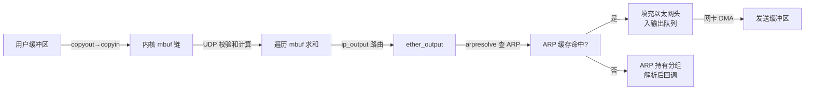
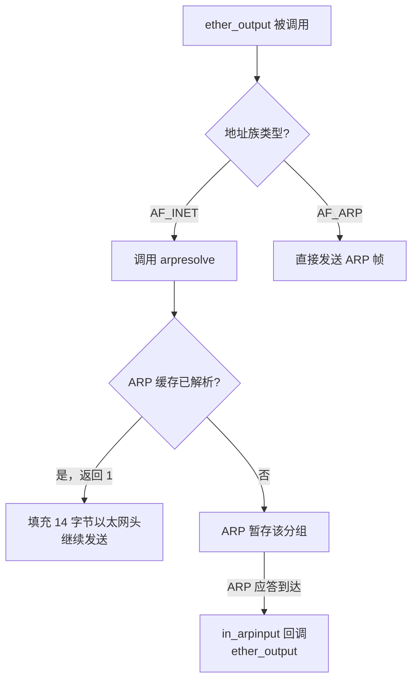

# 以太网的输入输出过程详解

## 以太网的输入输出过程详解

当用户程序调用 `sendto` 发送一个 UDP 数据报时，内核会完整地“搬运”这份用户数据三次。理解这三次拷贝发生的位置与原因，是把握以太网输出路径的关键。先想一个问题：为什么不直接从用户缓冲区把数据交给网卡？因为网卡以 DMA 方式工作，需要数据在物理上连续且位于内核地址空间，用户缓冲区则可能被换出或分散在多个页面中。

### 输出路径：从 mbuf 到传输队列

以太网输出的完整链路如下：

==第一次拷贝==发生在 `sendto` 系统调用的早期：内核将用户缓冲区中的 150 字节数据复制到内核 `mbuf` 链中。==第二次拷贝==实际上是计算 UDP 校验和时的遍历——校验和算法要求按 16 位字累加整个 UDP 数据报（含伪头部、UDP 头和用户数据），内核必须逐字读取这些字节，虽然不是“复制”到别处，但在时间开销上等价于一次完整遍历。==第三次拷贝==发生在线程处理接口输出队列时：网卡驱动将 mbuf 中的数据复制到网卡板载的发送缓冲区，随后网卡硬件完成 CSMA/CD、前导码插入和 CRC 计算。

> [!IMPORTANT]
> 考题中“three complete passes”对应：① 用户缓冲区 → 内核 mbuf；② 计算 UDP 校验和时的完整遍历；③ mbuf → 网卡发送缓冲区。第三次实际拷贝的字节数是 192（14 字节以太网头 + 20 字节 IP 头 + 8 字节 UDP 头 + 150 字节用户数据），而前两次仅涉及 150 字节用户数据。

### ether_output 的关键分支

`ether_output` 是 IP 层与以太网设备驱动之间的接口函数。它的核心逻辑之一是处理 `AF_INET` 地址族：

如果 `arpresolve` 返回 1，说明目的 IP 对应的 MAC 地址已在 ARP 缓存中，`ether_output` 可以立刻在 mbuf 前添加 14 字节以太网头（6 字节目的 MAC + 6 字节源 MAC + 2 字节类型字段）并继续。如果返回 0，ARP 模块会“持有”这个 IP 分组，等到解析完成后由 `in_arpinput` 回调 `ether_output` 重新投递。

> [!WARNING]
> ARP 解析期间分组并不会丢失——它被挂在 ARP 层的暂存队列中；但如果目的主机不可达，ARP 可能超时丢弃分组。理解“由 ARP 持有并回调”而不是“阻塞等待”是正确认识这段代码的关键。

### 环回与 CRC 的边界

`ether_output` 中还有一段容易被忽视的代码：当 `ether_output` 内部对分组做了拷贝（例如广播/组播时需同时发给自身），这份拷贝会被`looutput`处理——==它被当作“接收”的帧重新进入协议栈==。这说明环回并不走物理层，而是在网络接口层直接“折返”。

另一个关键边界是：mbuf 在离开 `ether_output` 进入输出队列时，包含的是==除 32 位 CRC 外的完整以太网帧==。CRC 由以太网硬件在发送瞬间计算并追加，内核与驱动代码从不计算它。这也是为什么在 `tcpdump` 抓包中能“看到”CRC 错误却在内核层面极少处理它的原因。

> [!NOTE]
> 辨析：`if_attach` 将驱动初始化的 `ifnet` 结构插入接口链表；对 LANCE 以太网驱动，其专用结构为 `le_softc`，而所有以太网驱动共享的公共部分是 `arpcom`（含 MAC 地址与 ARP 相关字段）。`ether_output` 通过 `ifnet` 找到 `arpcom` 来访问 MAC 地址。
