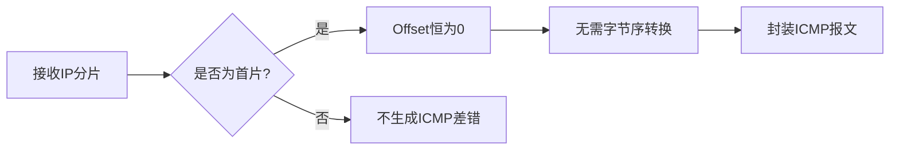

# IP 分片处理过程中可能遇到的错误或异常及发送的 ICMP 差错报文

在 IP 分片与重组过程中，如果数据报无法被正确处理，系统必须向源端反馈差错。但你是否想过：为什么有些错误只针对“第一个分片”报错？为什么 DF 位置 1 时返回的是特殊的不可达报文而非普通丢弃？

## 三类核心差错触发场景

IP 处理中的差错并非随意发送，而是严格对应特定异常条件。结合 `ip_forward` 和 `ip_output` 的实现，主要包含以下三种情况：

> [!IMPORTANT]
> ==ICMP 差错报文仅针对数据报的第一个分片（offset=0）生成==，后续分片出错通常静默丢弃，避免无效反馈淹没网络。

1.  **TTL 耗尽**：当 `ip_ttl` 减至 1（`IPTTLDEC`）时，`ip_forward` 丢弃分组并回送 **ICMP Time Exceeded**。这是追踪路由（traceroute）的基础机制。
2.  **DF 位禁止分片**：若出接口 MTU 小于数据报长度且 DF=1，`ip_output` 返回 `EMSGSIZE`。转发场景下，`ip_forward` 生成 **ICMP Destination Unreachable (Need Frag)**；本地产生的数据报则将错误传递给传输层协议。
3.  **重组超时**：目的主机收到首片后启动定时器，若超时仍未收齐所有分片，则发送 **ICMP Time Exceeded** 给源主机。注意此处与 TTL 超时的 Code 字段不同。

## ip_output 错误码与 ICMP 映射

内核通过 `ip_output` 的返回值决定生成何种 ICMP 报文，这是代码实现的关键逻辑：

| ip_output 错误码 | 生成的 ICMP 报文 | 触发描述 |
| :--- | :--- | :--- |
| `EMSGSIZE` | `ICMP_UNREACH_NEEDFRAG` | 包过大且 DF=1，无法转发 |
| `ENOBUFS` | `ICMP_SOURCEQUENCH` | 接口队列满或内存不足 |
| `EHOSTUNREACH` / `ENETDOWN` | `ICMP_UNREACH_HOST` | 无路由、接口宕机或默认兜底 |

[!WARNING]
`ENOBUFS` 触发的源抑制报文在现代 TCP/IP 栈中常被禁用，因其易被利用进行 DoS 攻击且拥塞控制已由传输层承担。复习时仍需掌握其原始语义，但要注意工程实践差异。

## 字节序转换的特殊规则

一个经典考点是：为何 `ip_forward` 调用 `icmp_error` 前需转换 Fragment ID 的字节序，却==不转换 Fragment Offset==？

答案在于 ICMP 差错报文**仅对首片生成**，而首片的偏移量始终为 0。0 在主机字节序和网络字节序下表示相同，因此无需转换。Fragment ID 则因各分片相同且可能非零，必须转换为网络字节序以嵌入 ICMP 报文中供源端匹配。

[!TIP]
记忆口诀：**“首片才报错，偏移零不换；DF 阻分片，NeedFrag 来传”**。做题时务必区分“转发产生”与“本地产生”对 EMSGSIZE 的不同处理方式，这是简答题高频得分点。
