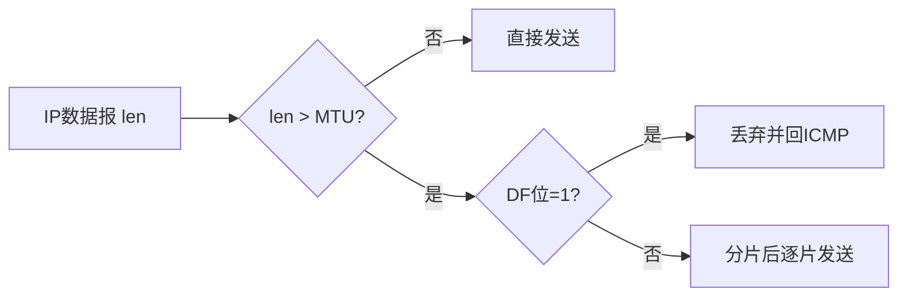

# IP 分片的触发条件与 MTU 限制

## 触发条件：什么时候需要分片

IP 数据报从源主机到目的主机的路径上，可能经过不同链路层技术的网络。每种链路层能承载的最大数据量不同，这个上限就是 **MTU（Maximum Transmission Unit，最大传输单元）**。以太网（Ethernet）的 MTU 通常为 1500 字节，而其他链路类型可能更小。

当 `ip_forward` 或 `ip_output` 发现一个数据报的长度 **大于所选传出接口的 MTU** 时，就要考虑分片。在 Net/3 源码中，这个判断位于 `ip_output` 内的注释片段：

```c
/*
 * Too large for interface; fragment if possible.
 */
```

核心判断条件可以理解为：

$$
\text{len} > \text{ifp->if\_mtu}
$$

其中 `len` 是 IP 数据报（含 20 字节首部）的总长度，`ifp->if_mtu` 是传出接口的最大传输单元。



> [!IMPORTANT]
> ==分片只发生在 IPv4 中==。IPv6 取消了路由器分片，源主机必须自行通过 Path MTU Discovery 确定合适的大小。此外，==只有最终目的主机才能重组分片==，中间的每一跳路由器只做转发、不再重组——因为各分片可能走不同路径，中间路由器无法保证能收齐所有分片。

## DF 位与 ICMP 差错

IP 首部第 2 个 16 位字段中的第 14 位是 **DF（Don’t Fragment，不可分片）** 标志。当路由器需要分片但发现 `DF=1` 时，会丢弃该数据报，并向源主机回送 **ICMP 目的不可达（Fragmentation Needed but DF set）** 报文，差错类型字段为 4（destination unreachable），代码为 4（fragmentation needed）。

这正是课件中所列的 IP 处理中的第三种差错情况：

> 当路由器收到一个需要分片的数据报，而 IP 首部 ‘DF’ 位为 1 时，发送 ICMP 不可达差错报文。

## 如何计算每个分片的长度

分片时有两个硬性约束：

- 每个分片的 **IP 数据报总长度 ≤ 接口 MTU**；
- 每个分片中 **数据部分的字节数必须是 8 的倍数**。

原因在于 IP 首部中的 **13 位片偏移字段是以 8 字节为单位表示偏移量**的。如果数据长度不是 8 的倍数，后续分片的偏移就无法精确表示。

计算步骤：

第一步：数据部分最大长度 $D_{max} = \text{MTU} - 20$（标准 IP 首部 20 字节）。

第二步：将 $D_{max}$ 向下取整到 8 的倍数：$D = \lfloor D_{max} / 8 \rfloor \times 8$。

第三步：除最后一片外，每片携带 $D$ 字节数据；最后一片携带剩余数据。

> [!TIP]
> 分片后只有第一片带有原始传输层首部（如 TCP/UDP 首部），后续分片只有 IP 首部。这也是为什么 `m_pullup` 几乎对每个收到的分片都会被调用——分片长度常超过 208 字节，数据存放在簇（cluster）里，需要把 IP 首部拉取到连续内存中处理。

## 一个算对了的例子

假设主机 A 发送一个总长 4000 字节的 IP 数据报（其中 IP 首部 20 字节，数据 3980 字节），经过一个 MTU = 1500 字节的以太网接口，且 `DF=0`。

**计算**：

- $D_{max} = 1500 - 20 = 1480$ 字节，恰好是 8 的倍数，所以 $D = 1480$。
- 数据总量 3980 字节，每片最多携带 1480 字节数据：
  - 分片 1：数据 1480 字节，偏移 = 0，总长 = 20 + 1480 = 1500 字节；
  - 分片 2：数据 1480 字节，偏移 = 1480 ÷ 8 = 185，总长 = 1500 字节；
  - 分片 3：数据 $3980 - 1480 \times 2 = 1020$ 字节，偏移 = 2960 ÷ 8 = 370，总长 = 1040 字节。

| 分片 | 数据字节数 | 偏移字段值 | 总长度 | MF 标志 |
|:---:|:---:|:---:|:---:|:---:|
| 1 | 1480 | 0 | 1500 | 1 |
| 2 | 1480 | 185 | 1500 | 1 |
| 3 | 1020 | 370 | 1040 | 0 |

> [!WARNING]
> 偏移字段的单位是 8 字节，因此偏移值不能直接写成数据字节数。考试中若问“分片 2 的片偏移字段是多少”，答案是 **185**，不是 1480。

## 与相近概念的区别

| 概念 | 发生位置 | 依据 | 结果 |
|:---|:---:|:---:|:---|
| IP 分片 | 源主机或中间路由器 | 接口 MTU | 一个数据报变多片，目的主机重组 |
| TCP 分段（Segmentation） | 仅源主机 | MSS（最大报文段长度） | 将字节流拆成多个 TCP 段，分属不同数据报，接收端按序号重组 |
| MTU Path Discovery | 源主机 | 逐步探测路径上最小 MTU | 源主机直接发送合适大小的数据报，避免中间路由器分片 |

一个常见的坑：**TCP 分段和 IP 分片是两个独立层次的操作**。TCP 根据 MSS 把用户数据拆成段，段封装成 IP 数据报后，仍可能因为路径 MTU 更小而被某台路由器再次分片。在 IPv4 中这是允许的，但会带来额外开销和脆弱性，所以现代实现倾向于通过 Path MTU Discovery 让源端同时控制两者。
