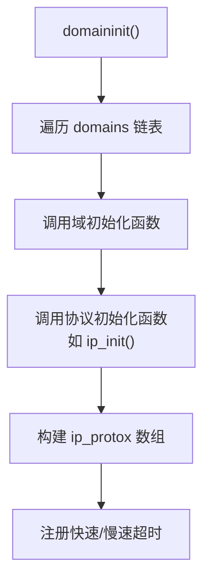

# domaininit 等协议初始化过程

## domaininit 是什么与为什么需要

在 4.4BSD-Lite 内核启动时，网络协议栈并非硬编码的固定模块，而是由多个“协议域”（Protocol Domain）动态组装而成。`domaininit()` 就是负责==协议域初始化==的核心入口函数。

试想：当 IP 数据报到达内核，系统如何知道该交给 TCP、UDP 还是 ICMP？这依赖于一个从“协议号”到“协议控制块”的快速映射机制。如果没有 `domaininit()` 在启动阶段构建好这些数据结构，内核将无法完成协议多路分解（Demultiplexing），网络栈也就无法工作。

> [!IMPORTANT]
> `domaininit()` 是连接静态编译的协议代码与运行时协议查找表的==唯一桥梁==，它确保了协议栈的可扩展性与正确性。

## 初始化具体做了什么

`domaininit()` 的执行逻辑可以概括为“链接、调用、定时”三步。我们可以通过以下流程理解其内部机制：

1.  **链接各域**：将所有已编译进内核的协议域（如 Internet 域、Unix 域）链接到全局 `domains` 链表中。
2.  **逐级初始化**：依次调用每个域的初始化函数，进而触发该域下所有协议的初始化函数（如 `ip_init`、`tcp_init`）。
3.  **设置定时器**：注册协议的快速超时（Fast Timeout）和慢速超时（Slow Timeout）处理函数，用于后续的拥塞控制、重传等周期性任务。

## ip_protox 数组的关键作用

这是考试中最常考的细节。当 `domaininit()` 调用 `ip_init()` 时，核心动作是初始化 `ip_protox` 数组。

| 概念 | 说明 | 考点关联 |
| :--- | :--- | :--- |
| `protosw` | 协议开关结构体，描述协议属性与操作 | 协议元数据 |
| `ip_protox` | 以协议号为索引的 `protosw` 指针数组 | ==多路分解依据== |
| `ip_init` | IP 层初始化函数 | 被 `domaininit` 调用 |

> [!TIP]
> 记忆口诀：**域连表，协建数，时注册**。即“域链接到链表，协议建立数组，超时函数注册”。

当收到 IP 数据报时，内核直接通过 `ip_protox[protocol_number]` 以 $O(1)$ 时间复杂度找到对应的 `protosw` 结构，避免了遍历链表的开销。这就是为什么课件强调“必须从数据报中存在的协议号推导出相应的 `protosw` 结构体”。

## 常见误区与辨析

> [!WARNING]
> 不要将 `domaininit()` 与单个协议的初始化混淆。`domaininit()` 是==总调度器==，而 `ip_init()`、`tcp_init()` 是被它调用的==子过程==。考题若问“谁初始化了 `ip_protox`”，准确答案是“`ip_init()` 在 `domaininit()` 调用时完成”，两者缺一不可。

另一个易错点是将 `domaininit()` 的作用局限于“创建链表”。实际上，==构建 `ip_protox` 映射数组==才是其在网络数据通路中最关键的功能，这直接关系到数据包能否被正确交付给传输层。

## 真题验证示例

**题目**：系统初始化时，`domaininit` 执行哪些操作？

**解析思路**：
1.  定位关键词“系统初始化”与“`domaininit`”。
2.  回忆三大核心动作：链接域、调用初始化、注册超时。
3.  补充关键副作用：通过调用 `ip_init` 初始化 `ip_protox` 数组。

**标准答案要点**：
-   将各协议域链接到 `domains` 链表；
-   调用域和协议的初始化函数（包括 `ip_init`）；
-   初始化 `ip_protox` 数组以支持协议多路分解；
-   调用并注册快速和慢速超时函数。

此答案完整覆盖了 P153 页的核心描述，也是简答题的高分模板。
