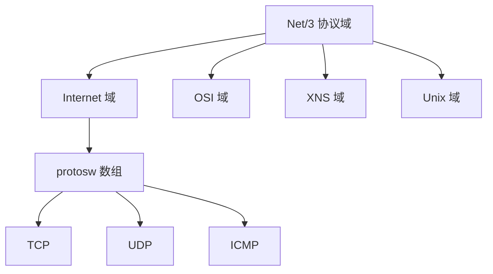
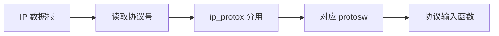
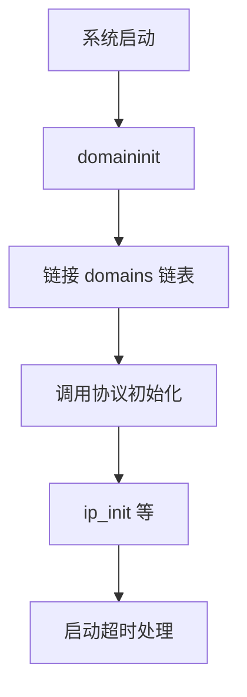

# Net/3 域（domain）与协议族常量的定义

## 域与协议族常量

Net/3 把功能上相关的协议组织成一个==协议域（domain）==，例如 Internet 协议域、OSI 协议域、XNS 协议域和 Unix 域协议。每个域用唯一的==协议族常量（protocol family constant）==标识。协议族常量的主要用途是区分不同协议域，使套接字等内核对象能够知道自己属于哪个协议域。

4.4BSD 支持 TCP/IP、XNS、OSI 协议族以及 Unix 域协议。

> [!IMPORTANT]
> ==协议域是协议的逻辑分组，协议族常量是域的标识；`protosw` 则描述域内某个协议的控制信息。==

## `protosw` 与协议分用

编译时，Net/3 为内核中的每个协议设置并初始化一个 `protosw`（protocol switch）结构，并把同一域内的这些结构组织成数组。例如，Internet 域的协议表为 `inetsw`。

`protosw` 中保存协议类型、协议号、协议处理函数、输入函数以及套接字请求和输出接口等。内核收到数据报后，需要根据数据报中的协议号找到对应的 `protosw`，再把数据交给正确的协议处理函数。

IP 层初始化时建立 `ip_protox` 数组。它把 IP 协议号映射到相应的 `protosw` 结构，使 TCP、UDP、ICMP 等上层或控制协议能够被正确分用。系统启动时，`domaininit()` 调用 `ip_init()`，由此完成 `ip_protox` 的初始化。

同一个协议可以提供多个 `protosw` 条目，以暴露不同接口。例如，Internet 域中的 IP 协议在 `inetsw[0]`、`inetsw[3]` 和 `inetsw[6]` 中出现，共有 3 个条目。

> [!TIP]
> 判断题目中的“哪个协议有 3 个 `protosw`”时，应直接检查 `inetsw` 各下标处的 `pr_protocol` 字段，而不是根据 TCP、UDP 的常见端口或套接字类型猜测。答案不是 UDP，而是 ==IP protocol==。

## `domaininit()` 的初始化流程

`domaininit()` 负责初始化网络协议域，主要过程包括：

1. 将各协议域链接到全局 `domains` 链表；
2. 调用各域以及域内协议的初始化函数；
3. 调用快速超时和慢速超时处理函数，启动协议定时机制。

> [!WARNING]
> `domaininit()` 不只是“把域挂到链表上”。它还负责调用协议初始化函数并启动快速、慢速超时处理；`ip_protox` 正是在 `ip_init()` 中建立。

## 域、协议族与套接字类型的区别

| 概念 | 作用 | 示例 |
|---|---|---|
| 协议域 `domain` | 对相关协议进行分组 | Internet 协议域 |
| 协议族常量 | 唯一标识一个协议域 | `AF_INET` |
| `protosw` | 描述域内某个协议的接口和函数 | TCP、UDP、ICMP 对应表项 |
| 套接字类型 | 描述套接字提供的通信服务 | `SOCK_STREAM`、`SOCK_DGRAM` |

例如，`AF_INET` 表示 Internet 协议域；`SOCK_STREAM` 表示面向连接的字节流服务。两者分别回答“属于哪个协议域”和“提供哪种通信接口”，不能互相替代。

## 常见误区

- ==不要把协议域等同于协议族常量==：前者是协议集合，后者只是该集合的标识。
- ==不要把 `protosw` 当成协议族常量==：`protosw` 是包含函数指针和操作接口的结构体。
- ==不要认为一个协议只能有一个 `protosw`==：同一协议可提供多个条目，以支持不同接口。
- ==不要混淆“协议号”和“协议族常量”==：IP 数据报中的协议号用于选择 `protosw`；协议族常量用于标识整个协议域。

例如，题目问“`inetsw` 中哪个协议有 3 个 `protosw` 结构”，逐项查看可知 `inetsw[0]`、`inetsw[3]`、`inetsw[6]` 的协议均为 IP，因此应选择 **C. IP protocol**。
