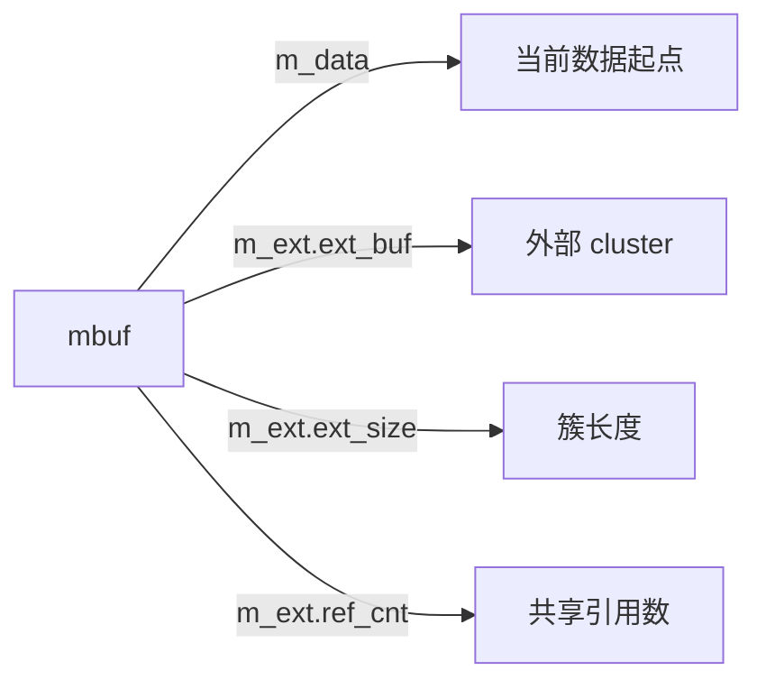

# 带簇的 mbuf（M_EXT）包含的内容与使用场景

## 带簇的 mbuf（M_EXT）是什么

mbuf 是 BSD 内核管理网络数据的内存缓冲区。它不仅存放普通用户数据，也用来暂存源/目的地址、套接字选项等控制信息。

当所需数据较大、无法方便地放入 mbuf 自带的固定缓冲区时，mbuf 可以引用一块外部分配的内存，该内存称为 **cluster（簇）**。此时，mbuf 通过 `m_ext` 描述这块簇：

- `m_ext.ext_buf`：簇的起始地址；
- `m_ext.ext_size`：簇的长度；
- `m_ext.ref_cnt`：共享该簇的 mbuf 引用计数。

> [!IMPORTANT]
> 带簇的 mbuf 仍通过 `m_data` 指向当前有效数据起点；`m_data` 可以位于簇内任意位置，不一定等于 `ext_buf`。

## 为什么需要 cluster

mbuf 自带的数据区有限，难以高效容纳以太网帧、IP 分片或大块应用数据。使用簇后，可以：

1. 把较大数据放在连续的大块内存中；
2. 让多个 mbuf 共享同一块簇，避免重复复制；
3. 配合 `m_pullup()` 调整数据布局，使协议首部连续可读。

例如，接收一个 1500 字节的以太网帧时，不必把整个帧硬塞进一个很小的 mbuf，而可以建立“mbuf + 多个簇”的链式结构。

## `m_devget()` 如何按数据量分配

网卡收到帧后，设备驱动调用 `m_devget()`，由它创建 mbuf 链并复制帧数据。需掌握其按数据长度选择存储方式的四种情况：

| 接收数据量 | 主要处理方式 |
|---|---|
| 0 字节 | 创建一个 mbuf，不附加数据 |
| 1～`MHLEN` 字节 | 数据直接放在 mbuf 自带缓冲区中 |
| `MHLEN + 1`～`MINCLBYTES - 1` 字节 | 分配一个簇，数据放入簇中 |
| 不小于 `MINCLBYTES`（208 字节） | 分配一个或多个簇，组成 mbuf 链 |

其中，`MHLEN` 是 mbuf 自带缓冲区的容量；当数据量达到 `MINCLBYTES` 时，就采用一个或多个 cluster。

> [!TIP]
> 记忆：`m_devget()` 负责“收帧建链”，`m_get()` 负责“分配一个 mbuf”；带簇时记住 `ext_buf + ext_size + ref_cnt`。

## `M_EXT` 与 `M_PKTHDR` 的区别

这两个标志解决的问题不同：

| 标志 | 含义 | 典型作用 |
|---|---|---|
| `M_EXT` | 数据位于外部 cluster 中 | 通过 `m_ext` 定位和共享外存 |
| `M_PKTHDR` | 该 mbuf 是一个完整分组的首部 mbuf | 标记分组头、长度等分组级信息 |

`M_PKTHDR` 通常设置在 mbuf 链的第一个 mbuf 上，用来标识“分组头 mbuf”。它与数据是否位于簇中没有直接关系，因此一个 mbuf 完全可能同时带有 `M_EXT` 和 `M_PKTHDR`。

## `m_get()`、共享簇与常见误区

`m_get()` 从空闲 mbuf 池中取得一个 mbuf，常用于构造控制信息、协议首部或补充数据链。它与 `m_devget()` 的区别是：`m_get()` 只分配 mbuf，不负责根据设备帧长度建立整条接收链。

如果 `m_copy()` 的源数据位于 cluster 中，不一定发生逐字节物理复制。内核可以增加该簇的引用计数，让新 mbuf 指向同一块内存。

> [!WARNING]
> 不能通过在每个 cluster 中增加“反向指向 mbuf”的指针来简化 `dtom()`。原因是同一 cluster 可能被多个 mbuf 共享，不存在唯一对应的反向指针，而且簇中也没有足够空间保存该信息。

`m_pullup()` 则用于让协议首部连续。若前部 mbuf 中的数据不足以容纳完整首部，它会重新整理 mbuf 链，把前 $N$ 字节集中到第一个 mbuf 中，且 $N \le MHLEN$。

## 一个正确例子

在 UDP `sendto()` 中：

1. 套接字层把目的地址复制进一个 mbuf，其 `m_type` 为 `MT_SONAME`；
2. 把 150 字节用户数据复制到 mbuf 链；
3. 调用 UDP 输出例程，在数据前加入 IP 首部和 UDP 首部；
4. 最终交给 IP 输出例程。

如果这 150 字节需要使用外部簇，相应 mbuf 会设置 `M_EXT`，并在 `m_ext` 中记录簇地址、长度和引用计数；而分组首部仍应由链首 mbuf 的 `M_PKTHDR` 标识。==`M_EXT` 表示“数据在哪里”，`M_PKTHDR` 表示“它是不是分组头”==。
