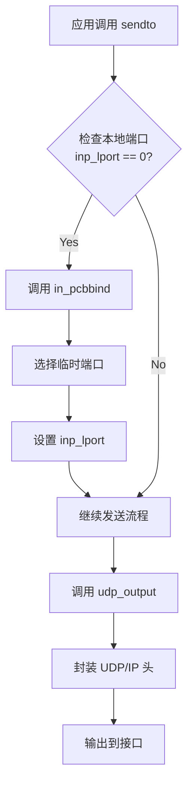

# 例子程序从未为应用指定本地端口号时的自动分配机制

## UDP 本地端口的自动分配机制

在《TCP/IP网络设计与实现》的示例程序中，客户端通常只调用 `socket()` 创建套接字，随后直接调用 `sendto()` 发送数据，而**从未显式调用 `bind()` 指定本地端口**。此时，内核如何确定源端口？这就是**临时端口（Ephemeral Port）的自动分配机制**。

> [!IMPORTANT]
> ==核心结论==：若 UDP 套接字未绑定本地端口，内核会在**首次发送数据**时，自动选择一个未被占用的临时端口绑定到该套接字。

## 为什么需要自动分配？

如果应用程序不关心本地端口（如大多数客户端），手动绑定既繁琐又容易冲突。内核自动分配解决了以下问题：
1. **简化编程**：应用层无需管理端口资源。
2. **避免冲突**：内核确保分配的端口在当前系统中唯一且可用。
3. **动态复用**：连接结束后，临时端口可被回收重用。

## 内核如何处理？（代码级流程）

当应用调用 `sendto()` 时，内核协议栈的处理流程如下：

具体涉及两个关键函数：
1. **`in_pcbconnect`**：在处理连接或发送请求时被调用。如果发现 `inp_lport` 为 0（未绑定），它会调用 `in_pcbbind`。
2. **`in_pcbbind`**：负责实际的绑定逻辑。它会遍历端口空间，找到一个空闲端口，将其赋值给 PCB（Protocol Control Block）中的 `inp_lport` 成员。

> [!NOTE]
> 这一过程对应用层是透明的。一旦分配完成，该套接字后续发出的所有数据包都将使用这个固定的临时端口作为源端口。

## 常见误区与辨析

| 特性 | 显式 bind() | 自动分配 (Ephemeral) |
| :--- | :--- | :--- |
| **触发时机** | 用户主动调用 | 首次 `sendto` 或 `connect` |
| **端口范围** | 用户指定 (需合法) | 内核选定 (通常为高端口) |
| **确定性** | 确定 | 随机/轮询 (不可预测) |
| **适用场景** | 服务器/固定服务 | 客户端/临时通信 |

> [!WARNING]
> **易错点**：不要认为每次 `sendto` 都会更换端口。**端口只在第一次发送时分配一次**，之后保持不变，直到套接字关闭。

## 算对了的例子

参考课件简答 25 与简答 4 的场景：
假设客户端执行 `sendto(sockfd, buf, len, 0, &serv_addr, ...)`。
1. 内核检查 `sockfd` 对应的 PCB，发现 `inp_lport == 0`。
2. 内核调用 `in_pcbbind`，选中端口 $P_{ephemeral}$（例如 54321）。
3. PCB 更新：`inp_lport = 54321`。
4. 数据包发出：源端口=54321，目的端口=Daytime(13)。
5. 服务器回复时，内核根据**目的端口 54321** 遍历 UDP PCB 链表，找到该套接字，将数据放入其接收队列。

若此时调用 `recvfrom` 且队列为空，进程将进入**睡眠状态**（简答 11），直到数据到达或被信号中断。
