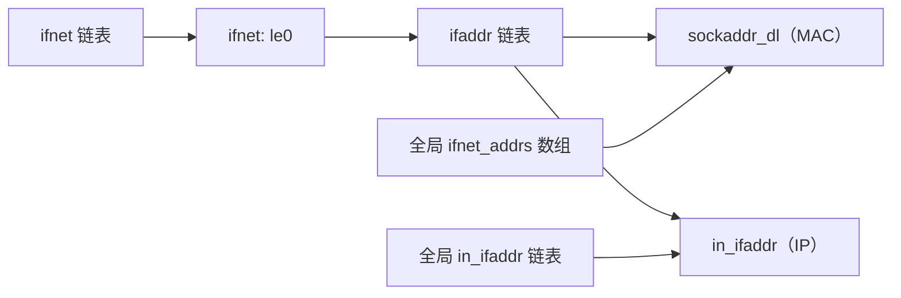
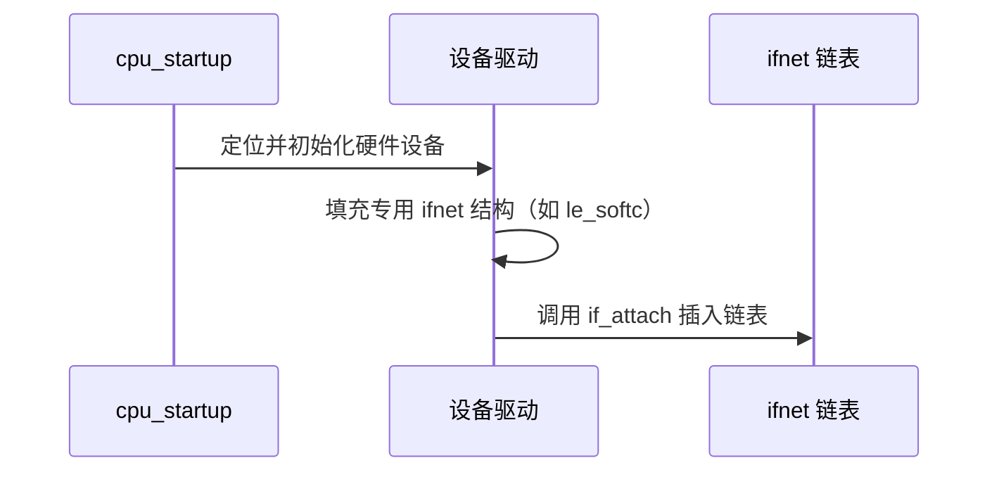

# 网络接口与地址结构概览

## 网络接口与地址结构概览

数据要在网络中传输，内核必须同时管理两样东西：**网络接口本身**（物理或逻辑的收发设备）和**接口上的地址**（协议地址与链路层地址）。Net/3 用两组核心结构来组织它们：`ifnet` 描述接口，`ifaddr` 描述接口上绑定的地址。

### 为什么需要专门的结构

一个系统可能有多块网卡（以太网、环回、点对点链路），每块网卡的驱动、MTU、状态、队列都不同。如果内核用零散变量管理这些信息，协议栈每发一个包都要查一遍“这个接口是什么类型、地址是什么”，既低效又容易出错。把接口抽象成统一的 `ifnet` 链表，协议层就可以不看具体硬件，只面向 `ifnet` 编程。

> [!IMPORTANT]
> `ifnet` 是**接口通用结构**，`ifaddr` 是**接口地址通用结构**；`in_ifaddr` 是 IP 协议专用的地址结构，`sockaddr_dl` 是数据链路层地址结构。

### 两类地址结构的关系

接口的链路层地址（如 MAC 地址）和 IP 地址是**分开存放**的：

| 全局变量 | 指向什么 |
|---|---|
| `ifnet_addrs` | 数据链路层地址（`sockaddr_dl`），如 MAC 地址 |
| `in_ifaddr` | 所有 IPv4 地址（`in_ifaddr` 链表） |

对每个接口，链路层地址挂在 `ifaddr` 链表中，而 IP 地址通过专用的 `in_ifaddr` 结构管理。`in_ifaddr` 结构内嵌了通用的 `ifaddr`，因此它既可以被 IP 协议使用，也能挂到接口的地址列表里。

### 初始化发生在什么时候

接口结构**不是**在进程调用 `socket` 时创建的，而是在**系统初始化阶段**就分配完成。

每个网络接口的驱动程序会初始化一个**专用的** `ifnet` 结构。例如，Net/3 中 LANCE 以太网驱动的专用结构是 `le_softc`，它内嵌了 `arpcom` 结构——后者是所有以太网驱动通用的部分，存放 ARP 相关的链路层信息。

> [!WARNING]
> 考试经常问“`ifnet` 和 `ifaddr` 何时分配”，答案是 ==“During system initialization”==，不是进程调用 `socket` 时。`socket` 调用创建的是 `socket` 结构、`file` 结构和 `vnode`，与接口结构无关。

### mbuf 与地址的关系

`mbuf` 主要用于在进程与网络接口之间传递用户数据，但它也承担**携带元数据**的职责：源地址、目的地址、套接字选项等都可能放在 mbuf 里。所以当 UDP 数据报到达网络接口时，内核先从 mbuf 中取出**目的地址和端口**，再在协议控制块（`inpcb`）链表中匹配对应的 socket 结构——mbuf 本身不直接指向 socket，它只是运输这些查找所需的键值。

> [!TIP]
> 记忆口诀：**接口靠 `ifnet`，地址靠 `ifaddr`，数据靠 `mbuf`，查找靠 `inpcb`**。

### 考试中的典型考法

简答题“When the `ifnet` and `ifaddr` structures are allocated for each network interface?”的标准答案只有一句话：**During system initialization.** 填空或选择可能反过来考：系统初始化时调用的函数是什么（`cpu_startup`），驱动初始化后调用什么函数插入链表（`if_attach`）。
