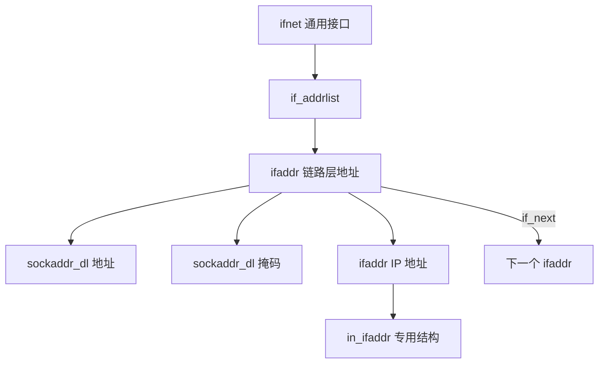
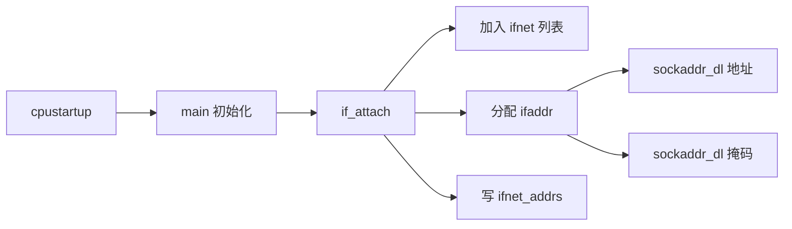

# 接口的地址链表管理

接口的地址链表管理（Address List Management）属于 **Chapter 3 Interface Layer**，同时也是理解 Chapter 6 中 IP 地址结构 `in_ifaddr` 的前提。想清楚这个问题，先问自己两个问题：一块网卡可以有几个地址？内核怎么把"链路层地址"和"IP 地址"这两类地址组织起来？

## 它是什么、为什么需要

每个网络接口（`ifnet`）并非只有一个地址：既有一个链路层（MAC）地址，又可能被配置一个或多个 IP 地址。内核需要一种==统一结构==来挂载这些异构地址，同时又保留各自的协议特有字段。于是 BSD TCP/IP 定义了 `ifnet`（通用接口结构）与 `ifaddr`（通用地址结构）：`ifnet` 通过 `if_addrlist` 指向自己的 `ifaddr` 链表；链表中每个 `ifaddr` 的首部是通用字段，之后追加协议特有字段（IP 用 `in_ifaddr`，链路层用一对 `sockaddr_dl`）。

## 数据结构分层

| 结构 | 层次 | 作用 |
| --- | --- | --- |
| `ifnet` | 通用接口 | 描述一块网卡，含 `if_addrlist` |
| `ifaddr` | 通用地址 | 所有地址共用的首部 |
| `le_softc` | 以太网专用接口 | LANCE 以太网控制器私有数据 |
| `arpcom` | 通用以太网结构 | 内嵌 `ifnet` + MAC 地址 |
| `in_ifaddr` | IP 专用地址 | 首字段为 `ia_ifa`（即 `ifaddr`） |
| `sockaddr_dl` | 链路层套接字地址 | 存放 MAC 地址与掩码 |

> [!IMPORTANT]
> ==`in_ifaddr` 以通用结构 `ia_ifa` 开头==，因此可以被当作 `ifaddr` 插入接口地址链表，又可通过全局变量 `in_ifaddr` 串成 IP 地址链表；链路层地址则通过全局数组 `ifnet_addrs[]` 访问。

## 内核怎么做：if_attach 的三步

每次调用 `if_attach` 时：

1. 将新 `ifnet` 加入全局 `ifnet` 列表；
2. 为该接口分配一个链路层 `ifaddr`，其内部含 ==2 个 `sockaddr_dl`==：一个存放链路层地址本身，一个存放地址掩码；
3. 在 `ifnet_addrs[]` 数组中初始化对应表项。

> [!TIP]
> 记忆口诀：**"一挂、二建、三登记"**——挂 `ifnet`、建一对 `sockaddr_dl`、登记 `ifnet_addrs`。

## 和相近概念的区别

- `ifnet` 列表 vs `ifnet_addrs[]`：前者是**接口**链表（按 `if_next` 串），后者是**地址**索引数组（按接口索引定位链路层 `ifaddr`）。
- `in_ifaddr` vs `ifaddr`：前者是 IP 特化版（多出 `ia_addr`、`ia_net`、`ia_dstaddr` 等），后者是抽象首部；==`in_ifaddr` 一定是 `ifaddr`，反之不成立==。
- 全局 `in_ifaddr` 变量 vs `in_ifaddr` 结构体：变量是**所有 IP 地址链表头**（按 `ia_next` 串），结构体是单个 IP 地址记录。

## 常见的坑

> [!WARNING]
> - `ifnet_addrs[]` 只索引**链路层地址**，不要以为它也存 IP 地址；IP 地址看全局变量 `in_ifaddr`。
> - 一个链路层 `ifaddr` 携带**两个** `sockaddr_dl`（地址 + 掩码），容易记成一个。
> - `if_addrlist` 是**单接口**地址链，`in_ifaddr`（全局变量）是**跨接口**的 IP 地址链，两者不同。

## 例子：判断描述正误

> 题干：`in_ifaddr` 结构体以通用接口地址结构 `ia_ifa` 开始，随后是 IP 特有的成员。对于分配给接口的每个 IP 地址，会分配一个 `in_ifaddr` 结构并添加到接口地址列表 `ia_next` 以及全局 IP 地址列表 `in_ifaddr` 中。所有的链路层地址都可以从 `ifnet_addrs` 数组访问。

按上面三条核对：① `ia_ifa` 开头 ✔；② 每个 IP 地址一个 `in_ifaddr`，既入接口地址链（`ia_next`）又入全局 IP 链（`in_ifaddr`）✔；③ 链路层地址由 `ifnet_addrs[]` 访问 ✔。故==描述正确（A）==。

> [!NOTE]
> `cpustartup` 在 `main` 中完成硬件与接口初始化后才调用 `if_attach`，此时地址链表才开始建立——这是 P61 上常考的顺序题。
