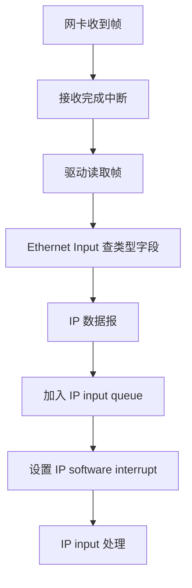

# 接口层的输入处理流程与层间通信队列

## 接口层的输入处理流程

当网卡收到一个帧时，==输入处理是异步的（asynchronous）==：它不是由某个进程的系统调用触发，而是由**接收完成中断**触发网卡驱动，再由驱动把数据交给协议栈。

> [!IMPORTANT]
> 输入处理是异步的，触发源是网卡驱动的接收完成中断，而不是进程的系统调用。

整体流程可以概括为：

在 4.4BSD-Lite 中，**Ethernet Input** 的关键动作是查看 Ethernet 帧头中的类型字段，判断该交给哪个协议层。若类型字段表明是 IP 数据报，就把对应的 mbuf 挂到 IP 输入队列上，并设置 **IP software interrupt**，让后续协议处理稍后再执行。

这样做的好处是把“硬件中断里的工作”压缩到最小：驱动只负责取包、识别、入队；真正耗时的协议处理推迟到软件中断里完成，避免长时间关中断影响系统响应。

## 层间通信队列

各层之间并不直接互相调用到底，而是通过队列解耦：

| 方向 | 使用的队列 | 作用 |
|---|---|---|
| 输入 | interface queues | 接口层到协议层 |
| 输出 | socket queues | 协议层到 socket 层 |

> [!TIP]
> 记法：**输入靠 interface queue，输出靠 socket queue**。题目问“network input and output 各用什么队列”时，就按这个对应关系答。

## 一个 UDP 数据报到达后如何找到 socket

当 UDP 数据报最终进入 UDP 输入处理时，内核要找到对应的 socket。它不会直接“猜 socket”，而是先查 **UDP protocol control block（inpcb）**：

1. 根据目的 UDP 端口号查找；
2. 必要时还会匹配目的 IP 地址、源 IP 地址、源端口号；
3. 找到 `inpcb` 后，通过其中的 `inp_socket` 指针找到对应的 `socket` 结构。

> [!IMPORTANT]
> 内核先找到匹配的 **inpcb**，再通过 `inp_socket` 找到 **socket structure**。

> [!WARNING]
> 常见错误是只答“根据端口号找 socket”。更准确的说法是：先根据端口等信息找到 protocol control block，再由 `inp_socket` 指针定位 socket。

简答时可以写成：

> The kernel searches the UDP protocol control blocks to find the matching one, based at least on the destination UDP port number, and possibly also on the destination IP address, source IP address, and source port numbers. Once the `inpcb` is found, the kernel locates the corresponding socket structure through the `inp_socket` pointer.

## 容易混淆的点

- **Ethernet Input 不做完整协议解析**：它只看类型字段并决定把包交给哪一层。
- **IP software interrupt 由接口层设置**：因为正是接口层把包放入 IP 输入队列后，才需要通知上层继续处理。
- **输入异步、输出通常由系统调用驱动**：输入来自中断，输出常由用户进程发起。

> [!CAUTION]
> 不要把“接收完成中断”和“系统调用”混在一起。输入包的到达由中断触发；系统调用更多对应发送路径或应用层收发接口。
