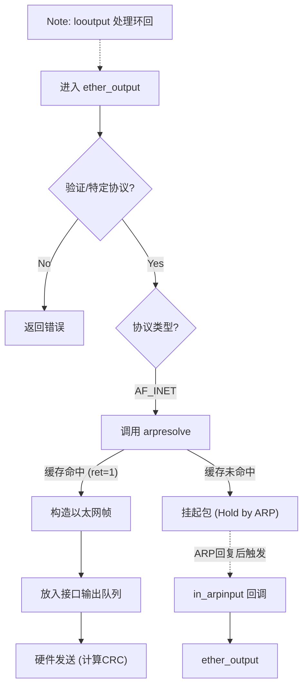

# 接口的输出队列与发送调度机制

## 接口的输出队列与发送调度机制

在网络协议栈中，当上层（IP层）将数据包传递给接口层时，数据并不会立即通过物理介质发送出去。为了协调高速CPU与低速网络设备之间的速度差异，并处理地址解析等异步操作，系统引入了**接口输出队列（Interface Output Queue）**。

> [!IMPORTANT]
> ==核心结论==：网络层间通信主要依赖两类队列：**Socket queues**（用户态与内核态交互）和 **Interface queues**（内核协议栈与网卡驱动交互）。

### 为什么需要输出队列？

想象一下，如果CPU生成数据包的速度远快于网卡发送比特流的速度，没有队列会发生什么？数据包会被直接丢弃。输出队列起到了**缓冲（Buffering）**和**调度（Scheduling）**的作用：
1. **流量整形**：平滑突发流量。
2. **异步等待**：在以太网中，若下一跳MAC地址未知，需等待ARP解析完成，此时数据包需暂存。

### `ether_output` 的处理流程

以以太网接口为例，`ether_output` 函数是发送路径的核心。其逻辑并非简单的“打包即发”，而是一个包含验证、寻址和排队的复杂过程。

> [!TIP]
> **关键考点**：当 `arpresolve` 成功（返回1）时，继续构造帧并排队；若失败，数据包被**ARP模块持有**，直到收到ARP应答后，由 `in_arpinput` 重新触发发送逻辑。

### 常见误区与辨析

| 特性 | Socket Queues | Interface Queues |
| :--- | :--- | :--- |
| **位置** | 传输层/应用层边界 | 网络层/链路层边界 |
| **作用** | 缓存用户读写数据 | 缓存待发送的网络包 |
| **典型场景** | TCP接收缓冲区满 | 网卡繁忙或ARP解析中 |

> [!WARNING]
> **易错点**：不要混淆“拷贝”与“发送”。在 `ether_output` 中，若代码进行了包拷贝（如环回测试），拷贝后的包会调用 `looutput` 模拟**接收**流程，而非直接发送。此外，以太网帧的 **32-bit CRC** 是由**硬件**在传输时计算的，软件构造的 mbuf 中不包含此字段。

### 实例分析

回顾简答题3的场景：
1. 进程发送IP包，调用 `ether_output`。
2. 进入 `AF_INET` 分支，调用 `arpresolve`。
3. **情况A**：ARP缓存中有对应MAC地址 $\rightarrow$ `arpresolve` 返回1 $\rightarrow$ 构造帧头 $\rightarrow$ 放入接口队列 $\rightarrow$ 驱动发送。
4. **情况B**：ARP缓存无记录 $\rightarrow$ 发送ARP请求 $\rightarrow$ 当前IP包被**挂起（Hold）** $\rightarrow$ 收到ARP Reply $\rightarrow$ `in_arpinput` 被调用 $\rightarrow$ 再次触发 `ether_output` $\rightarrow$ 此时缓存已更新，按情况A处理。

这种机制确保了即使在地址未知的情况下，数据包也不会丢失，而是优雅地等待地址解析完成。
