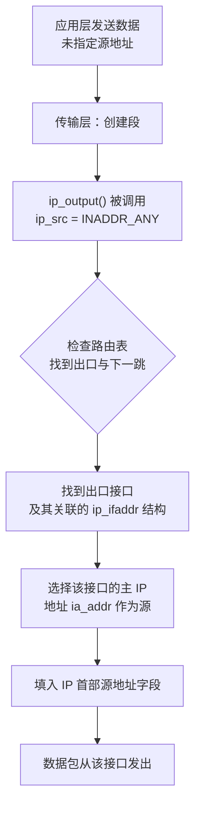
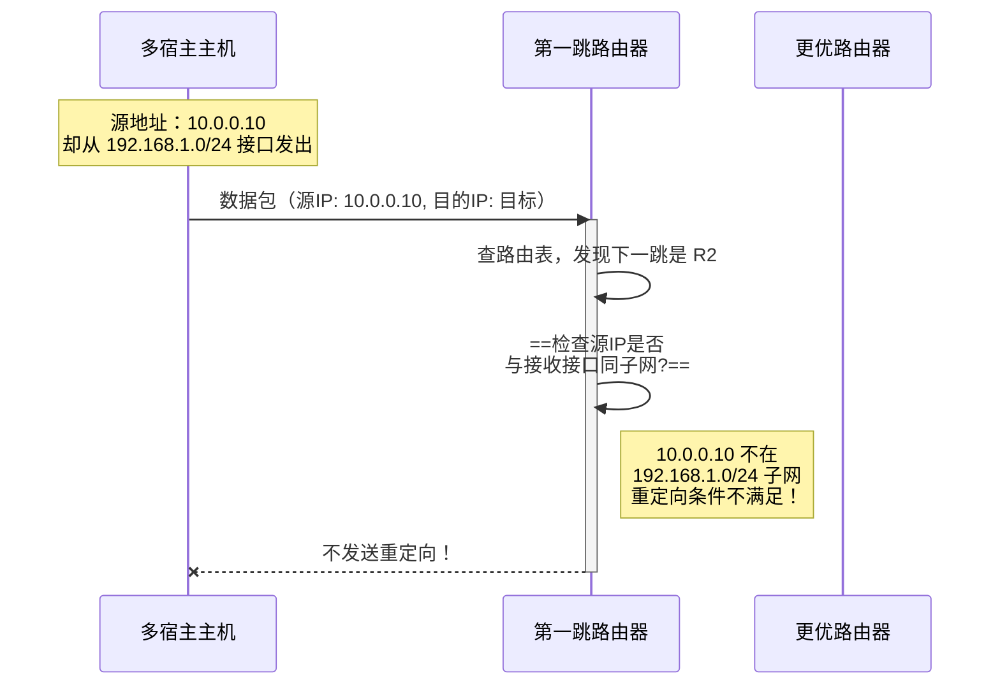

# 源地址选择规则与多宿主主机源地址

好的，我们来把“源地址选择规则与多宿主主机源地址”这个知识点讲清楚。

---

## 源地址选择：基本原则

当一个应用层数据包（如通过 `sendto()` 发送一个 UDP 数据报）进入网络层进行处理时，IP 协议栈必须做一件看似简单却很重要的事：为 IP 数据包的首部填入**源 IP 地址**。

最直接的问题是：如果应用程序在调用 `sendto()` 时没有通过 `bind()` 显式绑定一个本地 IP 地址（即此时 `ip_src` 未指定），内核该怎么办？

==核心规则是：`ip_output` 会查询路由表，找到发往目的地的出接口 (`ia`)，然后直接选用该接口上配置的主 IP 地址 (`ia_addr`) 作为数据包的源地址。==

> [!IMPORTANT]
> **未指定源地址时，源地址由出口接口决定，而非目的地址。**

这个设计保证了返回的数据包能通过同一个物理接口回到本机，符合最基本的双向通信模型。

---

## 多宿主主机带来的复杂性

如果一台主机安装了多块网卡，连接了不同的网络，它就成了一台**多宿主主机**。这会带来一个棘手的情况：应用程序**显式指定了一个源地址**，但内核选择的路由出口却是指向另一个接口的，怎么办？

例如，你的主机有两个 IP：
- `192.168.1.10/24` (eth0)
- `10.0.0.10/24` (eth1)

你 `bind` 到 `192.168.1.10` 发送一个数据包，但查路由表发现目的地竟要从 `eth1 (10.0.0.0/24 网络)` 出去。这叫**非对称路由**。

此时，遵循“弱端系统模型 (Weak End System Model)”，主机**仍会**接受并转发这个数据包。IP 层会尊重应用层显式绑定的源地址，尽管它不匹配出口接口的子网。数据包就这样被发送出去了。

> [!NOTE]
> **强 vs 弱端系统模型**：强模型会严格校验并拒绝源地址与出口接口不匹配的数据包。而本书基于 BSD 的实现采用弱模型，更加灵活。

---

## 多宿主主机引发的重定向失效

现在，我们把场景补全。数据包从 `eth0` 发出，到达了它所在子网的默认路由器。路由器发现，“要去最终目的地，你其实应该把数据包发给隔壁的另一台路由器，它就在我身后的网络里”。于是，路由器准备发送一个 **ICMP 重定向报文**给源主机，告诉它更优的下一跳。

但关键的一步发生了：

==ICMP 重定向报文的一个重要触发条件是：路由器发现它转发数据包的**接口**，和它接收该数据包的**接口是同一个**，并且源IP与该接口处于同一子网。==

在我们的例子中，路由器从 `192.168.1.0/24` 子网收到一个源地址为 `10.0.0.10` 的数据包。源地址与接收接口不在同一子网，路由器会认为这是一个配置错误或攻击，因此==不会发送重定向==。主机将永远无法得到这条更优路由的信息，可能导致单向通信或性能下降。

> [!WARNING]
> **常见坑点：**
> - 在多宿主主机上强制 `bind()` 某个IP后，可能造成出口接口与源IP不匹配，导致ICMP重定向失败。
> - 抓包时，如果看到反复走次优路径，别忘了检查是否是**源地址绑定不当**引发。

结合题目，当被问及 *“What happens when the first-hop router discovers that the packets should be going through a [不同的路由器]?”* 时，答案就是：它不会向主机发送重定向消息，因为源地址检验不通过。这是实现弱端系统模型的一个已知后果，在 RFC 1122 中有迹可循。
