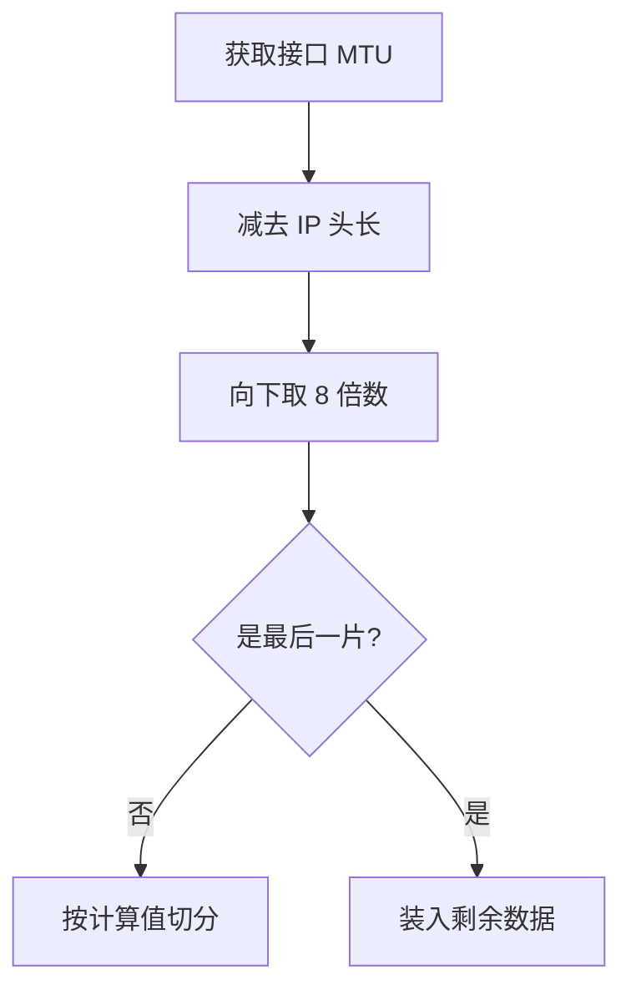

# 如何确定每个片段中的数据字节数（分片偏移计算）

当一个 IP 数据报的总长度超过出接口的 MTU 时，必须将其拆分。那么问题来了：拆出来的每个片段里，到底该装多少字节的数据？能不能随便切？

## 为什么不能随便切

IP 头部中的==分片偏移字段（Fragment Offset）以 8 字节为单位==。这意味着除了最后一个片段外，每个片段携带的数据长度必须是 8 的整数倍，否则接收端无法通过偏移量正确还原原始数据报。

> [!IMPORTANT]
> 核心规则：每个非末尾片段的数据长度 = $\lfloor (MTU - IP\_Header\_Len) / 8 \rfloor \times 8$

## 如何确定分片大小

在 Net/3 的 `ip_output` 实现中（参考 P220 代码示例 10-6），当检测到 `(u_short) ip->ip_len > ifp->if_mtu` 时触发分片。虽然算法本身直接，但因 mbuf 链的操作而变得复杂。确定每个片段数据字节数的步骤如下：

1. **计算可用载荷上限**：用接口的 `if_mtu` 减去当前 IP 头部的长度（通常为 20 字节，若有选项则更长）。
2. **对齐到 8 字节边界**：将上一步的结果向下取整为 8 的倍数。这就是除最后一片外，每个片段应包含的==数据字节数==。
3. **处理最后一片**：最后一个片段不需要凑齐 8 的倍数，它直接装载所有剩余的数据字节。

> [!TIP]
> 记忆口诀：**“先减头，再除八，乘回来，剩尾巴”**。

## 算对了的例子

假设一个 IP 数据报总长度为 4000 字节（含 20 字节 IP 头），要经过 MTU 为 1500 字节的接口。

- **可用数据上限**：$1500 - 20 = 1480$ 字节
- **对齐 8 字节**：$\lfloor 1480 / 8 \rfloor \times 8 = 185 \times 8 = 1480$ 字节（恰好是 8 的倍数）

| 片段序号 | 数据字节数 | 分片偏移（Offset） | MF 标志 |
| :---: | :---: | :---: | :---: |
| 1 | 1480 | $0 / 8 = 0$ | 1 |
| 2 | 1480 | $1480 / 8 = 185$ | 1 |
| 3 | $4000-20-1480\times2=1000$ | $2960 / 8 = 370$ | 0 |

若 MTU 改为 1504 字节，可用上限为 $1504 - 20 = 1484$，对齐后每片数据应为 $\lfloor 1484 / 8 \rfloor \times 8 = 1480$ 字节，而非 1484 字节。

## 与相近概念的区别

| 对比维度 | 分片数据长度计算 | 路径 MTU 发现（PMTUD） |
| :--- | :--- | :--- |
| **目的** | 决定当前路由器怎么切包 | 探测整条路径的最小 MTU |
| **机制** | 本地根据出接口 MTU 计算 | 发送方设置 DF 位，靠 ICMP 反馈调整 |
| **Net/3 支持** | 原生支持（`ip_output`） | ==未实现==（见 Vol.1 §11.8, §24.2） |

## 常见易错点与异常处理

> [!WARNING]
> 忘记向下取 8 的倍数是最常见的丢分点！如果算出的数据长度不是 8 的倍数，接收端重组时将产生错位。

> [!CAUTION]
> 如果 IP 头部的 **DF（Don't Fragment）位被置 1**，`ip_output` 绝不会执行上述计算，而是直接丢弃该包并返回 `EMSGSIZE` 错误：
> - 若数据报由本机生成，传输层协议会将此错误返回给应用进程；
> - 若数据报是被转发的，`ip_forward` 会生成一个 ICMP 目的不可达差错（指示需分片但 DF 已置位）。
