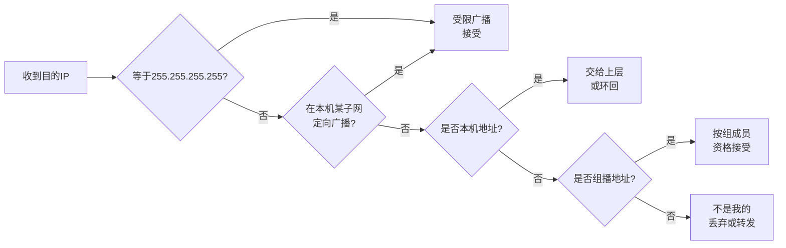

# 特殊 IP 地址（广播、组播、环回、全零）及无 IP 地址时的广播包处理

## 特殊 IP 地址与无地址时的广播处理

### 为什么需要“特殊”地址

IP 地址并非每个 32 位组合都指向某一台具体主机。协议设计者保留了几段地址用于**控制面**：有些表示“我自己”，有些表示“所有人”，有些表示“一组人”。如果不理解这些地址在协议栈代码里如何被判别，读 `ip_input` 和 `ether_input` 时就很容易卡住。

先想一个问题：一台主机在还没有拿到 IP 地址时，能不能收到发给“所有主机”的数据帧？数据链路层当然能收到，但 IP 层要不要接收它？

### 四类特殊地址

| 地址类型 | 形式 | 用途 | 是否可作为源地址 |
|---|---|---|---|
| 全零地址 | `0.0.0.0` | 表示“本主机、本网络”，常用于 DHCP 请求或绑定时通配 | 仅初始化阶段 |
| 环回地址 | `127.0.0.0/8`（常用 `127.0.0.1`） | 本机内部通信，不经过物理网卡 | 是 |
| 定向广播 | `net.255` 或 `net.subnet.255` | 发给某个网络的所有主机 | 否 |
| 受限广播 | `255.255.255.255` | 发给当前链路上的所有主机 | 否 | 
| 组播地址 | `224.0.0.0/4` | 发给一组主机，由 `ip_moptions` 控制 | 是（组成员可发） |

在 4.4BSD-Lite 的代码中，判断一个地址是否为广播地址的核心逻辑位于 `in_broadcast()`：它用 `in_ifaddr` 遍历本机所有 IPv4 地址，将目标地址与每个接口的子网掩码做比较，判断是否命中该子网的定向广播地址，或命中 `INADDR_BROADCAST`（即 `255.255.255.255`）。

### 无 IP 地址时，广播包该不该被接受

这个问题的关键在于**“接受”后能做什么**。

如果主机没有任何接口被分配 IP 地址，意味着全局的 `in_ifaddr` 链表为空，也意味着 `ifaddr` 列表中没有任何 `AF_INET` 类型的地址。此时若 `ip_input` 收到一个目的地址为 `255.255.255.255` 的广播数据报，它会做版本校验、头部校验和、选项处理……最后发现：这个包是广播，但系统根本没有自己的源 IP 可供后续回复。

所以正确答案是：==大概不应该接受==。原因不在“不能解析帧”，而在“没有可用的源地址回复”。一个没有 IP 的主机即使处理了该广播载荷（比如某个 UDP 请求），也无法构造回包，白白占用 CPU 和内存。此时更合理的做法是在 IP 层直接丢弃，而不是交给上层。

> [!IMPORTANT]
> 判断是否接受广播包的本质不是“目的地址我认不认识”，而是“==我有没有能力响应==它”。没有源地址，就没有回复能力。

### 和相近概念的区别

初学者常把“受限广播”和“定向广播”混为一谈。它们最关键的差异是**路由器转发行为**：

| 对比项 | 受限广播 `255.255.255.255` | 定向广播 `192.168.1.255` |
|---|---|---|
| 范围 | 当前链路（不会跨路由器） | 目标网络内的所有主机 |
| 路由器默认 | 不转发 | 老实现可转发（现默认禁止） |
| IP 层判别 | 直接比较 `INADDR_BROADCAST` | 需要遍历接口子网掩码计算 |
| 收到后回复 | 必须有本链路地址 | 必须有属于目标网络的地址 |

环回地址也容易被误认为“特殊广播”。但环回是**单播到本机**，数据不出接口，常用于服务自测或本地进程间通信。广播是**一对多**，两者在 `ip_input` 中的处理分支完全不同。

### 一个算对了的例子

设主机 H 的接口配置为：

- IP：`192.168.10.5`
- 掩码：`255.255.255.0` → 子网号 `192.168.10.0`

现在收到三个目的 IP 数据报：

| 目的地址 | 判别过程 | 是否接受 |
|---|---|---|
| `192.168.10.5` | 等于本机地址 | ✅ 接受并提交上层 |
| `192.168.10.255` | 网络号 `192.168.10.0` 与主机接口一致，且主机部分全 1 | ✅ 作为定向广播接受 |
| `255.255.255.255` | 等于 `INADDR_BROADCAST` | ✅ 受限广播接受，但需要回复能力 |
| `10.0.0.255` | 非本机网络、也不是全局广播 | ❌ 丢弃或转发（若配置为路由器） |

无地址场景：

- 主机没有配置任何 IPv4 地址 → `in_ifaddr == NULL` → 收到 `255.255.255.255` → 无法回复 → ==IP 层丢弃，不提交上层==。

正是这条规则，确保了早期引导阶段的主机不会被无意义的广播风暴拖垮。
