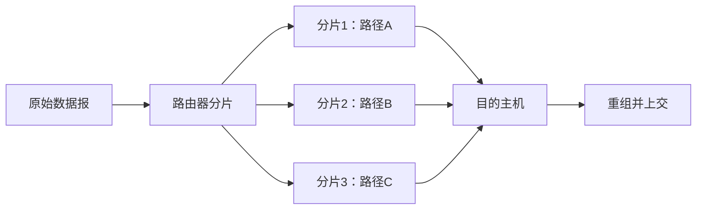
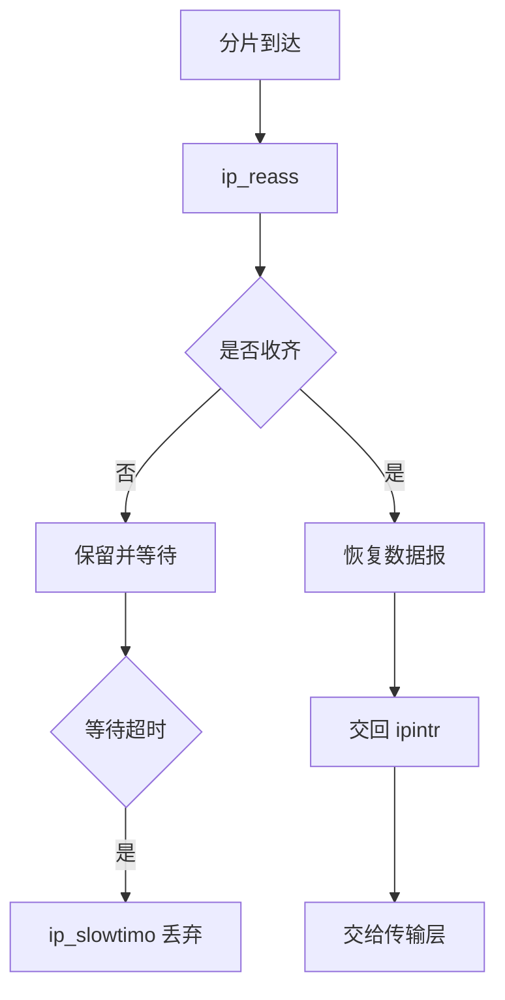

# 为何只有目的主机能重组原始数据报及重组函数实现

## 为什么只有目的主机能重组

IP 分片后，各分片是独立转发的数据报，网络不保证它们沿同一路径传输，也不保证按序到达。中间路由器可能只收到部分分片，甚至一个也收不到；即使暂时收齐，也无法据此判断其他分片的情况。因此，==只有目的主机才有机会看到同一原始数据报的全部分片==，重组只能在最终目的地完成。



> [!IMPORTANT]
> 分片可能独立选路、乱序或丢失；中间路由器只负责转发，==目的主机负责重组==。

## 分片与重组需要哪些信息

标准 IP 头通常为 **20 字节**，选项最多 **40 字节**，因此首部长度最大为 60 字节。当 `ip_output` 发现

```c
if ((u_short) ip->ip_len > ifp->if_mtu) { ... }
```

就把过大的数据报拆成若干能适应该链路 MTU 的分片。目的主机主要依据以下字段识别和拼接：

| 字段 | 重组时的作用 |
|---|---|
| Identification | 标识属于同一原始数据报的分片 |
| Fragment Offset | 确定本分片数据在原始数据中的位置，以 8 字节为单位 |
| MF（More Fragments） | $MF=1$ 表示后面还有分片；最后一片为 0 |
| Total Length | 确定当前分片的总长度，而非原始数据报总长 |

目的主机按标识等字段把分片归入相应重组队列，再依据偏移量放置数据。收齐从偏移 0 到最后一个分片、且中间没有空洞后，才恢复原始 IP 数据报并交给上层协议。

## `ip_reass` 与 `ip_slowtimo`

`ip_reass` 接受到达的分片并尝试重组。若重组成功，数据报被交回 `ipintr`，随后交给相应的传输协议；若尚未收齐，则保留已到达的分片，等待后续分片。



IP 没有为每个分片提供可靠的逐跳重传机制。为避免缺失分片使缓冲区无限期被占用，实现会设置重组定时器；若在合理时间内仍未收齐，`ip_slowtimo` 就丢弃这个不完整数据报及其已缓存分片。IP 本身也不保证最终交付，可靠性需要由 TCP 等上层机制处理。

## 一个算对的例子

某原始数据报的数据部分为 **4000 字节**，经 MTU 为 1500 字节的网络传输，忽略 IP 选项。每片含 20 字节 IP 头，因此数据最多为 1480 字节；同时，除最后一片外，数据长度通常须为 8 的整数倍。

| 分片 | 数据长度 | IP 总长度 | Offset | MF |
|---|---:|---:|---:|---:|
| 第 1 片 | 1480 B | 1500 B | 0 | 1 |
| 第 2 片 | 1480 B | 1500 B | $1480/8=185$ | 1 |
| 第 3 片 | 1040 B | 1060 B | $2960/8=370$ | 0 |

三片数据合计 $1480+1480+1040=4000$ 字节，偏移连续，最后一片 $MF=0$，所以目的主机能够完整重组。

> [!WARNING]
> **Offset 不是字节数，而是 8 字节块数**；`Total Length` 是当前分片长度。也不要把“目的主机重组”误写成“沿途路由器边转发边重组”。
