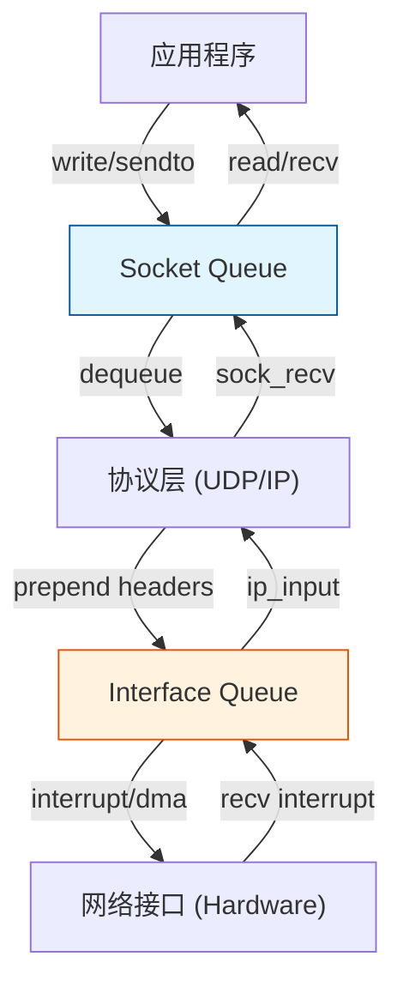

# 网络输入和输出时层间通信用哪些队列

## 层间通信队列机制

在网络输入和输出过程中，协议栈各层（Socket 层、协议层、接口层）并非直接通过函数调用的同步方式传递所有数据，而是依赖特定的数据结构进行缓冲和解耦。对于南邮《TCP/IP网络设计与实现》课程而言，理解这一机制是掌握异步 I/O 处理的关键。

> [!IMPORTANT]
> 核心结论：用于网络输入和输出层间通信的队列主要有两类：**Socket queues**（套接字队列）和 **Interface queues**（接口队列）。

### 为什么需要这些队列？

想象一下，如果网卡收到数据包后必须立即被上层应用取走，或者应用发送数据时必须等待网卡完全空闲，系统效率将极低。
*   **解耦速度差异**：网络接口（硬件）的速度与 CPU 处理协议（软件）的速度不匹配。
*   **异步处理**：如简答题 19 所述，Input processing is **Asynchronous**。中断发生时，数据先存入队列，后续再由内核线程或进程上下文处理。

### 两种队列的职责分工

| 队列类型 | 位置 | 主要作用 | 数据流向示例 |
| :--- | :--- | :--- | :--- |
| **Socket Queues** | Socket 层与协议层之间 | 缓存待发送或已接收的应用数据 | 用户 `sendto` -> Socket 队列 -> UDP/IP 处理 |
| **Interface Queues** | 协议层与接口层之间 | 缓存等待硬件发送或刚由硬件接收的数据包 | IP 层 -> Interface 队列 -> 网卡驱动 |

### 常见误区与辨析

> [!WARNING]
> 易错点：不要混淆“协议层内部处理”与“层间通信”。
> 例如，UDP 输出例程中 prepend IP header 是在协议层内部完成的内存操作（mbuf 链调整），此时数据尚未进入 Interface queue。只有当数据包准备好交给网卡驱动时，才会进入 ==Interface queue==。

*   **Socket Queue**：更贴近应用层视角。当调用 `sendto` 时，数据首先被复制到 Socket 的发送缓冲区（即 Socket queue 的一部分）。
*   **Interface Queue**：更贴近硬件视角。在简答题 22 中提到，IP software interrupt 是由 **interface layer** 设置的，这意味着接口层在处理完物理帧后，通过中断通知上层，并将数据从 Interface queue 移交给协议层。

### 典型场景分析：UDP 发送过程

结合简答题 10 和 27，我们可以梳理一个完整的发送路径：

1.  进程调用 `sendto`。
2.  数据进入 **Socket queue**（发送缓冲区）。
3.  UDP 输出例程被调用，为数据添加 UDP 头。
4.  IP 输出例程被调用，添加 IP 头。
5.  最终，封装好的 mbuf 被放入 **Interface queue**。
6.  网卡驱动从 Interface queue 取出数据，通过 DMA 发送到物理介质。

> [!TIP]
> 记忆技巧：
> *   **S**ocket Queue 对应 **S**oftware/Application boundary（软/应用边界）。
> *   **I**nterface Queue 对应 **I**ron/Hardware boundary（铁/硬件边界）。

通过区分这两类队列，可以清晰地回答简答题 27：“Which queues are used for communication between the layers for network input and output?” 答案即为 **Socket queues and interface queues**。
