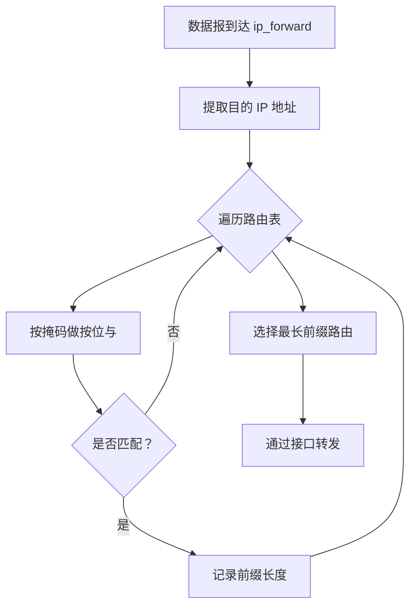

# IP 路由查询过程与最长前缀匹配

## 为什么需要路由查询

当一个 IP 数据报到达主机或路由器时，内核必须回答一个问题：**“该从哪个接口把它送出去？”** 如果系统被配置为路由器，尚未到达最终目的地的数据报会被 `ipintr` 交给 `ip_forward`，由它完成转发决策。这个决策的核心，就是在路由表中查找与目的 IP 地址最匹配的条目。

## 路由表与掩码匹配

Net/3 的路由表采用** Patricia 树**（一种压缩的二叉树）来组织，每个叶子节点保存一条路由，包含：

- 目的地址（destination）
- 地址掩码（mask）
- 下一跳网关（gateway）
- 输出接口（interface）

查找时，内核用目的 IP 地址与每条路由的掩码做按位与运算：

$$\text{match} = (\text{dest\_ip} \ \&\ \text{mask}) == (\text{route\_dest} \ \&\ \text{mask})$$

如果多条路由都匹配，则选择**掩码中 1 的个数最多（即前缀最长）**的那一条——这就是 ==最长前缀匹配（Longest Prefix Match）==。

## 最长前缀匹配示例

假设路由表中有以下三条路由：

| 路由条目 | 目的网络 | 掩码 | 前缀长度 |
|---------|---------|------|---------|
| R1 | 192.168.0.0 | 255.255.0.0 | 16 |
| R2 | 192.168.1.0 | 255.255.255.0 | 24 |
| R3 | 0.0.0.0 | 0.0.0.0 | 0（默认路由） |

现在收到目的地址为 **192.168.1.100** 的数据报：

- 与 R1 匹配：$192.168.1.100 \& 255.255.0.0 = 192.168.0.0$ ✓（前缀 16）
- 与 R2 匹配：$192.168.1.100 \& 255.255.255.0 = 192.168.1.0$ ✓（前缀 24）
- 与 R3 匹配：默认路由总是匹配 ✓（前缀 0）

三条都匹配，但 **R2 的前缀最长（24 位）**，因此选择 R2 作为转发路由。

> [!IMPORTANT]
> ==最长前缀匹配==是路由查询的唯一裁决规则。前缀越长，表示该路由描述的目的网络越具体，应优先于更笼统的路由（包括默认路由）。

## 转发过程中的常见坑

> [!WARNING]
> 在 `ip_forward` 中，如果 `ip_ttl` 已减至 1（`IPTTLDEC`），则**不能继续转发**，必须向源主机发送 ICMP 超时报文并丢弃数据报；否则先将 TTL 减 1 再查询路由表。

> [!CAUTION]
> 路由查询失败（无匹配路由且没有默认路由）时，发送 ICMP 主机不可达报文。注意这与“需要分片但 DF 位置 1”时发送的 ICMP 不可达报文是**不同类型**的差错，复习时要区分清楚。

> [!TIP]
> 记忆口诀：**“掩码越长越优先，默认路由兜底用；TTL 先减再转发，减到 1 就报错。”**
