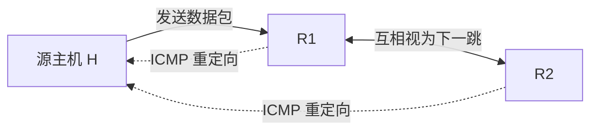

# 路由条目的动态添加、删除与更新

## 它是什么，为什么需要

在 IP 网络中，拓扑不可能一成不变：链路断开、新路由器上线、某条路径拥塞……如果全靠管理员手动维护路由表，网络稍有规模就会崩溃。因此，路由协议（如 RIP、OSPF）会==根据网络状态的变化，动态地添加、删除或更新路由条目==。

但“动态”带来了一个棘手问题：各台路由器收到更新消息的时间有先后，导致在路由更新期间，全网的==路由表暂时不一致==（temporarily inconsistent）。这种不一致最危险的后果就是产生**路由环路**（Routing Loop）。

## 怎么做：环路的产生与终结

设想一个场景：主机 H 想发数据包给目标 D，中间经过路由器 R1 和 R2。

> [!WARNING]
> 环路触发条件：如果 R1 认为到达 D 的最佳下一跳是 R2，而 R2 也认为最佳下一跳是 R1，就形成了路由环路。

在环路被消除之前，会发生什么？

1. **数据包弹跳**：原始数据包会在 R1 和 R2 之间来回弹跳（bouncing back and forth）。
2. **ICMP 重定向**：如果源主机 H 与这两台路由器在同一个网络上，每台路由器都会向源主机发回一个 ICMP Redirect 消息，试图告诉主机“你直接发给对方更好”，但这无法打破路由器之间的环路。
3. **TTL 兜底**：数据包每经过一台路由器，其 IP 首部的 TTL（Time To Live）字段减 $1$。当 TTL 最终减到 $0$ 时，数据包将被丢弃，并向源主机发送 ICMP Time Exceeded 消息。

> [!IMPORTANT]
> ==TTL 字段存在的主要原因之一，就是防止因路由环路导致的数据包在网络中无限循环。==

## 相近概念辨析

| 对比维度 | 路由环路（Routing Loop） | ICMP 重定向（Redirect） |
| :--- | :--- | :--- |
| **发生位置** | 路由器与路由器之间 | 路由器与同网段源主机之间 |
| **触发原因** | 路由表暂时不一致，互为下一跳 | 主机选错了默认网关（非最优） |
| **解决机制** | 依赖 TTL 耗尽丢包 / 路由收敛 | 主机修改本地路由表 |
| **对数据包影响**| 数据包在路由器间无效消耗带宽 | 提示主机后续包走更优路径 |

> [!NOTE]
> ICMP 重定向只是“建议”主机优化路径，它本身不能解除两台路由器之间已经形成的环路。

## 常见的坑

> [!CAUTION]
> 很多同学在考试中误以为“只要发了 ICMP 重定向，环路就会立刻消失”。这是错的！重定向只发给源主机，而环路发生在路由器之间。真正让环路中的包停下来的，是 TTL 归零。

> [!TIP]
> 记忆口诀：**“更新不一致，环路互指路；弹跳靠 TTL，重定向给主机。”**

## 算对了的例子

**题目情境**：主机 A（IP: `192.168.1.10`）与路由器 R1（`192.168.1.1`）、R2（`192.168.1.2`）在同一局域网。A 要发包给 `10.0.0.5`。某次路由更新期间，R1 的路由表认为去 `10.0.0.5` 的下一跳是 R2，而 R2 的路由表认为下一跳是 R1。A 发出的包初始 TTL = $64$。

**分析过程**：
1. A 将包发给 R1。R1 查表，把包转给 R2。
2. R2 查表，把包又转回 R1。此时包在 R1 和 R2 之间形成环路。
3. 因为 A、R1、R2 在同一网络，R1 和 R2 每次转发时，都会向 A 发送一个 ICMP 重定向消息。
4. 包每在 R1 和 R2 之间传递一次，TTL 减 $1$。
5. 经过 $64$ 次转发后，TTL 变为 $0$。当前持有该包的路由器将其丢弃，环路终止。

**结论**：该包最多在路由器之间弹跳 $64$ 次后被丢弃。若没有 TTL 机制，这个包将永远占用链路带宽。
