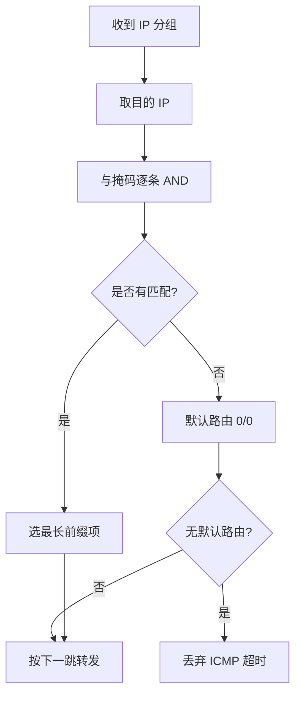

# 路由表的数据结构与查找算法
当路由器收到一个 IP 分组时，它需要依据**目的 IP 地址**在路由表中找到"下一跳应该交给谁"。这个过程称为 **IP Forwarding（IP 转发）**。路由表长什么样、怎么查、查得快不快，直接决定转发性能——这正是本知识点的核心。

### 路由表是什么

每台运行 IP 的设备（路由器、Linux 主机）都维护一张 ==Routing Table==，每一行（entry）至少包含三类字段：

| 字段 | 含义 | 示例 |
| --- | --- | --- |
| Destination / Prefix | 目的网络前缀 | `202.119.0.0/16` |
| Netmask / Prefix Length | 掩码或前缀长度 | `255.255.0.0` / `16` |
| Next Hop | 下一跳 IP 地址 | `202.119.23.1` |
| Interface | 出接口 | `eth0` |
| Metric | 代价（供选路用） | `110` |

> [!NOTE]
> 路由表项可能有两种：**Direct Route（直连路由）**和 **Indirect Route（间接路由，需经 Next Hop）**；也分为 **Host Route（/32）** 与 **Network Route**。

### 为什么要"最长前缀匹配"

IPv4 路由是 **CIDR** 化的，同一目的地址可能被多条前缀覆盖。例如 `192.168.1.5` 同时被 `/8`、`/16`、`/24` 匹配，应当选择**掩码最长**的那条，称为 ==Longest Prefix Match（LPM，最长前缀匹配）==。

> [!IMPORTANT]
> LPM 是 IP 路由查找的根本规则：==匹配前缀长度最长者优先==，而不是第一个命中者。

### 查找流程

简单实现是线性扫描：对每条 entry 计算 $d \land \text{mask} = \text{prefix}$，保留最长命中，时间复杂度 $O(N)$。规模大时硬件上采用 **TCAM**（并行比较），软件上用 **Trie（Patricia Trie）** 或 **Hash + 多级索引**，可降到 $O(W)$（$W$ 为前缀位宽，32 或 128）。

### 与相近概念的区别

| 概念 | 作用层面 | 关注点 |
| --- | --- | --- |
| Forwarding（转发） | 数据平面 | 本机怎么查表送出 |
| Routing（路由） | 控制平面 | 路由表项怎么产生（RIP/OSPF/BGP） |
| ARP | L2↔L3 映射 | Next Hop IP → MAC |
| Switching | L2 | 依据 MAC 查转发表 |

> [!WARNING]
> 常见坑：**"最长前缀"≠"掩码数值最大"**，而是**前缀位数最多**；`/24` 长于 `/16`。另外默认路由 `0.0.0.0/0` 前缀长度为 0，永远"最不优先"，只在无更长匹配时使用。

### 算对了的例子

路由表：

| 目的前缀 | Next Hop |
| --- | --- |
| `202.119.0.0/16` | `10.0.0.1` |
| `202.119.23.0/24` | `10.0.0.2` |
| `0.0.0.0/0` | `10.0.0.3` |

目的 IP `202.119.23.8`：

- 与 `/16` 匹配：`202.119.23.8 & 255.255.0.0 = 202.119.0.0` ✅
- 与 `/24` 匹配：`202.119.23.8 & 255.255.255.0 = 202.119.23.0` ✅
- `/24` 更长，**选 Next Hop = 10.0.0.2**，从对应接口发出。

> [!TIP]
> 记忆口诀："**掩码越长越具体，越具体越优先**"；默认路由是"兜底"，永远最后考虑。
