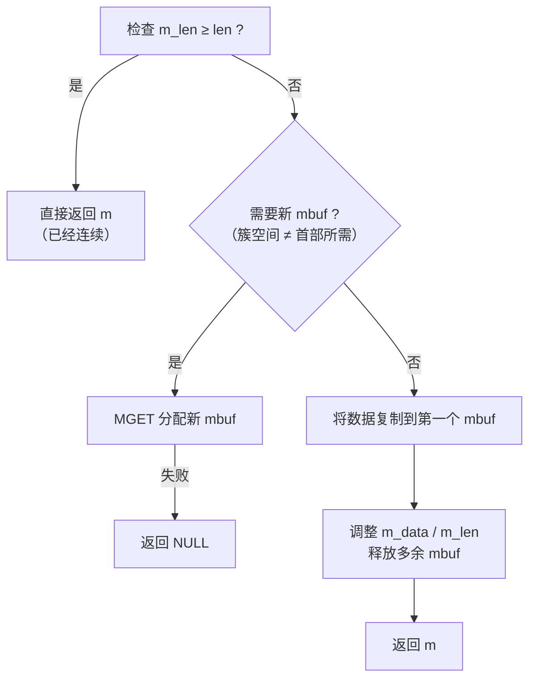

# 第一个 mbuf 中数据量小于最小协议首部时的拉齐（pullup）调用

## 为什么需要 `m_pullup`

在 BSD 网络协议栈中，数据包以 `mbuf` 链表的形式在协议层之间传递。每个 `mbuf` 都有自己的 `m_data` 指针和 `m_len` 长度字段，可以指向缓冲区中的任意位置。

这种灵活性带来了一个问题：==第一个 `mbuf` 中可能只包含协议首部的一部分==。例如，当收到的 IP 分片大于 208 字节时，`m_devget` 会把数据放入簇（cluster），而首部可能跨越了簇边界：


各协议层通过首部结构体指针来解析字段。IP 输入例程会这样写：

```c
struct ip *ip = mtod(m, struct ip *);
if (ip->ip_v != IPVERSION) { ... }
```

但 `mtod` 宏只能返回当前 `mbuf` 中 `m_data` 指向位置的数据。==如果最小协议首部跨越了两个 `mbuf`，直接用 `mtod` 会读到不完整的首部，导致解析错误甚至内核崩溃==。

[!IMPORTANT]
> 当 `m_len < 协议最小首部长度` 时，必须调用 `m_pullup` 把首部"拉齐"到第一个 mbuf 中，使之连续可被 `mtod` 安全访问。

## `m_pullup` 做了什么

`m_pullup(m, len)` 重新整理 `mbuf` 链表，保证==前 `len` 字节连续存放在第一个 `mbuf`== 中。`len` 是协议最小首部大小，且必须 ≤ `MHLEN`（100 字节）。

工作流程：



调用约定示例（UDP 接收路径）：

```c
if (m->m_len < sizeof(struct udphdr)) {
    m = m_pullup(m, sizeof(struct udphdr));
    if (m == NULL) {
        udpstat.udps_hdrops++;
        return;
    }
}
```

## 三种失败原因

`m_pullup` 返回 `NULL` 的情况有三种，考试常考后两种：

| 序号 | 失败原因 | 说明 |
|:---:|:---|:---|
| 1 | 需要分配新 `mbuf` 但 `MGET` 失败 | 内存耗尽，罕见 |
| 2 | ==链上数据总量 < 请求的 `len`== | **最常见**：IP 分片被截断或损坏 |
| 3 | 调用者请求的 `len` > `MHLEN`（100） | `m_pullup` 硬上限，超过直接返回 NULL |

[!WARNING]
> 第 2 种失败最容易被忽视——你以为首部在"下一个 mbuf 里"，但实际上整个链加起来都不够一个完整首部的长度。

## 为什么要为每个 IP 分片调用

当 IP 分片长度 > 208 字节时，`m_devget` 会用簇存储数据。第一个 `mbuf` 的 `m_len` 会小于完整 IP 首部（因为还有后续分片的完整首部都不一定在一个簇里）。==几乎所有接收到的分片都大于 208 字节==，所以 `m_pullup` 在 IP 分片重组路径上是必经之路。

[!TIP]
> 记住这个数字链：`208 = MINCLBYTES`（簇阈值），`20 = IP 首部最小长度`，`100 = MHLEN`（`m_pullup` 上限）。

## 为什么簇不加回指指针

你可能会想：如果每个簇都有一个回指 `mbuf` 的指针，`dtom` 不就不用担心了吗？不可行，原因有二：
1. **多个 `mbuf` 可以指向同一个簇**（共享引用），一对一的反向指针逻辑不成立；
2. **簇大小是 2 的幂（1024 或 2048）**，没有空间存放额外的回指指针。

因此，`m_pullup` 作为拉齐机制在网络协议栈中不可或缺——它用一个拷贝操作，换来了所有协议层对 `mtod` / `dtom` 宏的安全使用。
