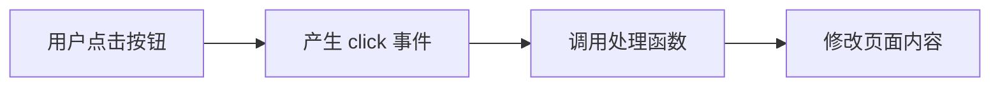

# 处理Body元素与Button元素的事件

## 为什么需要事件处理

网页中的按钮、输入框不会自动完成业务操作。用户点击按钮、提交表单或修改内容时，浏览器会产生**事件（event）**；JavaScript 通过**事件处理程序（event handler）**响应这些操作，使静态 HTML 文档具有交互能力。

Body 元素主要处理页面级事件，Button 元素则常用于触发具体功能。

## Body 元素的常用事件

| 事件 | 触发时机 | 典型用途 |
|---|---|---|
| `onload` | 页面及其资源加载完成 | 初始化页面、读取元素 |
| `onunload` | 页面正在卸载 | 清理工作；现代浏览器中应谨慎使用 |
| `onclick` | 在页面主体中单击 | 响应主体区域的点击 |

最常见的写法是在 `<body>` 中注册处理函数：

```html
<body onload="initPage()">
  <p id="message">页面正在加载</p>

  <script>
    function initPage() {
      document.getElementById("message").textContent = "加载完成";
    }
  </script>
</body>
```

这里不要写成 `onload="initPage"`：事件触发时需要**调用函数**，所以通常写 `initPage()`。

> [!TIP]
> 如果脚本只需等待 HTML 元素生成，而不必等待图片等资源，可优先考虑 `DOMContentLoaded`；`onload` 的触发通常更晚。

## Button 元素的事件

Button 最常用的是 `onclick`。点击按钮后，浏览器调用指定的 JavaScript 函数：

```html
<button id="checkBtn" type="button" onclick="showResult()">
  计算人数
</button>
<p id="result"></p>

<script>
  function showResult() {
    const groups = 4;
    const eachGroup = 6;
    document.getElementById("result").textContent =
      "总人数：" + groups * eachGroup;
  }
</script>
```

点击一次按钮，`showResult()` 执行一次，页面显示：

```text
总人数：24
```

这个例子的关键是：==乘法计算发生在事件处理函数中，只有点击事件发生后才执行==。

也可以用 `addEventListener()` 注册事件，使 HTML 与 JavaScript 分离：

```html
<button id="checkBtn" type="button">计算人数</button>

<script>
  document.getElementById("checkBtn")
    .addEventListener("click", showResult);

  function showResult() {
    alert(4 * 6);
  }
</script>
```

注意这里传入的是 `showResult`，不是 `showResult()`。后者会立即执行函数，并把其返回值注册为监听器。



## 相近写法的区别

| 写法 | 特点 | 注意事项 |
|---|---|---|
| `onclick="showResult()"` | 直接写在 HTML 中，简单直观 | 行为与结构混在一起 |
| `element.onclick = showResult` | 在脚本中绑定 | 再次赋值会覆盖原处理函数 |
| `addEventListener("click", showResult)` | 可注册多个监听器 | 推荐使用，结构更清晰 |

`onclick` 是 HTML 属性或 DOM 属性名称；`addEventListener()` 的事件类型则写成 `"click"`，不要写成 `"onclick"`。

> [!WARNING]
> 若按钮位于 `<form>` 内，`<button>` 的默认类型往往是 `submit`。只想执行脚本、不想提交表单时，应明确写 `type="button"`，否则可能出现页面刷新、计算结果一闪而过。

## 常见错误

- **函数尚未定义**：内联事件触发时，浏览器必须能找到对应的全局函数。
- **脚本执行过早**：使用 `getElementById()` 时元素还不存在，会得到 `null`；可把脚本放在元素之后，或在页面加载完成后初始化。
- **混淆 Body 与 Button 事件**：`onload` 通常由页面加载触发，`onclick` 由用户点击触发，二者不是替代关系。
- **重复绑定**：在每次点击处理函数中再次调用 `addEventListener()`，可能导致以后点击一次却执行多次。
- **依赖 `onunload` 保存重要数据**：浏览器可能不触发它，关键数据应及时保存。

> [!IMPORTANT]
> 解题时先判断“事件何时发生”，再找“哪个元素接收事件”，最后检查“处理函数是否真正执行”。事件名、函数调用写法和按钮默认提交行为，是最常见的三个失分点。
