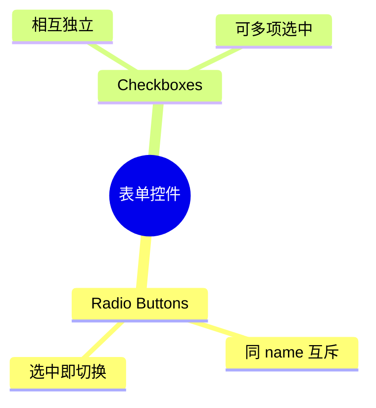

# 复选框（Checkboxes）与单选按钮（Radio Buttons）的事件处理

---
title: 复选框与单选按钮的事件处理
requires: [HTML表单基础, JavaScript函数]
---

# 复选框与单选按钮的事件处理

在 Web 交互中，用户输入不仅限于文本，还包含状态选择。理解 `checkbox`（复选框）与 `radio`（单选按钮）的行为差异及其事件绑定机制，是掌握 DOM 操作的基础。

## 核心行为差异

两者最本质的区别在于**互斥性**。

> [!IMPORTANT]
> ==Radio Buttons==：同组内（`name` 属性相同）互斥，只能选一项。
> ==Checkboxes==：独立存在，可多选或全不选。



回顾复习题 **2.25**：一组复选框允许用户同时选择多个选项，而一组单选按钮强制用户在同一时刻仅能选择一个选项。这种底层逻辑决定了我们在编写事件处理器时的策略不同。

## 事件处理实现策略

### 1. 单选按钮：直接传参
对于单选按钮，通常关注“选中了哪一个”。由于每次点击必然导致状态改变（从未选到选中，或从选中A切换到选中B），我们可以直接在 `onclick` 中传递具体值。

参考 **Exercise 5.1**，我们不需要检查当前是否被选中，因为点击即代表用户意图选择该颜色。

```html
<!-- 点击即触发，传入特定颜色字符串 -->
<input type="radio" name="color" onclick="showColor('red')"> Red
```

### 2. 复选框：状态累加与计算
复选框常用于购物车或选项统计。难点在于：**点击事件既可能是“勾选”，也可能是“取消勾选”**。

> [!WARNING]
> 简单累加陷阱：若仅在 `onclick` 中执行 `total += price`，当用户取消勾选时，总价不会减少，导致计算错误。

在实际工程或更严谨的习题解法中，应在事件处理器中检查 `this.checked` 属性，或每次重新遍历所有复选框计算总和。但在 **Exercise 5.3** 的简化模型中，题目暗示了一种单向累加逻辑（或假设用户只勾不消），其核心考点在于**全局变量的维护**与**表单提交的拦截**。

## 关键代码解析

以下结合 **Exercise 5.3** 展示完整流程：

```javascript
var totalCost = 0; // 全局变量保存状态

function updateTotal(cost) {
    // 注意：此简化解法未处理“取消勾选”的情况
    // 严谨做法应判断 event.target.checked
    totalCost += cost; 
}

function calculateAndSubmit() {
    var tax = totalCost * 0.05;
    var finalTotal = totalCost + tax;
    alert("Your total cost is $" + finalTotal.toFixed(2));
    return false; // ==关键点==：阻止表单默认提交
}
```

```html
<!-- Submit 按钮需返回 false 以停留在当前页 -->
<input type="submit" value="Submit" onclick="return calculateAndSubmit()">
```

> [!TIP]
> **`return false` 的作用**：在 `onclick` 中返回 `false` 可以阻止浏览器的默认行为（即表单向服务器发送请求）。这对于纯前端计算演示至关重要，否则页面会刷新，JS 内存中的 `totalCost` 将重置。

## 常见误区总结

| 特性 | 单选按钮 (Radio) | 复选框 (Checkbox) |
| :--- | :--- | :--- |
| **Name 属性** | 必须相同以形成组 | 通常不同，或无关紧要 |
| **事件逻辑** | 覆盖式（新值替旧值） | 累加式或状态切换 |
| **默认提交** | 仅发送选中的 value | 发送所有 checked 的 value |

> [!CAUTION]
> 若在复选框事件中仅做加法而不判断 `checked` 状态，会导致数据污染。考试中若遇到此类题目，务必确认题目是否要求处理“取消选择”的逻辑。
