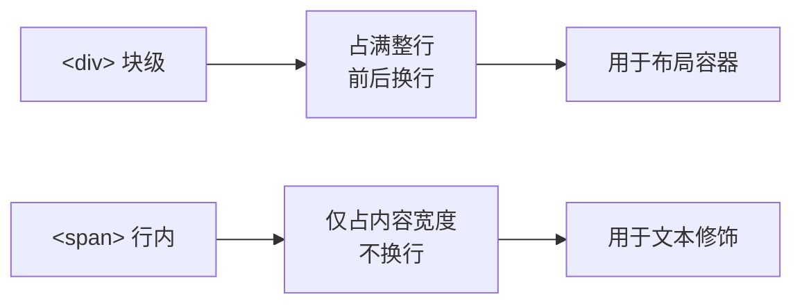

# div和span标签在CSS中的应用

## 为什么需要这两个标签？

在网页布局中，我们常常需要将一组相关的内容包裹起来统一设置样式，或者对文本中的某个片段进行精准修饰。如果直接对整段 `<p>` 或整个 `<body>` 应用样式，粒度太粗；如果为每个字都套一个标签，又太繁琐。

这就需要两个专门用于“划分区块”的标签：==`<div>` 和 `<span>` 本身没有任何语义，它们的唯一作用就是作为 CSS 样式的载体。==

## 块级与行内：核心区别

两者的本质差异在于默认的显示模式：

| 特性 | `<div>` | `<span>` |
|------|---------|----------|
| 显示类型 | 块级元素（block） | 行内元素（inline） |
| 默认宽度 | 占满父容器整个宽度 | 由内容撑开 |
| 前后是否换行 | 前后自动换行 | 不换行，与其他行内元素同行 |
| 典型用途 | 划分页面大区块、布局容器 | 标记文本片段、小范围样式 |



>[!IMPORTANT]
> `<div>` 是==块级元素==，默认在新行开始并占据整行宽度；`<span>` 是==行内元素==，只占据内容所需空间，不会打断文本流。这是它们最根本的区别。

## 怎么用？

**`<div>` 的典型场景：** 将一个页面区域（可能包含标题、段落、图片等多个元素）包裹起来，统一应用背景色、边框、内边距等样式。

```html
<div class="card">
    <h2>新闻标题</h2>
    <p>这是一条新闻的摘要内容……</p>
</div>
```

```css
.card {
    background-color: #f0f0f0;
    border: 1px solid #ccc;
    padding: 20px;
    margin-bottom: 15px;
}
```

**`<span>` 的典型场景：** 对段落中的某个词或短语进行高亮、变色等精细化控制。

```html
<p>点击<span class="highlight">这里</span>了解更多信息。</p>
```

```css
.highlight {
    color: red;
    font-weight: bold;
}
```

## 常见陷阱：给行内元素设宽高

>[!WARNING]
> 新手最常犯的错误：直接给 `<span>` 设置 `width` 和 `height`，发现无效。

原因在于，==行内元素的 `width` 和 `height` 属性默认是不生效的==，其尺寸完全由内容决定。如果需要让 `<span>` 具备块级元素的尺寸特性，应该使用 `display: inline-block;` 或 `display: block;`。

```css
/* 错误示范：span 的宽高不会生效 */
.bad-button {
    width: 100px;
    height: 40px;
}

/* 正确做法：先改变 display 类型 */
.good-button {
    display: inline-block;  /* 既保持行内排列，又能设宽高 */
    width: 100px;
    height: 40px;
}
```

## 一道真题演练

题目要求使用 `vertical-align` 实现图片与文本的垂直居中对齐。我们拆解一下思路：

1. 图片和文本需要在同一行，用 `<span>` 包裹文本，保持行内排列。
2. 外层用 `<div>` 作为容器，统一控制边距和边框。
3. 对图片和文本的 `<span>` 都设置 `vertical-align: middle;`，实现垂直居中。

```html
<div class="container">
    
    <span class="aligned-text">此文本需与图片垂直对齐</span>
</div>
```

```css
.container {
    display: inline-block;
    border: 1px solid #ccc;
    padding: 10px;
}

.aligned-image {
    vertical-align: middle;
    height: 50px;
    width: 50px;
}

.aligned-text {
    vertical-align: middle;
    font-size: 16px;
}
```

>[!TIP]
> `vertical-align` 只对==行内元素和表格单元格==生效。如果发现设了没反应，先检查目标元素是否为 `inline`、`inline-block` 或 `table-cell`。本例中 `<span>` 默认就是行内元素，恰好适用。

## 灵活切换：display 属性

`<div>` 和 `<span>` 的块级/行内身份并非不可改变。通过 `display` 属性，可以自由切换：

- `display: block;` — 让 `<span>` 表现得像 `<div>`，占满整行。
- `display: inline;` — 让 `<div>` 表现得像 `<span>`，融入文本流。
- `display: inline-block;` — 对外像行内元素（不换行），对内像块级元素（可设宽高），是布局利器。

==理解 `<div>` 和 `<span>` 的本质是“无意义的样式钩子”，才能灵活驾驭它们。== 语义化 HTML 中，它们应该在有语义标签（如 `<article>`、`<nav>`、`<strong>`）不适用时才使用。
