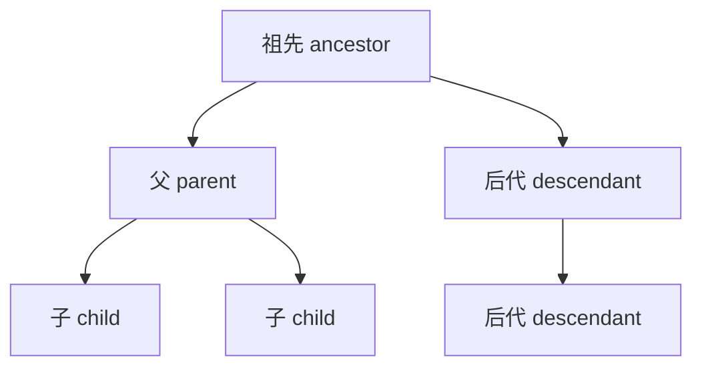

# CSS简介与作用

## CSS 简介与作用

如果 HTML 负责网页的“骨架”与内容结构，那么什么负责网页的“皮肤”与视觉呈现？为什么我们不直接在每个标签里写样式，而是要单独使用 CSS？

> [!IMPORTANT]
> ==CSS（Cascading Style Sheets）的核心价值在于“表现与结构分离”。== 它允许开发者集中管理样式规则，使同一份 HTML 在不同场景下呈现不同外观，同时大幅提升代码的可维护性与复用性。

### 为什么需要层叠样式表

在早期 Web 开发中，样式常以内联（inline）方式写在标签属性里。这种方式有两个致命缺陷：一是修改全局样式需逐个标签调整；二是 HTML 文件臃肿，语义被视觉代码污染。CSS 通过外部或文档级样式表解决了这些问题。

对比三种样式引入方式的优劣：

| 方式 | 作用域 | 可维护性 | 适用场景 |
| :--- | :--- | :--- | :--- |
| Inline | 单个元素 | 极差 | 临时调试/邮件模板 |
| Document-level | 当前页面 | 中等 | 单页特殊样式 |
| External | 多页面共享 | ==最佳== | 生产环境标准做法 |

> [!TIP]
> Review Questions 3.1 考点：文档级样式表优于内联样式的关键在于==批量控制与结构解耦==，而非单纯的“好看”。

### 选择器：精准定位目标元素

CSS 规则由“选择器 + 声明块”组成。如何准确选中想要的元素？这需要理解选择器的层级关系。



> [!WARNING]
> `ol ul` 与 `ol > ul` 是高频易混点。前者是==后代选择器==，匹配 `ol` 内任意层级的 `ul`；后者是==子代选择器==，仅匹配直接子级。嵌套列表排版错误多源于此混淆。

类选择器（class selector）则提供了跨元素的样式复用能力。无论标签类型如何，只要拥有相同 class 名，即可应用同一组规则。这正是 Review Questions 3.8 所强调的：==类选择器的目的是实现样式的通用化与模块化==。

### 单位选择：相对 vs 绝对

设置字体大小时，用 `pt` 还是 `em`？这不仅是审美问题，更是可访问性问题。

-   **pt（磅）**：绝对单位，印刷时代遗留，屏幕渲染不随用户设置缩放。
-   **em**：==相对单位==，基于当前元素或父元素字体大小计算，天然适配响应式与无障碍需求。

> [!CAUTION]
> 在高 DPI 设备或用户放大浏览器字号时，`pt` 可能导致文字过小无法阅读。==生产环境中正文排版应优先使用 em/rem==。

### 实战验证：从代码到效果

以简答题 7 为例，若要求显示“This is my first web page!”并设置特定样式，正确写法需同时满足结构与表现分离：

```html
<p class="intro">This is my first web page!</p>
```

```css
.intro {
  font-size: 1.2em;
  color: #333;
}
```

> [!NOTE]
> 注意术语对应：child（子元素）、descendant（后代元素）、inherit（继承）、pseudo（伪类/伪元素）。这些词汇在双语考试与英文文档中频繁出现，务必准确掌握其含义与拼写。
