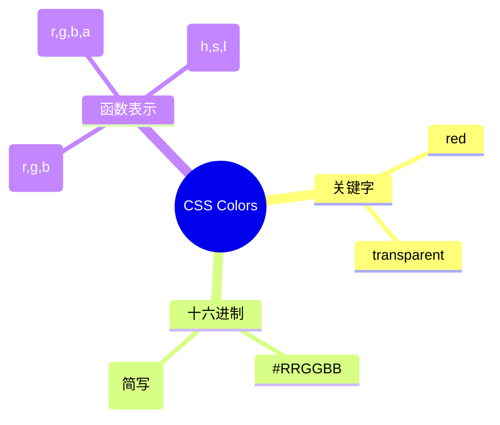

# CSS属性：颜色（Colors）

## CSS 颜色表示法

在 Web 页面设计中，颜色不仅是视觉元素，更是信息层级的重要载体。CSS 提供了多种方式来定义颜色，理解它们的底层逻辑有助于写出更规范、易维护的代码。你是否想过，为什么有时候设计师给的十六进制代码 `#FF0000` 和直接写 `red` 效果一样，但我们在工程中却更倾向于前者？

CSS 颜色主要通过以下三种方式定义：

1.  **关键字（Keywords）**：如 `red`, `blue`, `transparent`。
2.  **十六进制（Hexadecimal）**：如 `#FF0000`, `#F00`。
3.  **RGB/RGBA 函数**：如 `rgb(255, 0, 0)`, `rgba(255, 0, 0, 0.5)`。

> [!IMPORTANT]
> ==核心结论==：现代 Web 开发中，**Hex** 和 **RGB/RGBA** 是最常用的两种方式，因为它们能精确控制色彩值，且支持透明度（Alpha 通道）。

## 各种表示法的对比与转换

为了直观理解不同表示法的区别，请看下表：

| 表示法 | 示例 | 特点 | 适用场景 |
| :--- | :--- | :--- | :--- |
| 关键字 | `red` | 易读，但颜色有限 | 快速原型、默认样式 |
| Hex | `#FF0000` | 紧凑，兼容性好 | 通用设计稿还原 |
| RGB | `rgb(255,0,0)` | 直观对应光强 | 动态计算颜色 |
| RGBA | `rgba(255,0,0,0.5)` | 支持透明度 | 遮罩层、半透明效果 |

> [!TIP]
> **简写技巧**：当十六进制颜色每两位相同时，可以简写。例如 `#FF00AA` 可简写为 `#F0A`，但 `#FF00AB` 不能简写。

## 常见误区与“坑”

在实际编码中，学生常犯以下错误：

1.  **忘记井号**：写 `color: FF0000;` 是无效的，必须是 `#FF0000`。
2.  **透明度混淆**：`opacity` 属性会影响整个元素及其子元素的透明度，而 `rgba` 中的 `a` 仅影响当前背景或文字颜色，不影响子元素。
3.  **大小写敏感**：CSS 颜色关键字和 Hex 值**不区分大小写**，`#ff0000` 和 `#FF0000` 等价。

> [!WARNING]
> **高危误区**：不要在需要半透明背景时使用 `opacity`，这会导致内部文字也变淡，难以阅读。应优先使用 `background-color: rgba(...)`。

## 典型例题解析

**题目**：若要将一个 `div` 的背景色设置为红色，且不透明度为 50%，以下哪种写法是正确的？

A. `background-color: #FF0000; opacity: 0.5;`
B. `background-color: rgba(255, 0, 0, 0.5);`
C. `background-color: rgb(255, 0, 0, 0.5);`
D. `background-color: #FF000080;` (假设浏览器不支持八位 Hex)

**解析**：
*   A 选项：虽然视觉效果可能相似，但 `opacity` 会使 `div` 内的所有子元素也变为半透明，不符合“仅背景半透明”的隐含最佳实践。
*   B 选项：==正确==。`rgba` 专门用于定义带透明度的颜色，只影响背景色本身。
*   C 选项：错误。`rgb()` 函数只接受三个参数，第四个参数会被忽略或导致语法错误（取决于浏览器严格模式），应使用 `rgba()` 或现代 `rgb()` 语法。
*   D 选项：依赖浏览器对 8 位 Hex 的支持，兼容性不如 B。

因此，最标准且兼容性最好的答案是 **B**。
