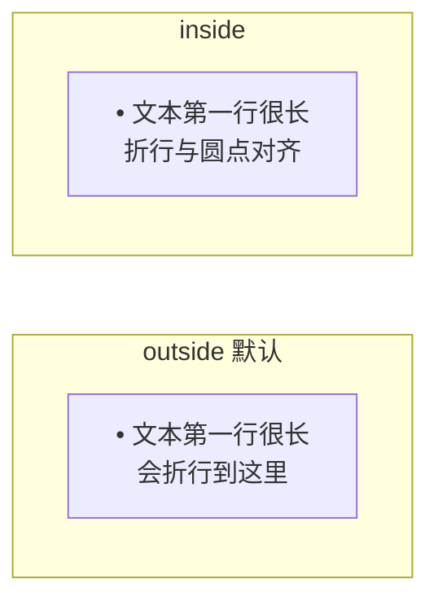

# CSS属性：列表属性（List properties）

## 列表属性：从 HTML 列表到 CSS 精修

先看一个常见场景：你在 HTML 里写了 `<ul>` 和 `<li>`，浏览器确实渲染出了圆点列表，但圆点离文字太远、项目之间挤在一起、想要小方块而不是圆点——这些“外观问题”HTML 本身解决不了。==列表属性（List properties）就是 CSS 中专门控制列表项标记样式与位置的一组属性==。

在课件中，列表属性对应 CSS 属性分类中的 **3.7 List properties**，核心有四个：

| 属性 | 作用 | 常用取值 |
|---|---|---|
| `list-style-type` | 设置列表项标记的类型 | `disc` `circle` `square` `decimal` `lower-alpha` `upper-roman` `none` |
| `list-style-image` | 用图片替代默认标记 | `url("...")` `none` |
| `list-style-position` | 标记在内容框内还是外 | `outside`（默认）`inside` |
| `list-style` | 简写属性 | 上述三者任意组合 |

> [!IMPORTANT]
> `list-style-type` 同时适用于无序列表（`disc`/`circle`/`square`）和有序列表（`decimal`/`lower-alpha`/`upper-roman`），它不改变 HTML 的 `<ul>` 或 `<ol>` 语义，只改变视觉标记。

### 为什么需要它

HTML 的 `<ul>` 默认圆点、`<ol>` 默认阿拉伯数字，但实际需求千差万别：导航栏要去掉圆点（`list-style-type: none`），步骤说明可能要用大写罗马数字，文章中的引用列表可能需要自定义小图标。如果每次都在 HTML 里塞 `` 或手动编号，既冗余又难以统一修改。CSS 列表属性将“结构”与“外观”分离，修改样式只需动样式表。

### `list-style-position` 的坑

```css
li { list-style-position: inside; }
```

标记会“嵌入”到文本内容的第一行内，文本换行时第二行会与标记左对齐；而默认的 `outside` 让标记悬在内容框外，文本换行时与第一行文字左对齐。两者视觉差异明显：



### 常见的坑

- **给 `<ul>` 设置 `list-style` 不会继承到所有场景**：实际上 `list-style` 属性是可继承的，但在某些 CSS Reset（如 `ul { list-style: none; }`）之后，若想恢复标记需显式声明。
- **忘了清除默认内边距**：默认 `<ul>` 有 `padding-left`（通常 40px），即使 `list-style-type: none` 之后，列表仍有缩进。做导航栏时通常要同时设置 `list-style: none; padding: 0; margin: 0;`。
- **`list-style-image` 不可控大小**：图片标记无法用 CSS 直接调整尺寸，若需要精确控制图标大小，更推荐用 `list-style: none` 配合 `li::before` 伪元素。

> [!TIP]
> 记忆口诀：“type 定样式，image 换图标，position 控里外，简写一个全搞定。”

### 一个算对了的例子

题目要求：将 `<ul>` 的标记改为小方块，去掉默认缩进，标记位于文本内部。

```css
ul {
    list-style-type: square;
    list-style-position: inside;
    padding-left: 0;
    margin-left: 0;
}
```

HTML 结构不变：

```html
<ul>
    <li>Web 技术</li>
    <li>JavaScript</li>
</ul>
```

渲染效果：每个 `<li>` 前方显示 `▪` 小方块，且方块紧贴文字（inside 效果），列表整体不再有左侧默认缩进。若用简写，可等价写为：

```css
ul {
    list-style: square inside;
    padding-left: 0;
    margin-left: 0;
}
```

> [!NOTE]
> 课件中 `list-style` 简写的书写顺序无严格要求，但 `type` 和 `position` 同时出现时，浏览器能正确解析；若省略某一项，则使用其默认值。
