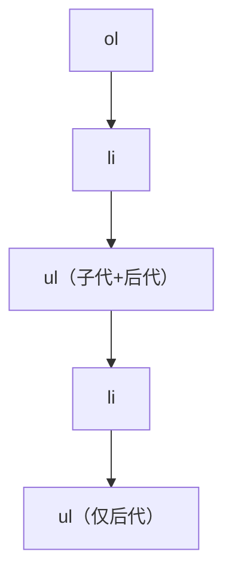

# 选择器形式（简单选择器、类选择器Class、通用选择器Generic、id选择器、上下文选择器Contextual、伪类Pseudo class、通配符Universal）

CSS 选择器是样式规则与 HTML 元素之间的“桥梁”。如果连目标元素都选不中，再精美的样式也无法生效。面对一个复杂的页面，我们该如何精准定位到特定元素，同时避免误伤其他内容？

## 选择器的核心形式

> [!IMPORTANT]
> ==选择器决定了样式的生效范围==。掌握不同选择器的语法与适用场景，是编写可维护 CSS 的前提。

| 选择器类型 | 语法示例 | 作用与特点 |
| :--- | :--- | :--- |
| 简单/标签选择器 | `p { }` | 选中所有指定标签，作用范围广 |
| 类选择器 (Class) | `.specials { }` | 以 `.` 开头，可复用于多个元素 |
| ID 选择器 | `#footer { }` | 以 `#` 开头，页面内唯一，优先级高 |
| 通用选择器 | `* { }` | 选中所有元素，常用于重置样式 |
| 上下文选择器 | `ol ul { }` | 基于 DOM 树层级关系定位元素 |
| 伪类 (Pseudo) | `a:hover { }` | 基于状态而非结构触发样式 |

课件特别强调 ==Generic Class（通用类）== 的概念：当同一样式需应用于多种不同标签时，应定义一个以点号开头的类名（如 `.highlight`），并通过 HTML 的 `class` 属性绑定。这避免了为每个标签重复书写相同规则。

## 上下文选择器的关键辨析

`ol ul` 和 `ol > ul` 看起来相似，但匹配逻辑完全不同。前者是 ==后代选择器（Descendant）==，匹配 `ol` 内部任意层级的 `ul`；后者是 ==子代选择器（Child）==，仅匹配 `ol` 的直接子级 `ul`。



> [!WARNING]
> 混淆后代与子代选择器是常见错误。若页面嵌套较深，`ol ul` 可能意外选中深层嵌套列表，而 `ol > ul` 能精确控制只作用于第一层。

## 复合选择器与优先级

当多个选择器组合使用时，需理解其匹配含义。例如真题中的三个选择器：

-   `p.specials`：选中 ==同时具有== `specials` 类的 `<p>` 元素
-   `p#footer`：选中 id 为 `footer` 的 `<p>` 元素
-   `p.featured.new`：选中 ==同时拥有== `featured` 和 `new` 两个类的 `<p>` 元素

> [!TIP]
> 多个类选择器连写（如 `.featured.new`）表示“且”关系，中间不能有空格。若写成 `.featured .new` 则变为后代关系，含义完全不同。

在优先级冲突时，ID 选择器权重 $(0,1,0,0)$ 远高于通用选择器 $(0,0,0,0)$。因此 `#footer { color: red }` 永远覆盖 `* { color: blue }`。

## 伪类：基于状态的样式

伪类不是选择“存在的元素”，而是选择“==处于某种状态的元素==”。`:hover` 在鼠标悬停时生效，`:focus` 在元素获得焦点时生效。这与 JavaScript 中 Window 对象作为默认对象的机制类似——状态由运行时环境动态赋予，而非静态写在 HTML 中。

> [!NOTE]
> 伪类使 CSS 具备交互能力，无需 JavaScript 即可实现按钮悬停变色、表单聚焦高亮等效果，是双语课程中"Pseudo class"的核心考点。

## 实战验证

结合 Exercise 3.1 的要求，以下代码展示了如何用外部样式表呈现教材二级目录：

```html
<!DOCTYPE html>
<html lang="zh">
<head>
  <meta charset="UTF-8">
  <title>教材目录</title>
  <link rel="stylesheet" href="toc.css">
</head>
<body>
  <h2 id="toc-title">第3章 层叠样式表</h2>
  <ol class="chapter-list">
    <li>3.4 选择器
      <ul>
        <li>3.4.2 Class Selectors</li>
        <li>3.4.6 Pseudo Class</li>
      </ul>
    </li>
  </ol>
</body>
</html>
```

```css
/* toc.css */
#toc-title { color: #003366; }       /* ID选择器 */
.chapter-list { font-family: Arial; } /* 类选择器 */
.chapter-list > li { font-weight: bold; } /* 子代选择器 */
.chapter-list ul li { font-weight: normal; color: #555; } /* 后代选择器 */
li:hover { background: #f0f8ff; }     /* 伪类 */
```

此例综合运用了 ID、类、子代、后代及伪类选择器，且 `>` 确保加粗仅作用于一级条目，验证了上下文选择器的精确控制能力。
