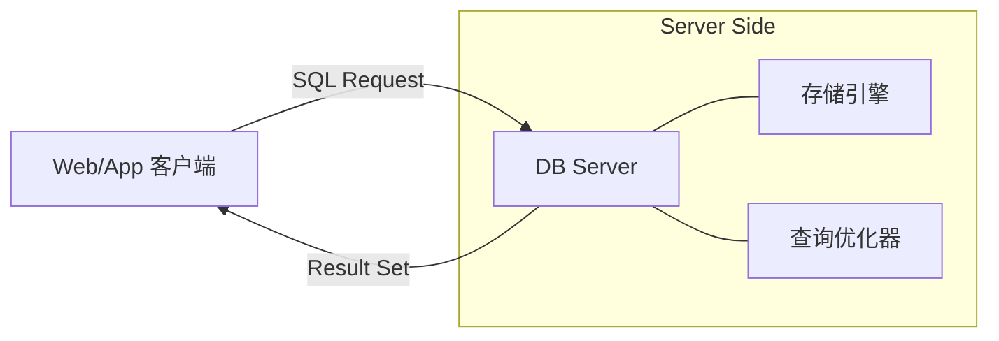
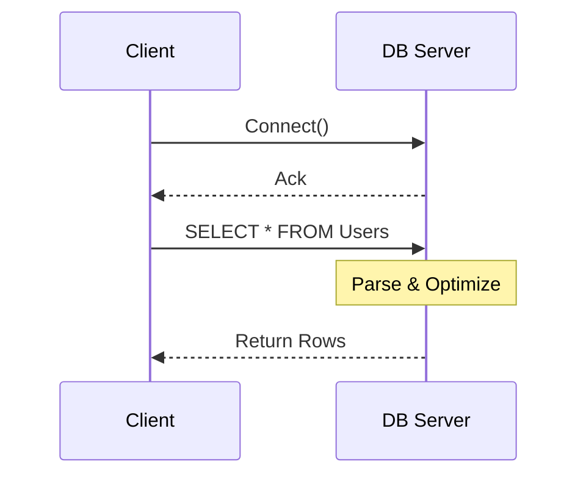

# 客户机/服务器数据库体系结构（C/S Architecture，含Access架构对比）

# 客户机/服务器数据库体系结构（C/S Architecture）

在 Web 技术中，如何高效、安全地访问数据是核心问题。==C/S 架构将数据处理逻辑从客户端剥离，交由专门的数据库服务器执行==，这是现代企业级应用的基础。

## 什么是 C/S 数据库架构？

传统单机应用中，应用程序直接操作本地文件（如 Access `.mdb`）。而在 C/S 架构中，系统被划分为两个角色：
*   **Client（客户机）**：负责用户界面展示和业务逻辑，发送 SQL 请求。
*   **Server（服务器）**：负责数据存储、查询优化、事务管理和并发控制。

> [!IMPORTANT]
> 核心特征：**胖客户端/瘦服务器**或**瘦客户端/胖服务器**取决于逻辑分布，但关键在于==网络传输的是 SQL 指令和结果集，而非原始数据文件==。

## 为什么需要 C/S 而非 Access 架构？

许多初学者混淆“使用 Access 软件”与“Access 架构”。Access 通常代表**文件共享架构（File-Server Architecture）**，而 C/S 是真正的数据库服务架构。二者对比如下：

| 特性 | Access (文件共享) | C/S (如 MySQL/Oracle) |
| :--- | :--- | :--- |
| **数据传输** | 传输整个数据文件块 | 仅传输 SQL 和结果集 |
| **并发控制** | 弱，易冲突 | 强，支持锁机制 |
| **安全性** | 依赖文件系统权限 | 细粒度用户/角色权限 |
| **性能瓶颈** | 网络带宽（传大量数据） | CPU/内存（服务端计算） |

> [!WARNING]
> 常见误区：认为 Access 只能做单机。实际上 Access 可作为前端连接后端 SQL Server，此时它充当 Client 角色，但纯 Access 文件共享模式不属于标准 C/S 数据库架构。

## 工作流程与关键交互

1.  **连接建立**：客户端通过驱动程序（如 ODBC/JDBC）与服务器建立会话。
2.  **请求发送**：客户端发送结构化查询语言（SQL）。
3.  **处理执行**：服务器解析、优化并执行查询。
4.  **结果返回**：服务器将精简后的结果集返回给客户端。

## 典型例题解析

**题目**：在 C/S 数据库架构中，当客户端执行 `SELECT * FROM Orders WHERE amount > 1000` 时，网络上传输的主要内容是什么？

A. 整个 Orders 表的数据文件
B. SQL 语句字符串和满足条件的记录
C. 数据库索引文件
D. 应用程序的二进制代码

**解析**：
*   **排除 A**：这是文件共享架构（如早期 Access）的做法，效率极低。
*   **排除 C/D**：索引和代码不直接在应用层网络传输。
*   **选中 B**：==C/S 的核心优势在于“移动计算而非移动数据”==。客户端发送轻量级的 SQL 文本，服务器筛选后仅返回少量符合条件的记录（Result Set），极大降低了网络负载。

> [!TIP]
> 记忆口诀：**C/S 传指令，文件传数据**。考试中看到“减少网络流量”、“提高并发”，优先选 C/S 架构相关选项。
