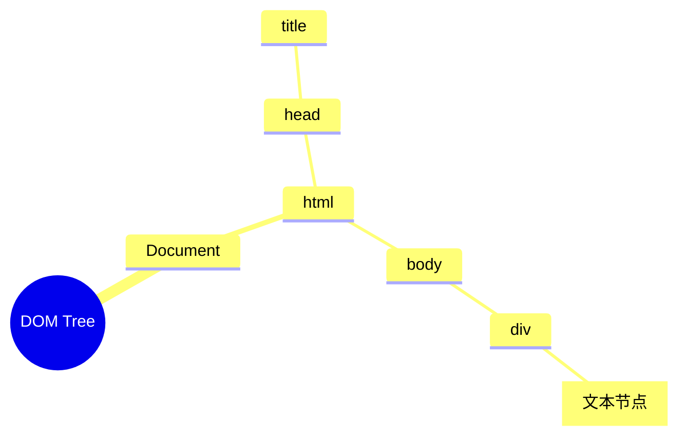

# 文档对象模型（DOM）概念与结构

## DOM 是什么与为什么需要

如果 JavaScript 只能做数学运算，网页如何响应点击、修改文字？我们需要一个“翻译官”将 HTML 文档转化为 JS 可操作的对象。==DOM（Document Object Model）正是这个 API==，它定义了 HTML 文档与应用程序之间的接口。

> [!IMPORTANT]
> DOM 不是 HTML 源码本身，而是浏览器在内存中构建的==抽象树形模型==。JS 通过此模型跨浏览器统一地创建、遍历、修改或删除元素及其内容。



## 元素与属性的 JS 绑定

HTML 标签在 DOM 中如何被 JS 识别？这是考试高频点。

> [!IMPORTANT]
> ==HTML elements are represented as objects, and their attributes are represented as properties of those objects.==

例如 `` 在 DOM 中是一个 `HTMLImageElement` 对象，其 `id` 和 `src` 直接映射为该对象的属性：

```javascript
const img = document.getElementById('logo');
console.log(img.src);       // 属性访问
console.log(typeof img);    // "object"
```

[!NOTE]
HTML 属性（attribute）是字符串标记；DOM 属性（property）是 JS 对象字段。二者通常同步，但 `value`、`checked` 等表单属性可能不同步，调试时以 property 为准。

## DOM 0 事件绑定的两种方式

如何让特定元素响应事件？在 DOM 0 模型中有两种等价写法：

| 方式 | 语法示例 | 特点 |
| :--- | :--- | :--- |
| JS 赋值 | `element.onclick = fn` | 结构与行为分离，推荐 |
| HTML 属性 | `<button onclick="fn()">` | 内联耦合，仅适合演示 |

> [!TIP]
> 简答题 5.6 标准答案即上述两行。记住关键词：==assign to on-property== 与 ==specify in HTML attribute==。

[!WARNING]
DOM 0 的 `on*` 属性同一时刻只能绑定==一个==处理函数，后赋值的会覆盖前者。若需多监听器，应使用 DOM 2 的 `addEventListener`。

## 常见误区与正确示例

很多初学者混淆“HTML 源码”与“DOM 树”，或误以为修改 `innerHTML` 就是修改了原始文件。

> [!CAUTION]
> DOM 操作只影响==内存中的实时文档==，刷新页面即恢复原状。永久修改需后端配合或本地存储。

下面是一个完整且正确的 DOM 0 事件绑定示例，对应简答 5.6 的第一种方式：

```html
<button id="btn">Click Me</button>
<script>
  // 获取元素对象
  const btn = document.getElementById('btn');
  // 定义处理函数
  function handleClick() {
    alert('Button clicked!');
  }
  // DOM 0: assign handler to on-property
  btn.onclick = handleClick;
</script>
```

该代码验证了：元素是对象（`btn`），事件处理器通过 `onclick` 属性绑定，完全符合课件对 DOM 0 模型的描述。掌握这一范式，即可顺利过渡到后续 DOM 2/3 事件机制的学习。
