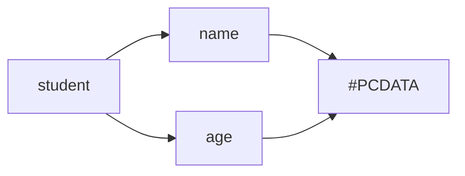

# 文档类型定义DTD（声明元素Declaring Elements、声明属性Declaring Attributes）

## 它是什么：DTD 是 XML 的"语法规则书"

XML 允许我们自定义标签，但自定义一旦不约束，每个人写出来的文档都长不一样，程序解析起来就像拆一盒没说明书的乐高。**DTD（Document Type Definition，文档类型定义）** 就是这份说明书：它在 XML 文档开头（或外链）声明==这个 XML 允许出现哪些元素、元素嵌套顺序如何、每个元素带哪些属性、属性取什么值==。XML 解析器先拿 DTD 校验文档，合法才继续处理。

一条 DTD 声明写在 `<!DOCTYPE 根元素 [...]>` 的方括号内：

```xml
<!DOCTYPE student [
  <!ELEMENT student (name, age)>
  <!ELEMENT name (#PCDATA)>
  <!ELEMENT age (#PCDATA)>
  <!ATTLIST student id CDATA #REQUIRED>
]>
```

## 为什么要用它：一致性 + 可校验

- **跨组织交换数据**：双方约定同一份 DTD，收发端结构一致。
- **早期校验**：解析器可以在不写业务代码的前提下报告"结构非法"。
- **文档即契约**：DTD 本身就是接口规范，别人看 DTD 就知道该传什么。

> [!NOTE]
> 现代 Web 中 XSD（XML Schema）功能更强（支持数据类型、命名空间），但 DTD 概念简单、仍是考试与老系统中的重点，==XSD 不能完全取代 DTD 的教学地位==。

## Declaring Elements（声明元素）

语法：`<!ELEMENT 元素名 内容模型>`，**元素名区分大小写**，且必须与文档中使用的完全一致。

常见内容模型：

| 写法 | 含义 |
| --- | --- |
| `(#PCDATA)` | 只含纯文本（Parsed Character Data） |
| `(A,B)` | 子元素 A 后紧跟 B，顺序固定 |
| `(A\|B)` | A 或 B 二选一 |
| `(A*)` | A 出现 0 次或多次 |
| `(A+)` | A 出现 1 次或多次 |
| `(A?)` | A 出现 0 次或 1 次 |
| `EMPTY` | 空元素（如 `<br/>`） |
| `ANY` | 任意内容（**尽量别用**，等于放弃校验） |



## Declaring Attributes（声明属性）

语法：`<!ATTLIST 元素名 属性名 类型 默认值>`。

常见类型：`CDATA`（字符数据）、`(枚举值1|枚举值2)`、`ID`（唯一标识）、`IDREF`（引用另一 ID）、`NMTOKEN` 等。

常见默认值：`#REQUIRED`（必须提供）、`#IMPLIED`（可省略）、`#FIXED "值"`（固定值，不可改）、`"默认值"`（不写则用它）。

> [!IMPORTANT]
> ==属性必须有值，且值必须用引号括起来==（单引号或双引号均可，但不能省略）。这是课件里明确强调的一条。

```xml
<!ATTLIST student
  id     ID      #REQUIRED
  grade  (fresh|soph|jun|sen) "fresh"
  note   CDATA   #IMPLIED>
```

## 与相近概念的区别

| | DTD | XSD (XML Schema) |
| --- | --- | --- |
| 语法 | 自有记号 `<!ELEMENT>` | 基于 XML 本身 |
| 数据类型 | 只有 `CDATA` 等弱类型 | 有 int、date 等强类型 |
| 命名空间 | 不支持 | 支持 |
| 表达能力 | 较弱（无继承、无键约束） | 强 |
| 复杂度 | 简单 | 复杂 |

## 常见的坑

> [!WARNING]
> - 元素声明中 ==`(A,B)` 是顺序敏感==的；写 `(A|B)` 才是二选一，别混。
> - `#PCDATA` 前的 `#` 不能漏；`(A)*` 的 `*` 必须放在括号**外**才有"重复整个组"的含义，`(A*)` 表示组内 A 可重复。
> - `<!ATTLIST>` 里默认值 `"fresh"` 不加 `#`，而 `#REQUIRED/#IMPLIED/#FIXED` 必须加 `#`。
> - DTD 中**没有**命名空间，写 `xmlns:x` 之类的属性不会被识别。

> [!TIP]
> 记忆口诀：**元素管结构，属性管元数据**。`ATTLIST` 里 "ATTL" 像 "attribute list" 的缩写。

## 一个做对了的例子

文档：

```xml
<student id="s1" grade="jun">
  <name>Zhang San</name>
  <age>20</age>
</student>
```

DTD：

```xml
<!ELEMENT student (name, age)>
<!ELEMENT name (#PCDATA)>
<!ELEMENT age  (#PCDATA)>
<!ATTLIST student
  id    ID                         #REQUIRED
  grade (fresh|soph|jun|sen)      "fresh">
```

校验：`student` 子元素顺序 `(name, age)` ✔；`name`、`age` 内为文本 ✔；`id="s1"` 是合法 `ID` ✔；`grade="jun"` 在枚举内 ✔。→ 文档合法。

若把 `<age>` 写在 `<name>` 之前，DTD 判定 ==顺序违规==，校验失败——这正是 DTD 提供的结构保障。
