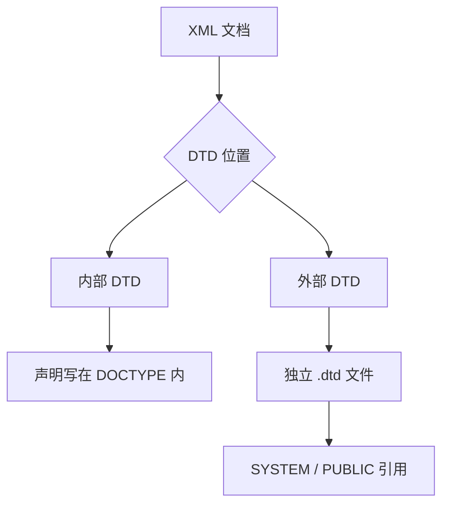

# DTD实体声明（Declaring Entities）、示例及内部与外部DTD（Internal and External DTDs）

## DTD 实体声明与内部/外部 DTD

### 什么是实体（Entity）

XML 文档中有些内容会反复出现，或者包含不能直接书写的特殊字符。实体（entity）就是一段**可以反复引用的文本缩写**，用 `&实体名;` 的形式在文档中引用。它类似于 C 语言里的宏定义或常量。

> [!IMPORTANT]
> 实体的核心价值：**定义一次，多处引用**。既避免重复输入，又保证全文一致；同时解决了 `<`、`&` 等特殊字符不能直接出现在元素内容中的问题。

### 三类常用实体

课件中明确提到三类常用实体（three commonly used entities）：

| 实体类型 | 声明位置 | 引用方式 | 典型用途 |
|---|---|---|---|
| 一般实体（general entity） | DTD 内部 | `&name;` | 文档内容中的可复用文本片段 |
| 参数实体（parameter entity） | DTD 内部 | `%name;` | 在 DTD 内部复用声明片段 |
| 外部文本实体（external text entity） | 独立文件 | `&name;` | 引用外部文件中的大段文本 |

一般实体声明的基本语法：

```xml
<!ENTITY entity-name "replacement text">
```

引用时在 XML 正文中写 `&entity-name;`，解析器会用 replacement text 替换它。

### 为什么需要实体

思考一个问题：如果一份二手车清单（used cars with color and price）要在多个段落中重复出现，每次都手写一遍，会发生什么？

- 内容冗余，维护困难；
- 特殊字符如 `<`、`&` 直接写会触发解析错误；
- 修改时需要全文搜索替换，极易遗漏。

实体恰好同时解决这三个问题。

### 声明与引用示例

下面是一份完整的内部 DTD 示例，同时展示元素声明、属性声明和实体声明：

```xml
<?xml version="1.0" encoding="UTF-8"?>
<!DOCTYPE cars [
  <!-- 元素声明 -->
  <!ELEMENT cars (car*)>
  <!ELEMENT car (model, price)>
  <!ELEMENT model (#PCDATA)>
  <!ELEMENT price (#PCDATA)>

  <!-- 属性声明 -->
  <!ATTLIST car color CDATA #IMPLIED>

  <!-- 一般实体声明 -->
  <!ENTITY brand "Nanjing Auto">
  <!ENTITY copy "&#169;">
]>
<cars>
  <car color="red">
    <model>&brand; Sedan</model>
    <price>120000</price>
  </car>
  <car color="blue">
    <model>&brand; SUV</model>
    <price>180000</price>
  </car>
  <note>Copyright &copy; 2024</note>
</cars>
```

解析后，`&brand;` 被替换为 `Nanjing Auto`，`&copy;` 被替换为 `©`。

> [!TIP]
> 记忆口诀：**元素管结构，属性管修饰，实体管复用**。三者分别对应 `ELEMENT`、`ATTLIST`、`ENTITY` 三种声明。

### 内部 DTD 与外部 DTD

DTD 既可以写在 XML 文档内部，也可以放在独立的 `.dtd` 文件中。

**内部 DTD**：用 `<!DOCTYPE root-element [` 开头，`]>` 结尾，声明全部写在方括号内。适合小型、独立的文档。

**外部 DTD**：将声明保存在独立文件中，通过 SYSTEM 或 PUBLIC 标识符引入。适合多份 XML 共享同一套规则。



外部 DTD 的引用语法：

```xml
<!DOCTYPE root-element SYSTEM "planes.dtd">
```

对应的 `planes.dtd` 文件内容示例：

```xml
<!ELEMENT planes (plane*)>
<!ELEMENT plane (model, year)>
<!ATTLIST plane color CDATA #IMPLIED>
<!ENTITY manufacturer "Boeing">
```

而 `planes.xml` 中只需正常引用实体：

```xml
<?xml version="1.0"?>
<!DOCTYPE planes SYSTEM "planes.dtd">
<planes>
  <plane color="white">
    <model>&manufacturer; 737</model>
    <year>2020</year>
  </plane>
</planes>
```

> [!IMPORTANT]
> ==内部 DTD 用 `[ ]` 包裹，外部 DTD 用 SYSTEM/PUBLIC 指向文件==。两者可以共存：外部 DTD 提供基础规则，内部 DTD 中的声明用于补充或覆盖。

### 常见易错点

> [!WARNING]
> - 实体引用必须**以分号结尾**，`&brand` 缺少分号会导致解析失败。
> - 参数实体在 DTD 内用 `%name;` 引用，**不能**在 XML 正文中用 `%` 引用。
> - 外部实体引用外部文件时，路径错误会导致验证失败。
> - 特殊字符 `&lt;`、`&gt;`、`&amp;`、`&apos;`、`&quot;` 是 XML 预定义实体，无需在 DTD 中重复声明。

### 实体与元素、属性的关系

| 声明类型 | 关键字 | 作用 | 示例 |
|---|---|---|---|
| 元素声明 | `ELEMENT` | 定义标签结构与内容类型 | `<!ELEMENT car (model, price)>` |
| 属性声明 | `ATTLIST` | 定义标签可携带的属性及默认值 | `<!ATTLIST car color CDATA #IMPLIED>` |
| 实体声明 | `ENTITY` | 定义可复用的文本片段 | `<!ENTITY brand "Nanjing Auto">` |

三者共同构成 DTD 的完整规则集，确保 XML 文档不仅是 well-formed（格式良好），更是 valid（符合 schema 定义的有效文档）。
