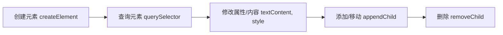

# 动态修改DOM（移动元素、可见性、修改颜色和字体、动态内容、定位鼠标光标、响应鼠标单击）

## 动态修改 DOM（移动元素、可见性、修改颜色和字体、动态内容、定位鼠标光标、响应鼠标单击）

在 Web 技术中，DOM（Document Object Model）是 HTML 文档的编程接口。页面加载后，JavaScript 可以像操作一棵树一样，==动态地查询、修改、添加或删除页面中的任何元素和属性==，无需刷新页面。这是实现现代富交互网页的核心机制。

你可能会问：为什么需要动态修改 DOM？试想一个场景——用户点击按钮后，页面上的某个区域需要显示“操作成功”，字体变为绿色，2 秒后自动消失。如果不修改 DOM，这个交互就无法完成。DOM 操作让页面从“静态快照”变成了“可交互的活文档”。

### 如何访问和移动元素

要修改 DOM，首先需要“拿到”目标节点。最常用的入口是 `document.getElementById()` 和 `document.querySelector()`。

- `document.getElementById("myDiv")` 返回单个元素。
- `document.querySelector(".box")` 使用 CSS 选择器语法，返回第一个匹配的元素。

移动元素的核心在于利用 `appendChild` 或 `insertBefore`。比如，将段落 `p` 移动到容器 `div` 的末尾：

```javascript
let container = document.getElementById("container");
let paragraph = document.getElementById("p1");
container.appendChild(paragraph);
```

`appendChild` 会将节点从原位置“剪切并粘贴”到新父节点下。它并不是复制，而是==移动==，因此同一个节点不会在 DOM 树中出现两次。

核心动作为 `<CRUD>`


### 修改可见性、颜色与字体

元素的样式有两种修改途径，各有适用场景。

- **类切换（推荐）**：在 CSS 中定义 `.hidden { display: none; }`，然后用 `element.classList.toggle("hidden")` 切换。此法代码分离，可维护性强。
- **直接操作 `style` 属性**：`element.style.display = "none"` 会作为行内样式生效，优先级最高，但不易维护。

颜色和字体修改类似：
```javascript
element.style.color = "red";
element.style.fontFamily = "Times New Roman, serif";
```

> [!IMPORTANT]
> 通过 `style` 属性读取的是行内样式。如果样式定义在外部 CSS 文件中，需用 `getComputedStyle(element).color` 才能获取到实际渲染值。

### 动态内容、光标定位与鼠标事件

`element.innerHTML` 可以整体替换子节点，但当心：
```javascript
element.innerHTML += "<p>新段落</p>"; // 要求浏览器重建内部所有节点，清空已有事件绑定
```
更安全的增量更新是用 `insertAdjacentHTML` 或先 `createElement` 再 `appendChild`，以保护已有的事件处理程序。

定位鼠标光标的常见需求是获取可视区域的坐标，`mousemove` 事件的 `clientX` 和 `clientY` 属性以视口左上角为原点：
```javascript
document.addEventListener("mousemove", (e) => {
    console.log(e.clientX, e.clientY);  // 相对于视口
});
```

响应鼠标单击时，最推荐 `addEventListener("click", handler)`。若需对动态生成的元素绑定，可使用事件委托：
```javascript
document.getElementById("list").addEventListener("click", (e) => {
    if (e.target.tagName === "LI") { /* 处理 li 单击 */ }
});
```

> [!WARNING]
> `onclick` 属性只能绑定一个处理函数，重复赋值会覆盖。`addEventListener` 允许多个处理函数叠加，且支持精细的捕获/冒泡控制。

### 一个完整的例子

**需求**：单击“加入购物车”按钮，将商品条目 `<li>苹果</li>` 移动到#cart，同时条目显示为红色，3 秒后变绿。

**初始 HTML**：
```html
<ul id="products"><li id="apple">苹果</li></ul>
<ul id="cart"></ul>
<button id="btn">加入购物车</button>
```

**脚本**：
```javascript
let btn = document.getElementById("btn");
btn.addEventListener("click", () => {
    let apple = document.getElementById("apple");
    let cart = document.getElementById("cart");
    cart.appendChild(apple);
    apple.style.color = "red";
    setTimeout(() => { apple.style.color = "green"; }, 3000);
});
```

**走查**：
1. 首次单击后，#cart 包含 `<li id="apple" style="color: red;">苹果</li>`，原#products 容器空。
2. 字体红色在 3 秒后变为绿色。
3. 若多次单击，第二次起 `document.getElementById("apple")` 依然有效（DOM 节点已移动到 #cart），颜色重置为红，再变绿。

### 常见陷阱

| 陷阱 | 解释 |
|------|------|
| `innerHTML` 累加 `+=` | 清空并重建所有内部节点，导致事件绑定丢失和性能浪费 |
| `style` 直接读值语义不一致 | 读不回外部 CSS 的样式，需 `getComputedStyle` |
| 错过元素为 null | 脚本在 `<head>` 中执行时 DOM 未构建完毕，应使用 `DOMContentLoaded` 或将脚本放在 `</body>` 前 |
| `parent.removeChild(child)` 需父元素 | IE 早期不适配 `child.remove()`，兼容性场景注意 |

> [!TIP]
> 尽量使用 CSS 类来管理视觉变化，让样式逻辑留在 CSS 文件，JavaScript 只负责切换状态，代码会更清晰。
