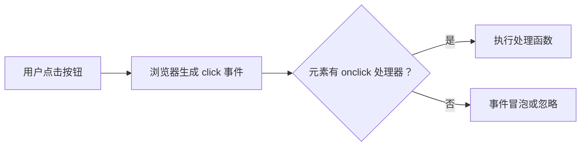

# 事件与事件处理（Events、Attributes、Tags、注册处理程序Registering a Handler及方法比较）

## 事件与事件处理

先从一个问题开始：浏览器怎么知道用户何时点击了按钮？答案在于**事件**——事件代表环境中发生的活动，例如鼠标移动、文档加载完成、按键按下等。JavaScript 正是通过监听这些事件来让页面“活起来”的。

### 事件、属性与标签

在 DOM 0 事件模型中，HTML 元素的属性会变成对应对象的命名属性。例如一个 `<input type="button" id="btn">`，可以通过 `document.getElementById("btn")` 拿到对象，它上面有一个 `onclick` 属性，专门用来挂接点击事件的处理程序。



### 注册处理程序的两种方式

> [!IMPORTANT]
> DOM 0 事件模型中有两种关联事件处理器的方法：
> 1. ==将函数赋值给元素对象对应的 `on` 属性==（如 `element.onclick = handlerFunction`）
> 2. ==在 HTML 标签的属性中直接指定处理代码==（如 `<button onclick="handlerCode">`）

**方式一：JavaScript 属性赋值**

```javascript
var btn = document.getElementById("myBtn");
btn.onclick = function() {
    alert("Button clicked!");
};
```

**方式二：HTML 标签属性赋值**

```html
<button onclick="alert('Button clicked!')">Click me</button>
```

### 两种方式的比较

| 特性 | JS 属性赋值 | HTML 标签属性 |
|------|------------|--------------|
| 代码分离 | 结构与行为分离，易维护 | HTML 中混杂 JS 代码 |
| 动态性 | 可在运行时改变处理器 | 需重写标签属性 |
| 传参灵活度 | 通过闭包或匿名函数传参 | 直接内嵌表达式传参 |
| 可读性 | JS 代码集中 | 标签内直观可见 |

> [!TIP]
> 记一个判断口诀：**“JS 管行为，HTML 管结构”**——优先使用属性赋值方式，让 HTML 保持干净。

### 常见的坑

> [!WARNING]
> 使用 HTML 属性方式时，如果函数调用缺少引号闭合，或函数名拼写错误，浏览器只会在事件触发时静默失败，难以调试。另外，**同一个元素的同一个事件只能挂一个处理器**（DOM 0 模型限制），后赋值的会覆盖先赋值的。

> [!CAUTION]
> `btn.onclick = showColor('red')` 这行代码会**立即执行** `showColor('red')` 并把返回值赋给 `onclick`，而不是把函数本身挂上去。若要传参，需要包一层函数：
> ```javascript
> btn.onclick = function() { showColor('red'); };
> ```

### 一个算对了的例子

要求：五个单选按钮，点击时弹出所选颜色，处理函数名为 `showColor`，颜色作为参数传入，函数名赋给 `onclick` 属性。

```html
<!DOCTYPE html>
<html>
<head>
    <title>Favorite Color</title>
    <script type="text/javascript">
        function showColor(color) {
            alert("Your favorite color is " + color);
        }
    </script>
</head>
<body>
    <h3>Select your favorite color:</h3>
    <input type="radio" name="color" value="red"
           onclick="showColor('red')"> Red<br>
    <input type="radio" name="color" value="blue"
           onclick="showColor('blue')"> Blue<br>
    <input type="radio" name="color" value="green"
           onclick="showColor('green')"> Green<br>
    <input type="radio" name="color" value="yellow"
           onclick="showColor('yellow')"> Yellow<br>
    <input type="radio" name="color" value="orange"
           onclick="showColor('orange')"> Orange<br>
</body>
</html>
```

这里使用方式二（HTML 属性）是为了满足题目中“函数名必须赋给 `onclick` 属性”的要求——`onclick="showColor('red')"` 中的 `showColor('red')` 是**事件触发时才执行的代码字符串**，因此 `showColor` 作为函数名正确地关联到了 `onclick` 属性上，颜色参数也成功传入。

### 延伸：事件冒泡与 DOM 2 模型

> [!NOTE]
> DOM 0 模型的限制很明显：一个事件只能挂一个处理器。DOM 2 引入了 `addEventListener`，支持**同一事件挂多个处理器**，还支持捕获/冒泡阶段控制。本课程此阶段重点掌握 DOM 0 两种方式即可，`addEventListener` 是后续扩展。
