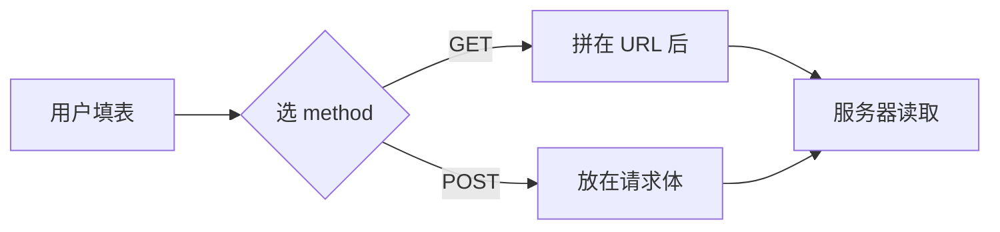

# 表单提交方法（GET与POST的选择与应用场景）

---
requires: [XHTML基础/表单元素]
---

当你在网页上填写完信息点击“提交”时，浏览器到底是怎么把数据送给服务器的？如果送错了方式，会发生什么？

## 它是什么：两种提交方法

在 XHTML 中，`<form>` 标签的 `method` 属性决定了表单数据的提交方式。只有两种合法取值：==GET== 和 ==POST==。



- **GET**：将表单字段名和值编码为 `key=value` 对，用 `&` 连接，追加在 URL 的 `?` 之后（即 Query String）。
- **POST**：将表单数据封装在 HTTP 请求的 Body（消息体）中发送，URL 保持不变。

## 为什么需要区分它们

既然都能传数据，为什么要分两种？因为它们在语义、安全性和容量上有本质区别。

> [!IMPORTANT]
> GET 用于**获取**数据（幂等、无副作用），POST 用于**修改/提交**数据（有副作用）。

| 对比维度 | GET | POST |
| :--- | :--- | :--- |
| 数据位置 | URL 查询字符串 | HTTP 请求体 (Body) |
| 数据长度限制 | 受 URL 长度限制（通常约 $2048$ 字符） | 理论上无限制 |
| 安全性 | 参数暴露在地址栏，易被收藏或分享 | 参数不在 URL 中，相对隐蔽 |
| 缓存与历史 | 会被浏览器缓存、保存在历史记录中 | 默认不缓存 |
| 适用场景 | 搜索、分页、筛选 | 登录、评论、上传文件、订单提交 |

## 怎么做：结合真题选方法

来看复习提纲里的这道题：开发一个用户评论网页（含 SUBJECT 和 MESSAGE 字段），应使用哪种方法提交表单？

1. **评论会产生新数据吗？** 会。这属于“修改服务器状态”的操作。
2. **评论内容可能很长吗？** 可能。MESSAGE 字段容易超出 URL 长度限制。
3. **结论**：必须选 ==POST 方法==。若用 GET，长评论会被截断，且所有用户的评论明文挂在 URL 里。

## 完整示例：爆米花销售表单

下面结合另一道考题，写一个完整的 XHTML 表单。注意两个关键约束：QUANTITY 只能填数字；Payment Method 默认选中 VISA。

> [!TIP]
> 限制只能输入数字，在 XHTML 中使用 `<input type="number" />`；默认选中单选框，添加 `checked="checked"` 属性。

```html
<form action="/order" method="post">
  <label>Buyer's Name: <input type="text" name="buyer_name" /></label><br/>
  <label>Street Address: <input type="text" name="address" /></label><br/>
  <label>City, State, Zip: <input type="text" name="city_state_zip" /></label><br/>

  <table border="1">
    <tr>
      <th>Product Name</th><th>Price</th><th>Quantity</th>
    </tr>
    <tr>
      <td>Unpopped Popcorn (1 lb.)</td><td>$3.00</td>
      <td><input type="number" name="qty_unpopped" min="0" /></td>
    </tr>
    <tr>
      <td>Caramel Popcorn (2 lb. cannister)</td><td>$3.50</td>
      <td><input type="number" name="qty_caramel" min="0" /></td>
    </tr>
    <tr>
      <td>Caramel Nut Popcorn (2 lb. cannister)</td><td>$4.50</td>
      <td><input type="number" name="qty_caramel_nut" min="0" /></td>
    </tr>
    <tr>
      <td>Toffey Nut Popcorn (2 lb. cannister)</td><td>$5.00</td>
      <td><input type="number" name="qty_toffey_nut" min="0" /></td>
    </tr>
  </table>

  <p>Payment Method:</p>
  <label><input type="radio" name="payment" value="visa" checked="checked" /> VISA</label>
  <label><input type="radio" name="payment" value="mastercard" /> Master Card</label>
  <label><input type="radio" name="payment" value="discover" /> Discover</label><br/>

  <input type="submit" value="Submit Order" />
  <input type="reset" value="Clear Order Form" />
</form>
```

> [!WARNING]
> 提交订单涉及交易（有副作用），`method` 必须设为 `"post"`。如果错写成 `"get"`，不仅订单详情会暴露在 URL 中，用户刷新页面时还会触发浏览器的“重新提交”警告甚至重复下单。

> [!CAUTION]
> 不要以为 POST 就是绝对安全的！POST 只是不把数据放在 URL 里，如果不配合 HTTPS，请求体依然是明文传输。选择 GET 还是 POST，首要依据是**操作语义**（是否改变服务器状态），其次才是数据量大小。
