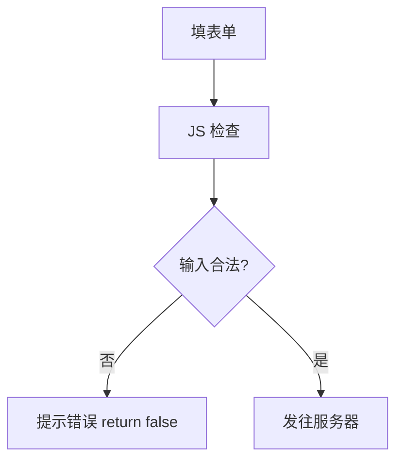

# 表单输入验证（Validating Form Input，如密码输入Password Input）

## 它是什么

先想一个问题：用户在页面上填完密码点 Submit，如果等到服务器返回“密码太短”，你觉得体验会怎样？在《Web技术（双语）》第 5 章里，表单输入验证（**Validating Form Input**）就是：用 JavaScript 在**客户端**、在表单数据发往服务器之前，先检查输入框里的内容是否符合要求。课件里的说法是：**Validating data using JavaScript provides quicker interaction for the user**。典型场景就是 Password Input——检查密码长度、是否两次输入一致。

## 为什么需要

考过的简答（Review Question 5.14）问：为什么要在发到服务器前用 JavaScript 检查有效性？

> [!IMPORTANT]
> 因为能在浏览器端尽早发现非法输入：==减少服务器负担与网络流量==，且给用户**即时反馈**，不必等一次到服务器的往返。

也就是说，纯靠服务器验证会多一次 round-trip；前端先拦一道，又快又省。

## 怎么做

先拿到表单元素，课件里的记号是：

```js
document.myForm.pushMe
```

这里 `myForm` 是 `<form name="myForm">`，`pushMe` 是某输入项的 `name`。对密码输入常见做法是：读 `document.myForm.password.value`，在 `onsubmit` 里判断，不符合就 `return false` 阻止提交。

验证流程可以这样看：



注意 `return false` 与课件练习里 “avoid actual submission of the form data” 是一回事。

## 和相近概念的区别

| 概念 | 发生位置 | 作用 |
|---|---|---|
| Validating Form Input (JS) | 客户端 | 即时反馈、减负载 |
| 服务器端验证 | 服务器 | 最终结果可信 |

[!NOTE]
JS 验证不是“安全验证”的最终防线；用户可禁用 JS，所以服务端仍要再验。

## 常见坑

- 忘记在事件里 `return false`，表单还是提交了；
- 用 `name` 引用写成 `id` 的写法，课件用的是 `document.myForm.pushMe` 这种 **name 路径**；
- 只做长度判断，不比较“确认密码”是否相同。

## 一个算对了的例子

课件 Exercise 5.3 虽是复选框算水果钱，但同样要求：Submit 的事件处理器弹出总价并 `return false` 避免真提交。核心是：

```js
alert("Your total cost is $" + finalTotal.toFixed(2));
return false;
```

把它迁移到 Password Input：若两次密码不等就 `alert` 并 `return false`，便掌握了本节要求的==先验证、再阻止提交==这一==核心模式==。
