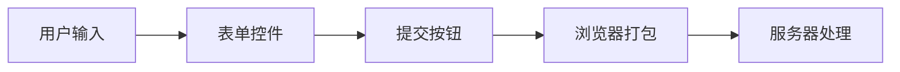

# 表单与控件（form标签、input元素、菜单select、label的for属性、placeholder属性）

## 表单与控件：从输入到提交

先想一个问题：一个网页如果只能“看”，不能“填”，它还能叫“交互式”吗？HTML 表单（form）解决的就是这个问题——让用户能把数据**提交**给服务器。

### 为什么需要表单

超链接只能“跳转”，不能“带数据”。表单则是一组**控件（control）**的容器，用户在控件中输入或选择内容，点击提交按钮后，浏览器把数据打包发给服务器处理。搜索框、登录框、评论框，本质都是表单。



### 核心元素

`<form>` 是容器，两个关键属性决定数据怎么发：

| 属性 | 作用 |
| :--- | :--- |
| `action` | 数据发给哪个 URL |
| `method` | 用 GET 还是 POST 发送 |

**GET 与 POST 的区别**是考试高频点：

| | GET | POST |
| :--- | :--- | :--- |
| 数据位置 | 拼在 URL 的 query string 后 | 放在请求体中 |
| 可见性 | 地址栏可见 | 不可见 |
| 长度限制 | 受 URL 长度限制 | 基本无限制 |
| 适用场景 | 搜索、筛选等**非敏感**数据 | 登录、评论等**敏感或大量**数据 |

> [!IMPORTANT]
> 评论表单应使用 ==POST 方法==——评论内容不适合暴露在 URL 中，长度也可能较大。

### 常用控件

**`<input>`** 是最常用的输入控件，靠 `type` 属性切换形态：

```html
<input type="text" name="username" />
<input type="password" name="pwd" />
<input type="number" name="quantity" />
<input type="radio" name="payment" value="visa" />
<input type="checkbox" name="hobby" value="reading" />
<input type="submit" value="Submit Order" />
<input type="reset" value="Clear Order Form" />
```

**`<select>`** 是下拉菜单，`<option>` 定义每个选项：

```html
<select name="city">
  <option value="nj">南京</option>
  <option value="bj">北京</option>
</select>
```

### label 的 for 属性

`<label>` 的 `for` 属性值应等于某个 `<input>` 的 `id`。作用：**把标签和控件绑定起来**。用户点击 label 文字时，焦点会自动落到对应的 input 上。例如：

```html
<label for="email">邮箱：</label>
<input type="text" id="email" name="email" />
```

点击“邮箱：”两个字，光标就会进入输入框。这对单选按钮和复选框体验提升尤其明显——点文字就能选中，不用精确点小圆点。

> [!TIP]
> 选择题里问到“for 属性有何作用”，核心答案就是：==建立 label 与表单控件的关联，提升可用性==。

### placeholder 属性

```html
<input type="text" placeholder="请输入用户名" />
```

`placeholder` 显示灰色提示文字，用户一开始输入就消失。它只是**提示**，不代替 `value`，也不会被提交。

> [!WARNING]
> `placeholder` ≠ 默认值。如果表单提交时用户没输入，该字段就是空的；想要默认值应设 `value` 属性。

### 完整示例

回顾题目中的 popcorn 销售表单，需求：Quantity 只能填数字，支付方式默认选中 Visa。

```html
<form action="order.php" method="post">
  <label for="qty1">Quantity：</label>
  <input type="number" id="qty1" name="qty1" min="0" />

  <p>Payment Method:</p>
  <label><input type="radio" name="payment" value="visa" checked /> Visa</label>
  <label><input type="radio" name="payment" value="mastercard" /> Master Card</label>
  <label><input type="radio" name="payment" value="discover" /> Discover</label>

  <input type="submit" value="Submit Order" />
  <input type="reset" value="Clear Order Form" />
</form>
```

关键点拆解：

- `type="number"` 限制 Quantity 只能输入数字；
- `checked` 属性让 Visa 单选按钮**默认选中**；
- 三个 radio 的 `name` 相同（都是 `payment`），保证互斥，只能选一个；
- `type="submit"` 和 `type="reset"` 分别对应提交和清空按钮。

> [!CAUTION]
> 单选按钮如果不写 `name` 或者 `name` 不一样，就无法互斥——用户能同时选中多个选项，这直接违背语义。

### 常见坑

1. **label 的 for 写错**：要和 `id` 精确匹配，不是 `name`。
2. **submit 按钮忘了写在 form 里**：点击后不会触发提交。
3. **GET 提交敏感数据**：密码、评论等内容用 GET 会留在浏览器历史和服务器日志里。
4. **radio 不设默认选中**：题目要求“默认选中”时忘了写 `checked`。
