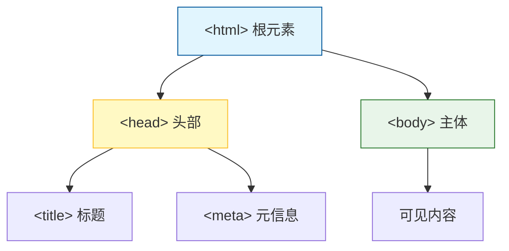

# HTML文档结构（head、body、meta元素）

## HTML 文档骨架解析

一个标准的 HTML 文档并非杂乱无章的标签堆砌，而是有着严格的层级结构。想象一下，如果浏览器是一台打印机，HTML 文档就是待打印的文件：**`<head>` 是文件的元数据（如作者、编码），不直接显示在纸面上；而 `<body>` 才是真正印在纸上的正文内容。**

> [!IMPORTANT]
> `==<html>`, `<head>`, `<title>`, `<body>`== 是每个标准文档的必备要素。缺少它们，虽然现代浏览器能“容错”渲染，但在严格模式（XHTML）或语义化标准下是不合法的。

## 核心组成部分

HTML 文档主要由两大部分组成，通过以下 Mermaid 图展示其层级关系：



### 1. `<head>`：文档的大脑
这部分内容**不会**直接显示在浏览器窗口中，但它决定了文档如何被处理。
*   **`<title>`**：定义浏览器标签页上显示的标题。这是 SEO（搜索引擎优化）的关键，也是用户区分多个标签页的依据。
*   **`<meta>`**：提供元数据。最常见的是字符集声明。
    *   `==<meta charset="UTF-8">==`：告诉浏览器使用 UTF-8 编码解析页面，防止中文乱码。这是双语课程中必须强调的基础配置。

### 2. `<body>`：文档的血肉
所有用户可见的内容（文本、图片、链接、表格等）都必须放在 `<body>` 标签内。
*   在复习提纲提到的 `2-headings.html` 例子中，介绍你自己、父母的信息段落，都必须包裹在 `<body>` 中。
*   若将 `<h1>` 或 `<p>` 误写在 `<head>` 中，浏览器通常会将其“纠错”移出头部或直接忽略样式，导致布局混乱。

## 常见误区与辨析

很多初学者容易混淆“标签（Tag）”与“元素（Element）”，或者搞不清 `<head>` 和 `<body>` 的边界。

| 概念 | 定义 | 示例 |
| :--- | :--- | :--- |
| **Tag (标签)** | 标记语言的基本构建块，由尖括号包围 | `<p>`, `</p>` |
| **Element (元素)** | 从开始标签到结束标签的整体，包含内容 | `<p>Hello</p>` |
| **Content (内容)** | 标签之间的文本或嵌套元素 | `Hello` |

> [!WARNING]
> **易错点**：不要在 `<head>` 中放置可见内容（如 `<h1>`）。虽然浏览器可能渲染出来，但这违反了 XHTML 规范，且在双语考试中会被判定为结构错误。

> [!TIP]
> **记忆技巧**：Head 是“头”，负责思考（元数据）；Body 是“身体”，负责行动（展示内容）。

## 实战示例

根据简答 6 的要求，创建一个包含个人信息的标准文档。注意缩进对齐，这是良好编程习惯的体现。

```html
<!DOCTYPE html>
<html lang="zh-CN">
<head>
    <!-- 元数据区域：不可见 -->
    <meta charset="UTF-8">
    <title>My Personal Information</title>
</head>
<body>
    <!-- 主体区域：可见 -->
    <h1>About Me</h1>
    
    <h2>Name</h2>
    <p><strong>Name:</strong> John Doe</p>

    <h2>Contact</h2>
    <p>
        <strong>Email:</strong> 
        <em>johndoe@example.com</em>
    </p>
    
    <hr />
    
    <h2>Academic</h2>
    <p><strong>Major:</strong> Computer Science</p>
</body>
</html>
```

在此结构中，`<meta>` 确保了字符正确显示，`<title>` 定义了标签页名称，而所有的 `<h1>`, `<p>`, `<strong>` 均位于 `<body>` 内，符合 ==W3C 标准结构==。
