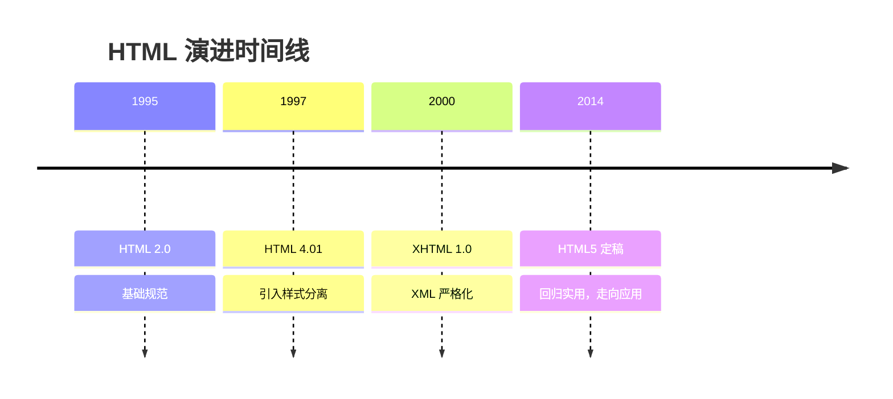
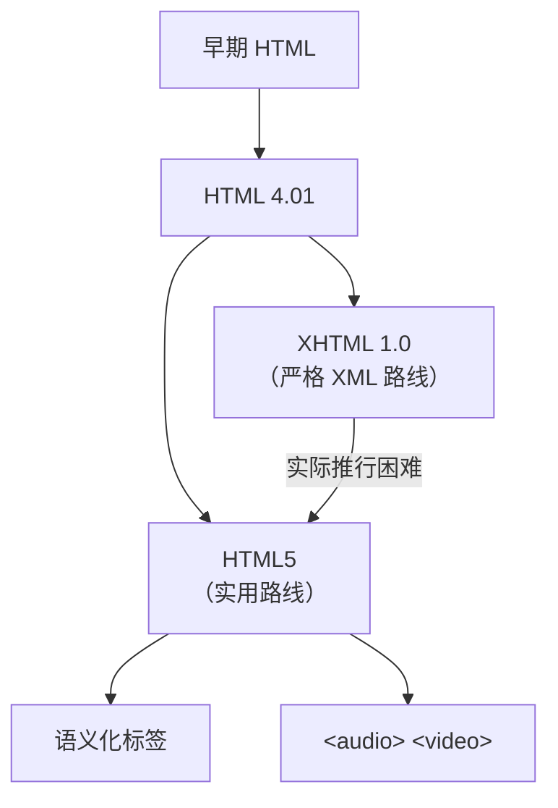

# HTML的起源与演进（HTML到XHTML/HTML5）

# HTML 的起源与演进

在正式学习具体标签之前，我们先退一步问一个问题：**为什么 HTML 会有“版本”？**  
如果你的个人博客用 1995 年的 HTML 写法，现在还能打开吗？

## 从 HTML 到 XHTML 的“严格化”尝试

早期 HTML（2.0～4.01）非常宽松：标签可以不闭合、属性值可以不加引号、大小写混用也没问题。这种“宽容”让入门变容易，但也带来两个问题：

- 浏览器必须花大量资源去“猜测”作者的真实意图（容错解析），不同浏览器猜的结果可能不同
- 机器（搜索引擎、屏幕阅读器）很难准确理解页面结构

于是 W3C 在 2000 年前后推出了 **XHTML 1.0**，核心思路是==用 XML 的严格语法来约束 HTML==，要求：

| 规则 | HTML 4 写法（允许） | XHTML 要求 |
|------|---------------------|------------|
| 标签闭合 | `<br>` | `<br />` |
| 属性值引号 | `` | `` |
| 元素嵌套 | `<b><i>text</b></i>` | 必须正确嵌套 |
| 标签大小写 | `<BODY>` | 必须小写 `<body>` |



> [!NOTE]
> XHTML 的理念是“严格要求作者，减轻解析器负担”。但在实际推行中发现，互联网上数十亿页面积重难返，一个标签错误就导致整个页面不显示，对用户伤害太大。

## HTML5：回归实用主义

WHATWG 和后来的 W3C 吸取教训，HTML5 的设计哲学变为 **“向后兼容、面向应用”**：

- 仍然宽容解析（不因一个错误拒绝整个页面）
- 新增语义化标签：`<header>`、`<nav>`、`<article>`、`<section>`、`<footer>`
- 原生多媒体支持，告别 Flash 插件

这正是课件 2.10 和 2.11 涉及的 `<audio>` 和 `<video>` 的由来——在 HTML 4 时代，播放音视频必须借助第三方插件；HTML5 直接把它们变成一等公民。



## 核心概念：Deprecated（废弃）

上面那道真题问的就是这个概念。==Deprecated 意味着“仍然可用，但不推荐”==——浏览器为了兼容旧网页暂时还支持它，但开发者在新项目中应该用替代方案。

这和“已移除（removed）”不同：

| 状态 | 含义 | 例子 |
|------|------|------|
| Deprecated | 不推荐使用，仍被支持 | `<font>`、`<center>`、`align` 属性 |
| Obsolete / Removed | 已从标准中删除 | `<blink>`、`<marquee>`（非标准） |

为什么废弃某些标签？常见原因：
- 与表现层相关，应由 CSS 替代（如 `<font color="red">` → `style="color: red"`）
- 语义不清晰，有更优替代（如 `<b>` 粗体含义模糊，`<strong>` 表示“重要”更好）
- 存在安全隐患或兼容性问题

> [!IMPORTANT]
> 废弃不代表立刻不能用，但在作业和考试中，涉及 HTML5 页面时应注意使用语义化标签替代已废弃的表现性标签，这是命题中常考察的点。

> [!WARNING]
> 常见误区：XHTML 不是 HTML 的“升级版”或“后续版本”，它是一条**并行的严格化分支**。目前主流开发使用的是 HTML5，而非 XHTML。

## `<audio>` 与 `<video>`：HTML5 最大的功能跨越

在 HTML5 之前，嵌入音频通常依赖 `<embed>` 或 `<object>` 标签加第三方插件（QuickTime、Flash 等）。一旦用户没装插件，页面就变成空白。HTML5 的 `<audio>` 让这件事简化到一行：

```html
<audio src="music.mp3" controls></audio>
```

`<video>` 同理，且支持多种格式回退：

```html
<video controls width="640">
  <source src="video.mp4" type="video/mp4">
  <source src="video.webm" type="video/webm">
  您的浏览器不支持 HTML5 视频标签。
</video>
```

> [!TIP]
> 记忆要点：`controls` 属性不加值（或写 `controls="controls"`）即显示播放控件；`autoplay` 在移动端常被浏览器禁用，这是个常见坑。

**算对一个例子**：要在页面中放置一个宽 400px 的音频播放器，显示控件，支持 MP3 和 OGG 两种格式——正确写法应在 `<audio>` 内部使用 `<source>` 回退，而非单写 `src` 属性，因为后者只支持一种格式，不兼容的浏览器将无法播放。
