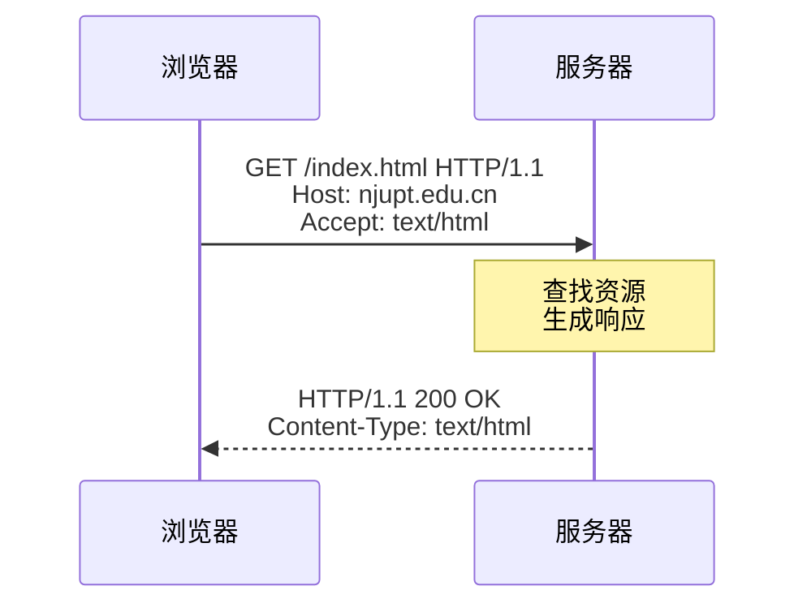

# HTTP请求阶段（GET方法、常见请求字段）

## HTTP 请求阶段：GET 方法与常见请求字段

你打开浏览器输入 `https://www.njupt.edu.cn`，按下回车。浏览器做的第一件事是什么？——它要**向服务器要东西**。怎么要？把“要什么、怎么要、我是谁、我能接受什么格式”说清楚。这就是 HTTP 请求阶段。

### 请求行：先说要干什么

HTTP 请求报文第一行叫**请求行**，格式为：

```
方法  请求目标  协议版本
GET  /index.html  HTTP/1.1
```

其中**方法**告诉服务器希望执行的操作。最常用的是 `GET` 和 `POST`：

| 方法 | 语义 | 数据位置 | 典型场景 |
| :--- | :--- | :--- | :--- |
| GET | 获取资源 | URL 查询串中 | 搜索、查看文章 |
| POST | 提交数据 | 请求体（body）中 | 登录、发表评论 |

> [!IMPORTANT]
> ==GET 是“拿”，POST 是“交”。== GET 请求的参数暴露在 URL 里，POST 把数据放进请求体，更适合提交表单。

### 头部字段：报文的“自我介绍”

请求行之后是若干**请求头**（header），每行一个 `字段名: 值`。考试高频字段如下：

| 字段 | 含义 | 示例 |
| :--- | :--- | :--- |
| `Host` | 请求的主机名和端口 | `www.njupt.edu.cn` |
| `User-Agent` | 客户端浏览器/系统信息 | `Mozilla/5.0 ...` |
| `Accept` | 客户端能接受的响应类型 | `text/html, */*` |
| `Accept-Language` | 偏好的自然语言 | `zh-CN, en;q=0.8` |
| `Accept-Encoding` | 可接受的压缩编码 | `gzip, deflate` |
| `Connection` | 连接管理方式 | `keep-alive` / `close` |
| `Referer` | 当前请求的来源页面 | `https://www.baidu.com/` |
| `Cookie` | 携带的会话信息 | `sessionId=abc123` |

其中 `Host` 在 HTTP/1.1 中**必填**——一台服务器可能托管多个虚拟主机，不写 `Host` 服务器不知道该回哪个网站。

### 一个完整的 GET 交互



图中的请求行告诉服务器“我要拿首页”，`Host` 指明“我要的是 njupt.edu.cn 这个虚拟主机”，`Accept` 表明“给我 HTML 就行”。服务器回复 `200 OK` 表示成功。

### GET 还是 POST？

原题给出一个“发表评论”表单，问用哪个方法。两个角度判断：

> [!TIP]
> **判断口诀**：改动数据用 POST，只读查询用 GET；敏感信息用 POST，大段内容用 POST。

发表评论会**改变服务器上的数据**（新增一条评论），且评论内容较长、不适合塞进 URL，所以正确答案是 ==POST==。如果把评论用 GET 提交，内容全暴露在地址栏里，既难看又容易被中间记录，还可能因 URL 过长被截断。

### 常见的坑

> [!WARNING]
> GET 请求**可以有请求体吗**？协议没有禁止，但很多服务器和中间件会忽略或不处理，**实践中不要给 GET 加 body**，参数老老实实放 URL 里。

> [!CAUTION]
> 不要把“安全”理解成“加密”。HTTP 方法语义里的 **safe（安全）** 指 GET 只读、不改变服务器状态；而**加密**要依赖 HTTPS。GET 请求的 URL 在 HTTP 明文传输下照样能被抓包看见。

---

**算对了的例子**：某客户端发出请求：

```http
GET /search?q=njupt&page=2 HTTP/1.1
Host: www.example.com
Accept: text/html
Cookie: sid=xyz
```

服务器收到后知道：用户要找关键词 `njupt` 的第 2 页结果（URL 查询串），目标主机是 `www.example.com`，可以返回 HTML 页面，且带着会话标识 `sid=xyz`。若请求的是“删除账户”操作，则方法不应再用 `GET`，而应是 `POST` 或 `DELETE`——这正是“方法语义”与“实际副作用”的匹配问题。
