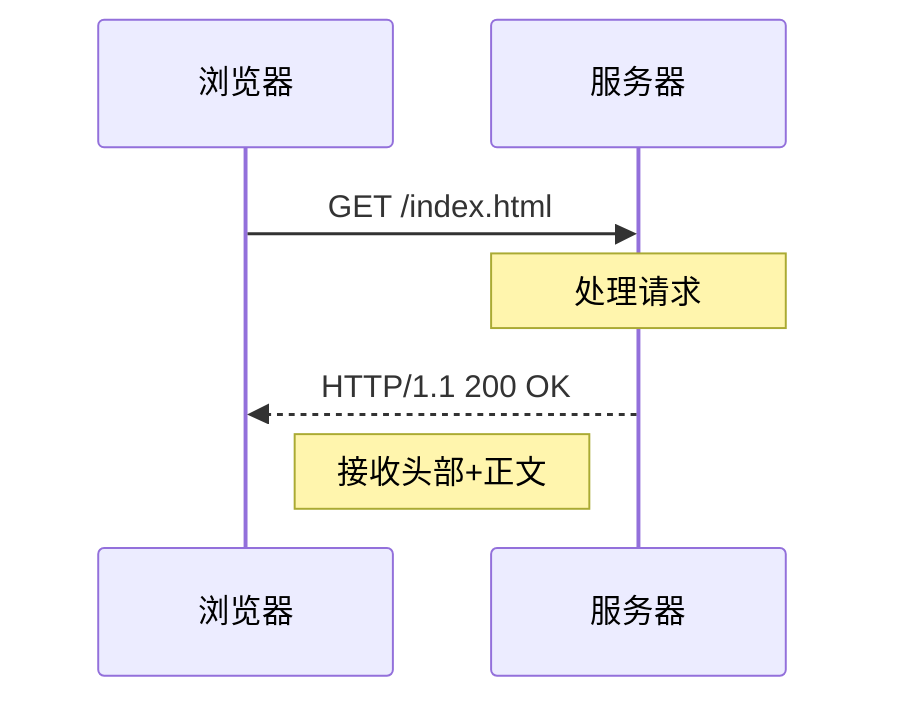
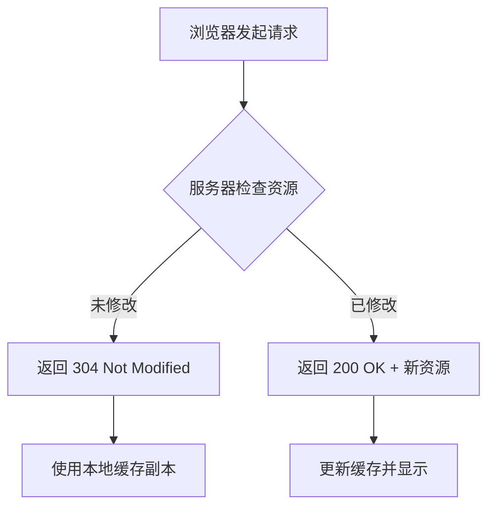

# HTTP响应（状态码如200 OK、常见响应字段、缓存机制）

# HTTP响应（状态码、字段与缓存）

HTTP 响应是服务器对客户端请求的答复。理解响应的结构，尤其是**状态码**和**缓存机制**，是优化 Web 性能的关键。

## 响应报文结构

一个标准的 HTTP/1.1 响应包含三部分：状态行、响应头、响应体。

状态行格式为 `HTTP-Version Status-Code Reason-Phrase`。例如 `HTTP/1.1 200 OK`，其中 `200` 表示成功，`OK` 是原因短语（可选）。

> [!IMPORTANT]
> ==核心考点==：状态码是三位数字，第一类数字定义类别。
> *   `2xx`：成功（如 `200 OK`）
> *   `3xx`：重定向/缓存协商（如 `304 Not Modified`）
> *   `4xx`：客户端错误（如 `404 Not Found`）
> *   `5xx`：服务器错误（如 `500 Internal Server Error`）

## 常见响应字段

响应头携带元数据，指导浏览器如何处理正文。

| 字段名 | 作用 | 示例 |
| :--- | :--- | :--- |
| `Content-Type` | 指定媒体类型 | `text/html; charset=utf-8` |
| `Content-Length` | 正文长度（字节） | `1024` |
| `Cache-Control` | 缓存指令 | `max-age=3600` |
| `ETag` | 资源唯一标识 | `"abc123"` |
| `Last-Modified` | 最后修改时间 | `Wed, 21 Oct 2023 07:28:00 GMT` |

## HTTP 缓存机制分析

缓存旨在减少网络传输，提升加载速度。其核心在于**协商缓存**与**强缓存**。

### 协商缓存流程（304）

当资源过期或需验证时，浏览器会发送条件请求（携带 `If-None-Match` 或 `If-Modified-Since`）。

> [!TIP]
> **解题技巧**：若题目图中出现 "Browser displays local copy" 且无大量数据传输箭头，通常对应 `304` 状态码。此时服务器**没有**返回完整的资源正文，仅返回头部信息。

### 真题回顾

**简答 8**：观察交互过程，服务器端的 HTTP 响应有无返回客户端请求的资源？
*   **解析**：图中提示 "original has not changed"，说明命中协商缓存。服务器返回 `304 Not Modified`，**未返回**资源实体内容，节省了带宽。

> [!WARNING]
> **常见坑**：混淆 `200` 和 `304`。`200` 必然伴随资源正文传输；`304` 仅代表“可以使用缓存”，正文为空。在计算网络吞吐量或分析抓包数据时，务必区分二者。

==核心结论==：`304` 状态码是 HTTP 缓存生效的标志，它通过避免重复传输未改变的资源来优化性能。
