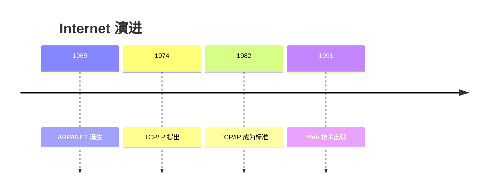
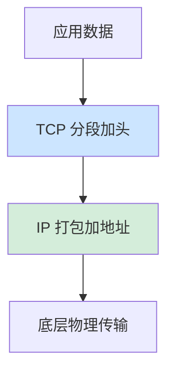

# Internet历史与起源（ARPANET、TCP/IP发展）

想象一下：如果全世界有成千上万种不同品牌、不同操作系统的计算机，它们说着各自的“方言”，怎样才能让它们互相听懂并交换信息？

这正是 Internet 诞生之初必须解决的核心问题。

## ARPANET 与 TCP/IP 的诞生

Internet 并非一夜建成。它的前身是 1969 年美国国防部建立的 ==ARPANET==（阿帕网），最初仅连接了少数几台大型机。随着网络规模扩大，不同底层硬件和操作系统之间的通信壁垒日益凸显。

为了让异构设备能够互联，Vint Cerf 和 Bob Kahn 在 20 世纪 70 年代设计了 TCP/IP 协议族。

> [!IMPORTANT]
> 自 ==1982 年==起，所有 Internet 连接在最底层均使用 TCP/IP。

## TCP 与 IP 各司其职

课件中给出了两个关键缩写，它们分别位于不同的协议层，承担完全不同的职责：

- **TCP (Transfer Control Protocol)**：负责端到端的可靠数据传输，确保数据按序、无差错地到达。
- **IP (Internet Protocol)**：负责寻址和路由，将数据包从源主机跨越多个网络投递到目的主机。

> [!NOTE]
> 尽管英文全称通常为 *Transmission* Control Protocol，但本课程课件记为 *Transfer* Control Protocol，考试作答时请以课件术语为准。

为什么需要两层而不是一层？因为 ==TCP/IP 隐藏了接入 Internet 的设备之间的差异==。无论你的电脑用的是以太网还是 Wi-Fi，运行的是 Windows 还是 Linux，只要遵守 IP 规则就能被路由，只要遵守 TCP 规则就能保证数据不丢。

| 特性 | TCP | IP |
| :--- | :--- | :--- |
| **核心功能** | 可靠传输、流量控制 | 逻辑寻址、路由转发 |
| **工作层次** | 传输层 | 网络层 |
| **是否隐藏设备差异** | 配合 IP 共同实现 | 统一底层物理网络接口 |

## 常见误区与辨析

> [!WARNING]
> 易错坑：认为“TCP/IP 只是一个协议”。实际上它是一个 ==协议族（Protocol Suite）==，包含 TCP、IP、UDP、ICMP 等众多协议。

> [!CAUTION]
> 高危误区：混淆时间节点。Web（万维网）诞生于 1991 年，而 TCP/IP 成为 Internet 标准是在 1982 年。Web 是跑在 TCP/IP 之上的应用，不要将两者混为一谈。

**概念辨析：ARPANET vs. Internet**
ARPANET 是一个具体的早期实验性网络；Internet 是采用 TCP/IP 协议族互连而成的全球性网络集合。ARPANET 是 Internet 的“祖先”，但现代 Internet 早已超越了它的架构。

> [!TIP]
> 记忆口诀：“**82 定 TCP/IP，屏蔽差异靠分层**”。答题时若问及 Internet 底层基础，务必点出 1982 年和“隐藏设备差异”这两个得分词眼。
