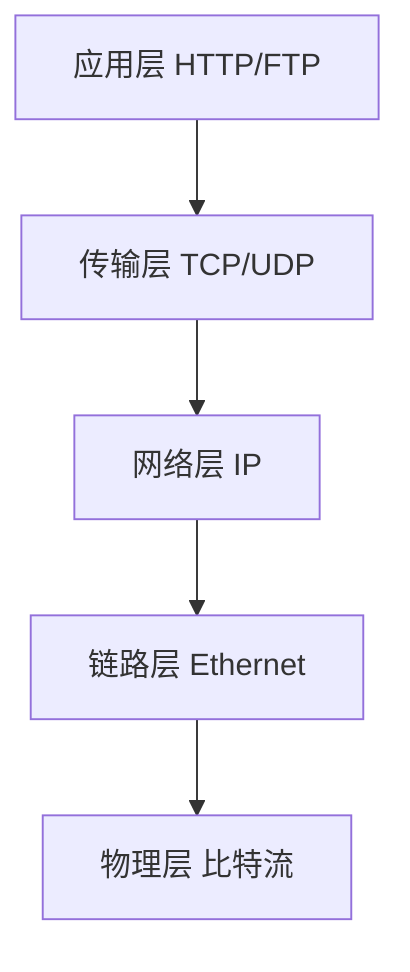

# Internet协议栈与应用层协议端口号

## 协议栈与端口号：Web通信的基石

当你在浏览器输入网址并回车时，数据是如何准确找到目标服务器上的Web服务，而不是邮件或文件传输服务的？这依赖于Internet协议栈的分层协作与应用层端口号的精准寻址。理解这一机制，是掌握Web技术双语课程中后续HTTP、DNS等协议交互的前提。

### Internet协议栈的分层模型

Internet协议栈采用分层架构，每一层只关注特定功能，通过封装与解封装实现端到端通信。对于Web开发而言，==应用层、传输层、网络层==是最核心的三层。

> [!IMPORTANT]
> Web技术课程重点关注==应用层协议语义==与==传输层可靠性保障==，网络层及以下通常作为透明传输通道理解。

### 常见应用层协议及端口号

端口号是传输层区分同一主机上不同应用进程的标识符。在填空题与简答题中，以下协议与端口号的对应关系属于高频考点：

| 应用层协议 | 默认端口 | 传输层协议 | 核心用途 |
| :--- | :--- | :--- | :--- |
| FTP | 20/21 | TCP | 文件传输（20数据/21控制） |
| SMTP | 25 | TCP | 邮件发送 |
| HTTP | 80 | TCP | Web页面访问 |
| HTTPS | 443 | TCP | 加密Web访问 |
| DNS | 53 | UDP/TCP | 域名解析 |

> [!TIP]
> 记忆口诀：“==FTP二十一，SMTP二十五，HTTP八十整，HTTPS四四三==”。FTP需特别注意双端口机制，21用于命令控制，20用于数据传输。

### 为什么必须记住默认端口？

URL结构中端口号常被省略，正是因为浏览器与服务器约定了默认值。例如 `http://njupt.edu.cn` 等价于 `http://njupt.edu.cn:80`。若服务端使用非标准端口（如8080），则URL中==必须显式指定==，否则客户端将尝试连接默认端口导致失败。

> [!WARNING]
> 混淆FTP的20与21端口是常见错误。答题时若只写“FTP端口21”可能被扣分，应注明“==控制端口21，数据端口20==”。

### 真题示例与解析

以课件填空题为为例，要求填写FTP、HTTP、SMTP的端口号。正确作答如下：

-   **FTP**：21（控制）/ 20（数据）
-   **HTTP**：80
-   **SMTP**：25

> [!CAUTION]
> 切勿将SMTP（25）与POP3（110）或IMAP（143）混淆。SMTP仅负责==邮件发送==，接收邮件使用其他协议与端口。双语考试中若题干为英文“Mail Transfer”，同样对应SMTP:25。

掌握协议栈分层思想与核心端口号，不仅能应对基础考题，更为理解后续虚拟主机、代理服务器等Web架构概念打下坚实基础。建议在复习时将端口号与协议功能绑定记忆，避免孤立背诵数字。
