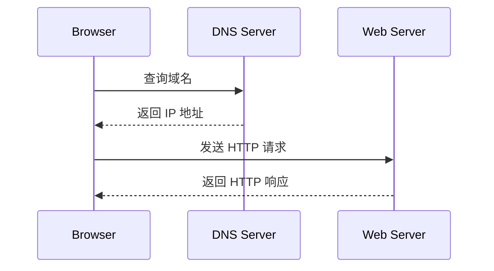

# IP地址与域名系统（DNS）

## 为什么既需要 IP 地址，又需要域名？

主机在 Internet 中通信，需要能够标识通信对象。**IP address（IP 地址）**用于标识网络中的主机或接口，例如 `192.168.1.10`；但数字地址不便记忆，所以通常使用 **domain name（域名）**，如 `www.njupt.edu.cn`。

**DNS（Domain Name System，域名系统）**提供域名与 IP 地址之间的映射。课件中的 **Domain Name Servers** 指域名服务器，其核心作用是：==将 fully qualified domain name（完全限定域名）转换为 IP 地址==。浏览器只有取得服务器 IP 地址后，才能进一步建立连接并发送 HTTP request。

> [!IMPORTANT]
> DNS 主要解决“域名如何找到 IP 地址”，不负责传输 Web page，也不等同于 HTTP。

## 从域名到网页

以访问 `www.example.com` 为例，简化过程如下：

实际解析可能依次查询本地缓存、hosts 文件、递归解析器以及各级 name server；若已有有效缓存，就不必重复完整查询。

完全限定域名通常从主机名一直写到根域，例如 `www.example.com.`。末尾的点表示根域，日常输入时常可省略。

## 相近概念不要混淆

| 概念 | 含义与作用 |
|---|---|
| IP address | 标识网络中的主机或接口，是通信寻址依据 |
| domain name | 便于人记忆和使用的名称 |
| name server | 保存或查询域名解析数据的服务器 |
| host | 网络中的主机，也可指 URL 中的主机部分 |
| URL | 资源定位地址，还可包含 protocol、port number、path 等 |
| DNS | 完成域名解析的系统，不是网页本身 |

例如 `http://www.example.com:8080/news/index.html` 中，域名只是 `www.example.com`；`8080` 是端口号，`/news/index.html` 是路径。==域名解析成功，不代表 Web 服务器一定可用==：服务器可能关机、端口可能未开放，也可能返回错误响应。

> [!WARNING]
> 查询本机 IP 时，`127.0.0.1` 是 IPv4 回环地址，只表示本机；`::1` 是 IPv6 回环地址。它们不能作为本机局域网地址填写。手机使用移动数据时，还可能看到运营商分配的私有地址或 IPv6 地址。

## IP 地址查询实例

下面是一份可写入简答题的正确示例，地址应以查询时的实际结果为准：

|  | 笔记本 | 手机 |
| :--- | :--- | :--- |
| IP 地址 | `192.168.1.100` | `192.168.1.101` |
| 查询方法 | Windows 执行 `ipconfig`，查看当前无线网卡的 IPv4 地址 | 连接同一 Wi-Fi，在“设置—WLAN—当前网络详情”中查看 |

这里两个地址都属于 IPv4 私有地址，适用于局域网。若设备重启、切换网络或 DHCP 重新分配地址，结果可能变化，因此考试作答时应写清“查询环境、查询命令或路径、对应地址”，不要把公网 IP 与局域网 IP 混为一谈。

> [!TIP]
> 记忆主线：**域名便于记忆，IP 用于寻址，DNS 负责转换；本机 IP 用系统网络工具查询。**
