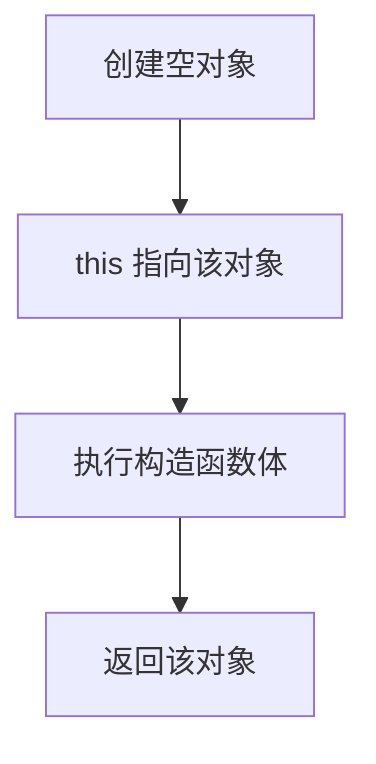

# 数组（创建、特性、方法、二维数组）、函数基础（局部变量、参数、构造函数Constructor）与动态属性（for-in循环）

## 数组的创建

先想一个问题：如果一门语言没有“把多个值装进一个变量”的能力，要处理 100 个学生成绩时怎么办？写 100 个独立变量显然不现实。数组正是为“批量管理同类数据”而生的基础结构。

JavaScript 创建数组有两种等价方式：

| 方式 | 语法示例 | 说明 |
|------|----------|------|
| Array 构造函数 | `new Array(3)` | 创建长度为 3 的空数组 |
| Array 构造函数 | `new Array(1, 2, 3)` | 创建含三个元素的数组 |
| 数组字面量 | `[1, 2, 3]` | 最常用，简洁直观 |

> [!WARNING]
> `new Array(3)` 创建的是**长度为 3 的稀疏数组**（每个位置都是 `undefined`），而不是 `[3]`。这是实践中极易踩的坑。

```javascript
let a = new Array(3);      // [ <3 empty items> ]，length 为 3
let b = new Array(1, 2, 3) // [1, 2, 3]
let c = [1, 2, 3];         // [1, 2, 3]，推荐写法
```

## 数组特性

JavaScript 数组与 C/Java 数组有关键差异：

- 数组元素**类型不要求一致**：`[1, "hello", true, null]` 合法。
- 长度**动态可变**，无需预先声明容量。
- `length` 属性可写：手动增大产生空槽，手动减小会截断数组。
- 底层本质是对象，索引是字符串 `"0"`、`"1"` 等。

```javascript
let arr = [1, 2, 3];
arr[5] = 6;          // 中间 index 3、4 成为空槽
console.log(arr.length); // 6
arr.length = 2;      // 直接截断，[1, 2]
```

## 常用数组方法

| 方法 | 作用 | 是否修改原数组 |
|------|------|----------------|
| `push(item)` | 尾部追加元素 | 是 |
| `pop()` | 移除并返回尾部元素 | 是 |
| `shift()` / `unshift()` | 头部移除/插入 | 是 |
| `splice(start, n, ...)` | 删除/插入元素 | 是 |
| `slice(start, end)` | 截取子数组 | 否 |
| `filter(fn)` | 按条件过滤，返回新数组 | 否 |
| `map(fn)` | 逐元素变换，返回新数组 | 否 |
| `indexOf(val)` | 查找元素位置 | 否 |

> [!IMPORTANT]
> `==filter` 和 `map` 都返回新数组，不改变原数组；要“原地修改”必须配合 `length = 0` 清空再重新推入，或用 `splice`。==

## 二维数组

JavaScript 没有原生“二维数组”语法，通常用“数组的数组”模拟：

```javascript
let matrix = [
    [1, 2, 3],
    [4, 5, 6],
    [7, 8, 9]
];
console.log(matrix[1][2]); // 6
```

创建 $m \times n$ 的矩阵时，注意不能写 `new Array(m).fill(new Array(n))`——这样每行引用的是同一个数组。正确做法是循环逐行创建：

```javascript
let m = 3, n = 4;
let grid = [];
for (let i = 0; i < m; i++) {
    grid.push(new Array(n).fill(0));
}
```

## 函数基础：局部变量与参数

函数内部用 `let`/`const` 声明的变量是**局部变量**，只在函数体内可见。特别注意：**用 `var` 声明的变量具有函数作用域**，而 `let`/`const` 具有块级作用域，这是二者最显著的差异。

参数传递规则：基本类型（number、string、boolean 等）**按值传递**，函数内修改形参不影响外部实参；对象（包括数组）**按引用传递**，函数内修改属性或元素会直接影响外部对象。

```javascript
function modify(num, arr) {
    num = 100;        // 只改局部副本
    arr[0] = 999;     // 修改了外部数组
}
let a = 1, b = [1, 2, 3];
modify(a, b);
console.log(a);  // 1，未变
console.log(b);  // [999, 2, 3]，已变
```

## 构造函数 Constructor

构造函数是用于创建对象的特殊函数，约定**首字母大写**，配合 `new` 调用：

```javascript
function Student(name, age) {
    this.name = name;
    this.age = age;
}
let s = new Student("Alice", 20);
console.log(s.name); // Alice
```

`new` 的执行过程可以拆解为四步：



> [!WARNING]
> 忘记写 `new` 直接调用构造函数时，`this` 指向全局对象（严格模式下为 `undefined`），属性会被错误地挂到全局，是常见高危错误。

## 动态属性与 for-in 循环

JavaScript 对象的属性可以**运行时动态添加和删除**：

```javascript
let obj = { name: "Alice" };
obj.age = 20;           // 动态添加
delete obj.name;        // 动态删除
console.log(obj);       // { age: 20 }
```

遍历对象可枚举属性用 `for-in` 循环：

```javascript
let car = { brand: "Toyota", price: 200000 };
for (let key in car) {
    console.log(key + ": " + car[key]);
}
```

> [!CAUTION]
> `==for-in 遍历的是对象属性，不适合遍历数组==`。遍历数组请用普通 `for` 循环或 `for-of`，因为 `for-in` 不保证索引顺序，且会把自定义附加属性也遍历出来。

## 综合举例：no_zeros 函数

试题要求：接收一个数字数组，**原地**移除所有零值，返回原数组是否含零。

关键在于“原地修改”三个字。`filter` 虽简洁，但它返回新数组、不改变引用；要真正原地修改，需要清空原数组再回填：

```javascript
function no_zeros(arr) {
    let hasZero = arr.some(item => item === 0);
    let nonZero = arr.filter(item => item !== 0);
    arr.length = 0;                 // 清空原数组
    for (let val of nonZero) {
        arr.push(val);              // 原地回填
    }
    return hasZero;
}

let test = [5, 0, 3, 0, 7];
let result = no_zeros(test);
console.log(result); // true
console.log(test);   // [5, 3, 7]
```

这里 `arr.length = 0` 是原地清空的常用技巧——它保持了数组引用的不变性，外部数组没有被替换成新引用，确保“modify the given array”的语义成立。
