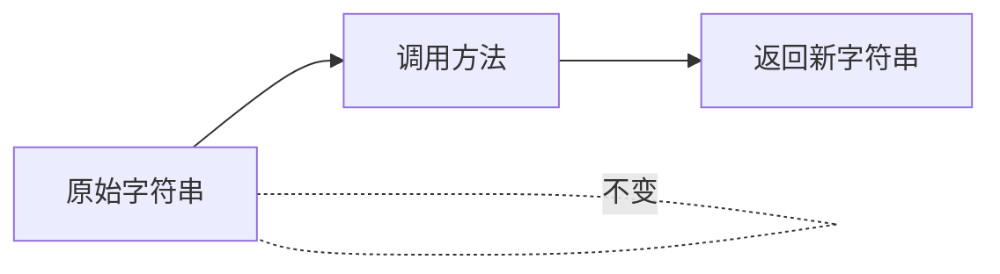

# 内置对象的使用（Math对象、Number对象、String属性与方法、Date对象）

---
requires: [JavaScript基础/变量与数据类型, JavaScript基础/运算符与表达式]
---

在 JavaScript 中，如果我们要计算平方根、格式化日期或截取字符串，难道每次都要自己从头写函数吗？当然不用。JavaScript 解释器（interpreter）预先提供了一批**内置对象（Built-in Objects）**，让我们直接调用即可。

## Math 对象

Math 是一个==静态对象==，不需要用构造函数（constructors）创建实例，直接通过 `Math.方法()` 调用。

| 常用方法/属性 | 功能说明 |
| :--- | :--- |
| `Math.max(a, b, ...)` | 返回参数中的最大值 |
| `Math.min(a, b, ...)` | 返回参数中的最小值 |
| `Math.random()` | 返回 $[0, 1)$ 之间的伪随机数 |
| `Math.floor(x)` | 向下取整 |
| `Math.PI` | 圆周率 $\pi$ |

> [!WARNING]
> `Math` 不是构造函数，绝对不能写 `new Math()`，否则会抛出类型错误（TypeError）。

下面这道经典考题展示了如何用 `Math.max` 结合对话框窗口（dialog window）求三个输入数的最大值：

```javascript
// 获取三个输入数字，注意 prompt 返回的是字符串，需要 type conversion
let num1 = parseFloat(prompt("请输入第一个数字"));
let num2 = parseFloat(prompt("请输入第二个数字"));
let num3 = parseFloat(prompt("请输入第三个数字"));

// 使用 Math.max 找出最大值
let maxNum = Math.max(num1, num2, num3);

// 输出结果（catenation 连接字符串与变量）
alert("最大的数字是：" + maxNum);
```

> [!TIP]
> `prompt()` 返回的永远是字符串（String），参与数学运算前必须做类型转换（type conversion），如用 `parseFloat()` 或 `Number()` 转为 primitives 数值。

## Number 对象

Number 既是基本类型（primitives），也是包装对象。当你对一个数值变量调用方法时，解释器（interpreter）会临时将其包装为 Number 对象。

- **`toFixed(n)`**：保留 $n$ 位小数并返回**字符串**。例如 `(3.1415).toFixed(2)` 结果为 `"3.14"`。
- **常量属性**：`Number.MAX_VALUE`、`Number.MIN_VALUE`、`Number.NaN`。

> [!CAUTION]
> 对整数直接调用方法时，不能只写一个点。`5.toFixed(2)` 会报语法错误，因为解释器会把 `.` 当成小数点。正确写法是加括号 `(5).toFixed(2)` 或写两个点 `5..toFixed(2)`。

## String 属性与方法

思考一下：如何在不改变原字符串的前提下提取子串？由于字符串是不可变的，所有 String 方法都会返回一个**新字符串**。



| 方法 | 作用 | 示例 (`let s = "NJUPT"`) |
| :--- | :--- | :--- |
| `length` | 属性，返回字符数 | `s.length` $\Rightarrow 5$ |
| `charAt(i)` | 返回索引 $i$ 处的字符 | `s.charAt(1)` $\Rightarrow$ `"J"` |
| `indexOf(sub)` | 返回子串首次出现的索引 | `s.indexOf("U")` $\Rightarrow 2$ |
| `slice(start, end)` | 截取 `[start, end)` 的子串 | `s.slice(0, 3)` $\Rightarrow$ `"NJU"` |
| `split(sep)` | 按分隔符拆分为数组（array） | `"a,b".split(",")` $\Rightarrow$ `["a","b"]` |

> [!NOTE]
> `slice()`、`substring()` 和 `substr()` 都能截取字符串，但参数含义不同。推荐统一使用 `slice(start, end)`，它支持负数索引（从末尾倒数），语义最清晰。

## Date 对象

Date 用于处理日期和时间，与前三者不同，它==必须通过 `new` 关键字实例化==。

```javascript
let now = new Date();          // 当前时间
let y2k = new Date(2000, 0, 1); // 注意：月份从 0 开始！即 0 代表 1 月
```

常用方法包括 `getFullYear()`、`getMonth()`、`getDate()`、`getDay()`（星期几，0为周日）以及 `getTime()`（返回自 1970-01-01 起的毫秒数）。

> [!IMPORTANT]
> `getMonth()` 的返回值范围是 $0 \sim 11$，这是考试与实战中最容易踩坑的地方。显示月份时务必手动 `+1`。

## 综合对比

这四个内置对象在使用方式上有本质区别：

| 对象 | 是否需要 `new` | 核心定位 |
| :--- | :--- | :--- |
| `Math` | 否（纯静态） | 数学计算工具库 |
| `Number` | 通常不需要 | 数值操作与格式化 |
| `String` | 通常不需要 | 文本处理与检索 |
| `Date` | ==必须== | 日期时间的创建与解析 |
